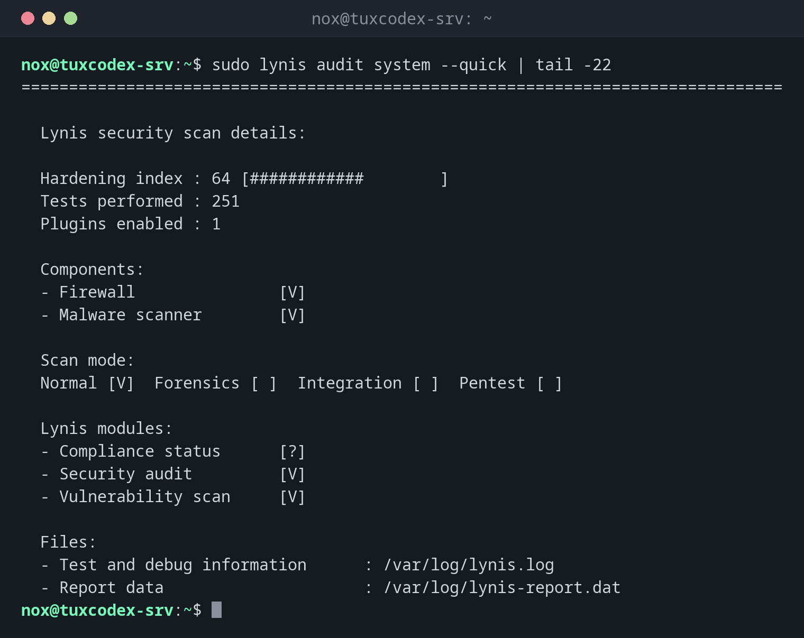

# lynis

> Prüft die Sicherheit eines Linux-Systems und liefert einen Härtungsindex plus konkrete Vorschläge.



## Syntax

```bash
lynis audit system [OPTIONEN]
lynis show details TEST-ID
```

## Optionen

| Option | Beschreibung |
|--------|--------------|
| `audit system` | Das ganze System prüfen (als root für vollständige Ergebnisse) |
| `--quick`, `-Q` | Zwischen den Abschnitten nicht auf einen Tastendruck warten |
| `--no-colors` | Einfache Ausgabe, für Logs |
| `--tests-from-group GRUPPE` | Nur einen Bereich, etwa `ssh`, `firewalls` oder `authentication` |
| `show details TEST-ID` | Details eines einzelnen Tests, etwa `SSH-7408` |
| `show groups` | Die Testgruppen auflisten |

Jeder Lauf schreibt `/var/log/lynis.log` (Details) und `/var/log/lynis-report.dat` (maschinenlesbare Ergebnisse).

## Beispiele

**Das System prüfen:**

```bash
sudo lynis audit system --quick | tail -22
```

```text
================================================================================

  Lynis security scan details:

  Hardening index : 64 [############        ]
  Tests performed : 251
  Plugins enabled : 1

  Components:
  - Firewall               [V]
  - Malware scanner        [V]

  Scan mode:
  Normal [V]  Forensics [ ]  Integration [ ]  Pentest [ ]

  Lynis modules:
  - Compliance status      [?]
  - Security audit         [V]
  - Vulnerability scan     [V]

  Files:
  - Test and debug information      : /var/log/lynis.log
  - Report data                     : /var/log/lynis-report.dat
```

**Die Warnungen und die ersten Vorschläge:**

```bash
sudo lynis audit system --quick | sed -n '/Warnings (/,/DEB-0831/p'
```

```text
  Warnings (1):
  ----------------------------
  ! No AIDE database was found, needed for AIDE functionality [FINT-4316]
      https://cisofy.com/lynis/controls/FINT-4316/

  Suggestions (38):
  ----------------------------
  * Install libpam-tmpdir to set $TMP and $TMPDIR for PAM sessions [DEB-0280]
    - Related resources
      * Website: https://cisofy.com/lynis/controls/DEB-0280/

  * Install apt-listbugs to display a list of critical bugs prior to each APT installation. [DEB-0810]
    - Related resources
      * Website: https://cisofy.com/lynis/controls/DEB-0810/

  * Install apt-listchanges to display any significant changes prior to any upgrade via APT. [DEB-0811]
    - Related resources
      * Website: https://cisofy.com/lynis/controls/DEB-0811/

  * Install needrestart, alternatively to debian-goodies, so that you can run needrestart after upgrades to determine which daemons are using old versions of libraries and need restarting. [DEB-0831]
```

**Alle Vorschläge in Kurzform:**

```bash
sudo grep '^suggestion' /var/log/lynis-report.dat | cut -d'|' -f1,2 | head -5
```

```text
suggestion[]=DEB-0280|Install libpam-tmpdir to set $TMP and $TMPDIR for PAM sessions
suggestion[]=DEB-0810|Install apt-listbugs to display a list of critical bugs prior to each APT installation.
suggestion[]=DEB-0811|Install apt-listchanges to display any significant changes prior to any upgrade via APT.
suggestion[]=DEB-0831|Install needrestart, alternatively to debian-goodies, so that you can run needrestart after upgrades to determine which daemons are using old versions of libraries and need restarting.
suggestion[]=BOOT-5264|Consider hardening system services
```

## Wann brauche ich das?

- Nach dem Einrichten eines Servers, als Checkliste für die Härtung
- Regelmäßig, um zu sehen, ob der Härtungsindex gleich bleibt oder sinkt
- Vor einem Audit, um Schwachstellen vorher zu finden und zu beheben

!!! tip "Den Härtungsindex verfolgen"
    Notiere dir den Index nach jedem Lauf. Sinkt er nach Änderungen, wurde etwas geöffnet
    oder gelockert. 100 ist nicht das Ziel; jeder Vorschlag muss zum Server passen.

!!! warning "Nicht blind umsetzen"
    Manche Vorschläge passen nicht auf jeden Server, etwa Compiler auf einer Build-Maschine
    zu entfernen. Lies die verlinkte Erklärung und entscheide jeden einzeln.

## Unterschiede zwischen Distributionen

| | Debian | Ubuntu | RHEL | Arch |
|---|--------|--------|------|------|
| Installation | `sudo apt install lynis` | `sudo apt install lynis` | `sudo dnf install lynis` (EPEL) | `sudo pacman -S lynis` |

## Verwandte Befehle

[aide](aide.md) · [rkhunter](rkhunter.md) · [systemd-analyze](../09-systemd/systemd-analyze.md) · [needrestart](../10-packages/needrestart.md)
