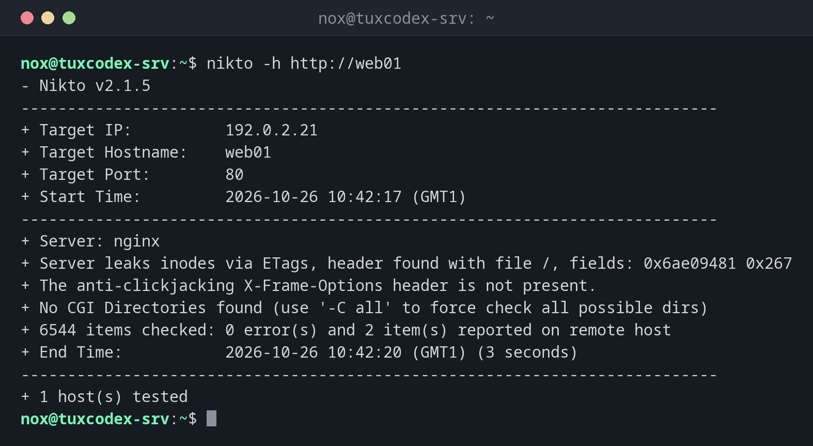

# nikto

> Checks a web server for known problems: missing security headers, dangerous files, outdated software.



## Syntax

```bash
nikto -h URL [OPTIONS]
```

## Options

| Option | Description |
|--------|-------------|
| `-h URL` | Target, such as `http://web01` or `https://status.example.com` |
| `-p PORT` | Port, if not in the URL |
| `-ssl` | Force HTTPS |
| `-Tuning X` | Only certain test groups, such as `1` (interesting files) or `x` to exclude |
| `-o FILE -Format htm` | Save the report, also as `csv`, `txt` or `xml` |
| `-useragent TEXT` | Another user agent |

## Examples

**Check a web server:**

```bash
nikto -h http://web01
```

```text
- Nikto v2.1.5
---------------------------------------------------------------------------
+ Target IP:          192.0.2.21
+ Target Hostname:    web01
+ Target Port:        80
+ Start Time:         2026-10-26 10:42:17 (GMT1)
---------------------------------------------------------------------------
+ Server: nginx
+ Server leaks inodes via ETags, header found with file /, fields: 0x6ae09481 0x267
+ The anti-clickjacking X-Frame-Options header is not present.
+ No CGI Directories found (use '-C all' to force check all possible dirs)
+ 6544 items checked: 0 error(s) and 2 item(s) reported on remote host
+ End Time:           2026-10-26 10:42:20 (GMT1) (3 seconds)
---------------------------------------------------------------------------
+ 1 host(s) tested
```

**Save the report as HTML:**

```bash
nikto -h https://status.example.com -o nikto-status.html -Format htm | tail -3
```

```text
+ 6544 items checked: 0 error(s) and 1 item(s) reported on remote host
+ End Time:           2026-10-26 10:44:51 (GMT1) (6 seconds)
---------------------------------------------------------------------------
```

**After adding the header in nginx:**

```bash
grep add_header /etc/nginx/conf.d/status.conf
nikto -h http://web01 | grep -c X-Frame-Options
```

```text
    add_header X-Frame-Options "SAMEORIGIN" always;
0
```

## When do I need it?

- After setting up a web server, to find forgotten defaults and missing headers
- Before going live with a new web application
- To check that backup files or admin pages aren't reachable from outside

!!! tip "Missing headers are easy to fix"
    Headers like `X-Frame-Options` and `Content-Security-Policy` are added in the nginx
    configuration with `add_header`. Run nikto again afterwards to confirm.

!!! warning "Loud and visible"
    nikto sends thousands of requests and doesn't try to hide. It fills the access log and
    triggers intrusion detection and fail2ban. Only run it against your own servers.

## Distribution differences

| | Debian | Ubuntu | RHEL | Arch |
|---|--------|--------|------|------|
| Install | `sudo apt install nikto` (repository part `non-free`) | `sudo apt install nikto` (multiverse) | from GitHub (`sullo/nikto`) | `sudo pacman -S nikto` |
| Version | old 2.1.5 | old 2.1.5 | current from Git | current |

## Related commands

[nmap](nmap.md) · [curl](../11-network/curl.md) · [fail2ban-client](../12-ssh/fail2ban-client.md)
