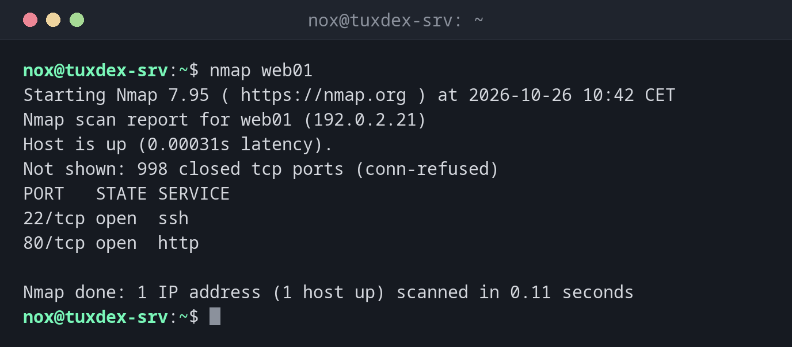

# nmap

> Durchsucht Hosts und Netze nach erreichbaren Rechnern, offenen Ports, Diensten und ihren Versionen.



## Syntax

```bash
nmap [SCAN-TYP] [OPTIONEN] ZIEL...
```

## Optionen

| Option | Beschreibung |
|--------|--------------|
| `ZIEL` | Hostname, IP-Adresse oder Netz, etwa `192.0.2.0/24` |
| `-sn` | Nur erreichbare Hosts finden, kein Portscan |
| `-p PORTS` | Nur diese Ports, etwa `22,80,443` oder `1-1024`; `-p-` heißt alle 65535 |
| `-sV` | Herausfinden, welcher Dienst in welcher Version auf jedem offenen Port läuft |
| `-O` | Das Betriebssystem erraten (braucht root) |
| `-sU` | UDP statt TCP scannen (langsam, braucht root) |
| `--script NAME` | NSE-Skripte ausführen, etwa `ssh2-enum-algos` oder `http-headers` |
| `-oN DATEI`, `-oX DATEI` | Das Ergebnis als Text oder XML speichern |
| `-T4` | Schnelleres Timing für gute Netze |

Ohne `sudo` nutzt nmap einen normalen TCP-Connect-Scan, als root den schnelleren SYN-Scan (`-sS`).

## Beispiele

**Die häufigsten Ports eines Servers scannen:**

```bash
nmap web01
```

```text
Starting Nmap 7.95 ( https://nmap.org ) at 2026-10-26 10:42 CET
Nmap scan report for web01 (192.0.2.21)
Host is up (0.00031s latency).
Not shown: 998 closed tcp ports (conn-refused)
PORT   STATE SERVICE
22/tcp open  ssh
80/tcp open  http

Nmap done: 1 IP address (1 host up) scanned in 0.11 seconds
```

Ohne `-p` prüft nmap die 1000 häufigsten Ports. `closed` heißt, der Host antwortet, aber dort lauscht nichts; `filtered` hieße, eine Firewall verwirft die Pakete.

**Dienste und Versionen:**

```bash
nmap -sV web01
```

```text
Starting Nmap 7.95 ( https://nmap.org ) at 2026-10-26 10:42 CET
Nmap scan report for web01 (192.0.2.21)
Host is up (0.00031s latency).
Not shown: 998 closed tcp ports (conn-refused)
PORT   STATE SERVICE VERSION
22/tcp open  ssh     OpenSSH 10.0p2 Debian 7+deb13u4 (protocol 2.0)
80/tcp open  http    nginx
Service Info: OS: Linux; CPE: cpe:/o:linux:linux_kernel

Service detection performed. Please report any incorrect results at https://nmap.org/submit/ .
Nmap done: 1 IP address (1 host up) scanned in 6.22 seconds
```

**Bestimmte Ports prüfen:**

```bash
nmap -p 22,80,443,3306 web01
```

```text
Starting Nmap 7.95 ( https://nmap.org ) at 2026-10-26 10:42 CET
Nmap scan report for web01 (192.0.2.21)
Host is up (0.00031s latency).

PORT     STATE  SERVICE
22/tcp   open   ssh
80/tcp   open   http
443/tcp  closed https
3306/tcp closed mysql

Nmap done: 1 IP address (1 host up) scanned in 0.08 seconds
```

**Die laufenden Rechner im Netz finden:**

```bash
sudo nmap -sn 192.0.2.0/24
```

```text
Starting Nmap 7.95 ( https://nmap.org ) at 2026-10-26 10:42 CET
Nmap scan report for gateway (192.0.2.1)
Host is up (0.00029s latency).
MAC Address: 52:54:00:12:35:02 (QEMU virtual NIC)
Nmap scan report for tuxdex-srv (192.0.2.10)
Host is up.
Nmap scan report for web01 (192.0.2.21)
Host is up (0.00031s latency).
MAC Address: 52:54:00:3a:1c:7e (QEMU virtual NIC)
Nmap scan report for web02 (192.0.2.22)
Host is up (0.00027s latency).
MAC Address: 52:54:00:9b:44:d1 (QEMU virtual NIC)
Nmap done: 256 IP addresses (4 hosts up) scanned in 2.31 seconds
```

**Die HTTP-Header mit einem Skript lesen:**

```bash
nmap --script http-headers,http-title -p 80 web01
```

```text
Starting Nmap 7.95 ( https://nmap.org ) at 2026-10-26 10:42 CET
Nmap scan report for web01 (192.0.2.21)
Host is up (0.00031s latency).

PORT   STATE SERVICE
80/tcp open  http
| http-headers:
|   Server: nginx
|   Date: Mon, 26 Oct 2026 09:42:17 GMT
|   Content-Type: text/html
|   Content-Length: 615
|   Connection: close
|   ETag: "6ae09481-267"
|   Accept-Ranges: bytes
|
|_  (Request type: HEAD)
|_http-title: Welcome to nginx!

Nmap done: 1 IP address (1 host up) scanned in 0.13 seconds
```

## Wann brauche ich das?

- Nach dem Einrichten eines Servers, um von außen zu prüfen, welche Ports wirklich offen sind
- Nach Firewall-Änderungen, um sicherzugehen, dass nur die gewollten Ports erreichbar sind
- Um alle Rechner im eigenen Netz zu finden und zu sehen, was auf ihnen läuft

!!! tip "Außen und innen vergleichen"
    Starte `nmap` von einem anderen Rechner und `ss -tlnp` auf dem Server. Ein Dienst, den
    `ss` auf `0.0.0.0` zeigt, `nmap` aber nicht findet, wird von der Firewall geblockt. Einer,
    den `nmap` findet, den du aber nicht erwartet hast, muss weg.

!!! danger "Nur eigene Systeme"
    Portscans fremder Systeme sind aus Sicht der Besitzer ein Angriff und können strafbar
    sein. Scanne nur eigene Server oder mit schriftlicher Erlaubnis, siehe die
    [Grundlagen](basics.md).

## Unterschiede zwischen Distributionen

| | Debian | Ubuntu | RHEL | Arch |
|---|--------|--------|------|------|
| Installation | `sudo apt install nmap` | `sudo apt install nmap` | `sudo dnf install nmap` | `sudo pacman -S nmap` |

## Verwandte Befehle

[nikto](nikto.md) · [lynis](lynis.md) · [ss](../11-network/ss.md) · [ufw](../11-network/ufw.md)
