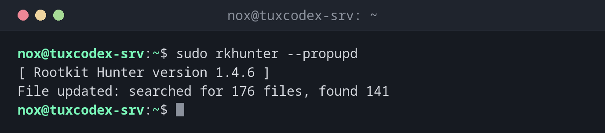

# rkhunter

> Durchsucht das System nach Anzeichen von Rootkits, Hintertüren und veränderten Systemprogrammen.



## Syntax

```bash
rkhunter --check [OPTIONEN]
rkhunter --propupd | --update
```

## Optionen

| Option | Beschreibung |
|--------|--------------|
| `--check`, `-c` | Alle Prüfungen ausführen |
| `--sk`, `--skip-keypress` | Zwischen den Abschnitten nicht auf einen Tastendruck warten |
| `--rwo`, `--report-warnings-only` | Nur Warnungen zeigen |
| `--cronjob` | Einstellungen für Cron: keine Farben, keine Tastendrücke |
| `--propupd` | Die aktuellen Eigenschaften der Systemprogramme als guten Zustand speichern |
| `--update` | Die Datendateien aktualisieren |

Das vollständige Log steht in `/var/log/rkhunter.log`. Unter Debian und Ubuntu richtet das Paket außerdem eine tägliche Prüfung in `/etc/cron.daily/rkhunter` ein.

## Beispiele

**Den sauberen Zustand nach der Installation speichern:**

```bash
sudo rkhunter --propupd
```

```text
[ Rootkit Hunter version 1.4.6 ]
File updated: searched for 176 files, found 141
```

**Das System prüfen:**

```bash
sudo rkhunter --check --sk | tail -20
```

```text
System checks summary
=====================

File properties checks...
    Files checked: 141
    Suspect files: 0

Rootkit checks...
    Rootkits checked : 461
    Possible rootkits: 0

Applications checks...
    All checks skipped

The system checks took: 1 minute and 4 seconds

All results have been written to the log file: /var/log/rkhunter.log

No warnings were found while checking the system.
```

**Nur Warnungen, nach einem Paket-Update:**

```bash
sudo rkhunter --check --sk --rwo
```

```text
Warning: The file properties have changed:
         File: /usr/bin/curl
         Current hash: 6f1c0a4e9b2d7385c1e8f0a2b4d6c8e0f1a3b5c7d9e1f3a5b7c9d1e3f5a7b9c1
         Stored hash : 2d4f6a8c0e2a4c6e8a0c2e4a6c8e0a2c4e6a8c0e2a4c6e8a0c2e4a6c8e0a2c4e
         Current inode: 393742    Stored inode: 393618
         Current file modification time: 1792915200 (24-Oct-2026 09:20:00)
         Stored file modification time : 1786694400 (13-Aug-2026 10:00:00)
```

`curl` wurde durch `apt upgrade` aktualisiert. Prüf, ob das Update wirklich von dir war (`grep curl /var/log/apt/history.log`), und führe dann `rkhunter --propupd` aus.

## Wann brauche ich das?

- Direkt nach der Installation eines Servers, um mit `--propupd` einen sauberen Zustand zu speichern
- Jede Nacht als Cronjob, mit einer Mail bei Warnungen
- Wenn du vermutest, dass ein Server kompromittiert wurde

!!! tip "Nach jedem Update: --propupd"
    Paket-Updates ändern Systemprogramme, und rkhunter meldet sie als verändert. Führe nach
    jedem Update `rkhunter --propupd` aus. Unter Debian erledigt `APT_AUTOGEN=true` in
    `/etc/default/rkhunter` das automatisch.

!!! warning "Fehlalarme sind normal"
    Typische harmlose Warnungen sind geänderte Dateien nach einem Update oder Skripte statt
    Binärdateien. Trage bekannte Fälle in `/etc/rkhunter.conf.local` als Ausnahme ein, statt
    die ganze Ausgabe zu ignorieren.

## Unterschiede zwischen Distributionen

| | Debian | Ubuntu | RHEL | Arch |
|---|--------|--------|------|------|
| Installation | `sudo apt install rkhunter` | `sudo apt install rkhunter` | `sudo dnf install rkhunter` (EPEL) | `sudo pacman -S rkhunter` |

## Verwandte Befehle

[chkrootkit](chkrootkit.md) · [aide](aide.md) · [debsums](debsums.md) · [crontab](../16-scheduling/crontab.md)
