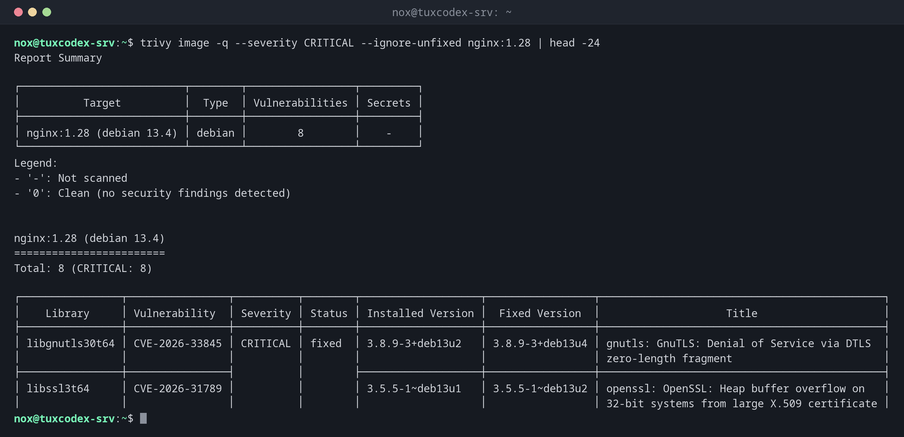

# trivy

> Durchsucht Container-Images, Verzeichnisse und Konfigurationsdateien nach bekannten Schwachstellen, Geheimnissen und Fehlkonfigurationen.



## Syntax

```bash
trivy image | fs | config | repo [OPTIONEN] ZIEL
```

## Optionen

| Option | Beschreibung |
|--------|--------------|
| `image NAME` | Ein Container-Image prüfen, lokal oder aus einer Registry |
| `fs VERZEICHNIS` | Ein Projektverzeichnis prüfen (Abhängigkeiten, Geheimnisse) |
| `config VERZEICHNIS` | Dockerfiles, Kubernetes-Manifeste und Terraform auf Fehlkonfigurationen prüfen |
| `--severity HIGH,CRITICAL` | Nur diese Schweregrade |
| `--ignore-unfixed` | Schwachstellen ohne verfügbare Korrektur ausblenden |
| `--exit-code 1` | Bei Funden 1 zurückgeben, für CI-Pipelines |
| `-q`, `--quiet` | Keine Fortschrittsmeldungen |
| `-f json` | Ausgabe als JSON (auch `sarif`, `cyclonedx`) |

Der erste Lauf lädt die Schwachstellen-Datenbank nach `~/.cache/trivy`; spätere Läufe aktualisieren sie automatisch.

## Beispiele

**Kritische Schwachstellen mit Korrektur in einem Image:**

```bash
trivy image -q --severity CRITICAL --ignore-unfixed nginx:1.28 | head -24
```

```text
Report Summary

┌──────────────────────────┬────────┬─────────────────┬─────────┐
│          Target          │  Type  │ Vulnerabilities │ Secrets │
├──────────────────────────┼────────┼─────────────────┼─────────┤
│ nginx:1.28 (debian 13.4) │ debian │        8        │    -    │
└──────────────────────────┴────────┴─────────────────┴─────────┘
Legend:
- '-': Not scanned
- '0': Clean (no security findings detected)


nginx:1.28 (debian 13.4)
========================
Total: 8 (CRITICAL: 8)

┌────────────────┬────────────────┬──────────┬────────┬───────────────────┬─────────────────┬─────────────────────────────────────────────┐
│    Library     │ Vulnerability  │ Severity │ Status │ Installed Version │  Fixed Version  │                    Title                    │
├────────────────┼────────────────┼──────────┼────────┼───────────────────┼─────────────────┼─────────────────────────────────────────────┤
│ libgnutls30t64 │ CVE-2026-33845 │ CRITICAL │ fixed  │ 3.8.9-3+deb13u2   │ 3.8.9-3+deb13u4 │ gnutls: GnuTLS: Denial of Service via DTLS  │
│                │                │          │        │                   │                 │ zero-length fragment                        │
├────────────────┼────────────────┤          │        ├───────────────────┼─────────────────┼─────────────────────────────────────────────┤
│ libssl3t64     │ CVE-2026-31789 │          │        │ 3.5.5-1~deb13u1   │ 3.5.5-1~deb13u2 │ openssl: OpenSSL: Heap buffer overflow on   │
│                │                │          │        │                   │                 │ 32-bit systems from large X.509 certificate │
```

`Fixed Version` zeigt, dass Debian für diese Pakete schon Updates hat: ein neueres Image oder ein Neubau behebt sie.

**Ein Dockerfile prüfen:**

```bash
trivy config -q .
```

```text
Dockerfile (dockerfile)
=======================
Tests: 27 (SUCCESSES: 25, FAILURES: 2)
Failures: 2 (UNKNOWN: 0, LOW: 1, MEDIUM: 0, HIGH: 1, CRITICAL: 0)

DS-0002 (HIGH): Specify at least 1 USER command in Dockerfile with non-root user as argument
════════════════════════════════════════
Running containers with 'root' user can lead to a container escape situation. It is a best practice to run containers as non-root users, which can be done by adding a 'USER' statement to the Dockerfile.

See https://avd.aquasec.com/misconfig/ds-0002
────────────────────────────────────────


DS-0026 (LOW): Add HEALTHCHECK instruction in your Dockerfile
════════════════════════════════════════
You should add HEALTHCHECK instruction in your docker container images to perform the health check on running containers.

See https://avd.aquasec.com/misconfig/ds-0026
────────────────────────────────────────
```

**Eine Pipeline bei kritischen Funden stoppen:**

```bash
trivy image -q --exit-code 1 --severity CRITICAL nginx:1.28 >/dev/null
echo "exit code: $?"
```

```text
exit code: 1
```

## Wann brauche ich das?

- Vor dem Ausrollen eines Images, um zu wissen, welche bekannten Schwachstellen es enthält
- In der CI-Pipeline, damit Images mit kritischen Schwachstellen gestoppt werden
- Um Dockerfiles und Kubernetes-Manifeste auf typische Fehler wie den Betrieb als root zu prüfen

!!! tip "Als Schritt in der Pipeline"
    `trivy image --exit-code 1 --severity CRITICAL --ignore-unfixed IMAGE` nach dem Build
    stoppt die Pipeline, wenn es eine kritische Schwachstelle gibt, die ein Update beheben
    würde. Siehe das Kapitel [CI/CD](../22-ci-cd/index.md).

!!! warning "Viele Funde sind normal"
    Auch frische offizielle Images zeigen Dutzende Funde, viele ohne Korrektur. Konzentrier
    dich auf `CRITICAL` und `HIGH` mit einer korrigierten Version und baue Images regelmäßig
    neu, damit sie die Korrekturen bekommen.

## Unterschiede zwischen Distributionen

| | Debian | Ubuntu | RHEL | Arch |
|---|--------|--------|------|------|
| Installation | Repository von Aqua Security, dann `sudo apt install trivy` | Repository von Aqua Security, dann `sudo apt install trivy` | Repository von Aqua Security, dann `sudo dnf install trivy` | `sudo pacman -S trivy` |

## Verwandte Befehle

[docker build](../19-docker/docker-build.md) · [docker images](../19-docker/docker-images.md) · [gh run](../22-ci-cd/gh-run.md)
