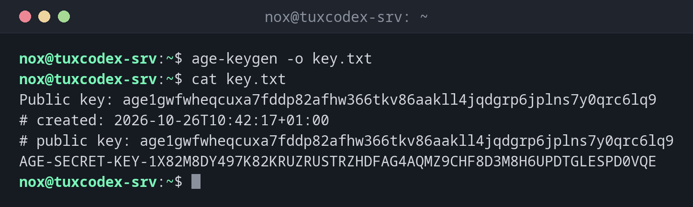

# age

> A simple, modern tool for encrypting files, with short keys and no configuration.



## Syntax

```bash
age -r RECIPIENT [-o OUTPUT] FILE
age -d -i KEYFILE [-o OUTPUT] FILE
age-keygen [-o KEYFILE]
```

## Options

| Option | Description |
|--------|-------------|
| `age-keygen -o FILE` | Create a key pair; the file contains the secret key, the public key is printed |
| `-r RECIPIENT` | Encrypt for this public key (`age1…`); several `-r` are possible |
| `-R FILE` | Recipients from a file, also SSH public keys (`~/.ssh/id_ed25519.pub`) |
| `-p`, `--passphrase` | Encrypt with a passphrase instead of keys |
| `-d -i KEYFILE` | Decrypt with a secret key, also an SSH private key |
| `-o FILE` | Output file |
| `-a`, `--armor` | Text output instead of binary, for mails and YAML |

## Examples

**Create a key pair:**

```bash
age-keygen -o key.txt
cat key.txt
```

```text
Public key: age1gwfwheqcuxa7fddp82afhw366tkv86aakll4jqdgrp6jplns7y0qrc6lq9
# created: 2026-10-26T10:42:17+01:00
# public key: age1gwfwheqcuxa7fddp82afhw366tkv86aakll4jqdgrp6jplns7y0qrc6lq9
AGE-SECRET-KEY-1X82M8DY497K82KRUZRUSTRZHDFAG4AQMZ9CHF8D3M8H6UPDTGLESPD0VQE
```

**Encrypt a backup for the public key:**

```bash
age -r age1gwfwheqcuxa7fddp82afhw366tkv86aakll4jqdgrp6jplns7y0qrc6lq9 \
  -o backup-2026-10-26.tar.gz.age backup-2026-10-26.tar.gz
ls -l backup-2026-10-26.tar.gz.age
```

```text
-rw-r--r-- 1 nox nox 7892 Oct 26 10:42 backup-2026-10-26.tar.gz.age
```

Only the public key is needed for this, so the secret `key.txt` doesn't have to be on the server.

**Decrypt with the key file:**

```bash
age -d -i key.txt -o backup.tar.gz backup-2026-10-26.tar.gz.age
ls -l backup.tar.gz
```

```text
-rw-r--r-- 1 nox nox 7692 Oct 26 10:43 backup.tar.gz
```

**Encrypt with a passphrase:**

```bash
age -p -o secrets.txt.age secrets.txt
```

```text
Enter passphrase (leave empty to autogenerate a secure one):
Confirm passphrase:
```

## When do I need it?

- For backups that are encrypted on the server and only decrypted elsewhere
- For secrets in scripts and repositories, for example together with `sops`
- When gpg is too complicated and you only want to encrypt files

!!! tip "Use existing SSH keys"
    age can encrypt directly for SSH public keys: `age -R ~/.ssh/authorized_keys` encrypts
    for everyone who may log in, and they decrypt with `age -d -i ~/.ssh/id_ed25519`.

!!! danger "The key file is the only way back"
    There is no password recovery. Store `key.txt` outside the server, for example in your
    password manager, before you encrypt the first backup with it.

## Distribution differences

| | Debian | Ubuntu | RHEL | Arch |
|---|--------|--------|------|------|
| Install | `sudo apt install age` | `sudo apt install age` | `sudo dnf install age` (EPEL) | `sudo pacman -S age` |

## Related commands

[gpg](gpg.md) · [ssh-keygen](../12-ssh/ssh-keygen.md) · [tar](../14-archives/tar.md) · [ansible-vault](../21-ansible/ansible-vault.md)
