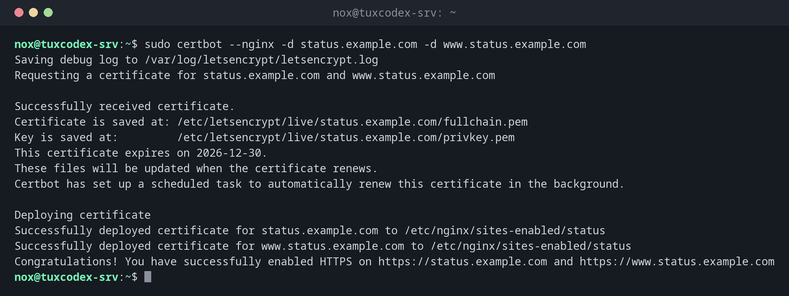

# certbot

> Holt kostenlose TLS-Zertifikate von Let's Encrypt, richtet sie in nginx oder Apache ein und erneuert sie automatisch.



## Syntax

```bash
certbot [--nginx | --apache | certonly] -d DOMAIN [-d DOMAIN...]
certbot certificates | renew [--dry-run] | delete
```

## Optionen

| Option | Beschreibung |
|--------|--------------|
| `--nginx`, `--apache` | Das Zertifikat holen und den Webserver einrichten |
| `certonly` | Nur das Zertifikat holen, keine Konfiguration ändern |
| `--webroot -w VERZEICHNIS` | Den Besitz über eine Datei im Web-Root nachweisen (mit `certonly`) |
| `--standalone` | Einen eigenen Webserver für die Prüfung starten (Port 80 muss frei sein) |
| `-d DOMAIN` | Domain; mehrere `-d` für mehrere Namen in einem Zertifikat |
| `certificates` | Die Zertifikate mit Ablaufdatum auflisten |
| `renew --dry-run` | Die Erneuerung gegen den Test-Server prüfen |
| `--deploy-hook BEFEHL` | Nach jeder erfolgreichen Erneuerung einen Befehl ausführen, etwa einen Dienst neu laden |

Let's-Encrypt-Zertifikate gelten 90 Tage. certbot erneuert sie, wenn weniger als 30 Tage übrig sind.

## Beispiele

**Ein Zertifikat holen und nginx einrichten:**

```bash
sudo certbot --nginx -d status.example.com -d www.status.example.com
```

```text
Saving debug log to /var/log/letsencrypt/letsencrypt.log
Requesting a certificate for status.example.com and www.status.example.com

Successfully received certificate.
Certificate is saved at: /etc/letsencrypt/live/status.example.com/fullchain.pem
Key is saved at:         /etc/letsencrypt/live/status.example.com/privkey.pem
This certificate expires on 2026-12-30.
These files will be updated when the certificate renews.
Certbot has set up a scheduled task to automatically renew this certificate in the background.

Deploying certificate
Successfully deployed certificate for status.example.com to /etc/nginx/sites-enabled/status
Successfully deployed certificate for www.status.example.com to /etc/nginx/sites-enabled/status
Congratulations! You have successfully enabled HTTPS on https://status.example.com and https://www.status.example.com
```

**Alle Zertifikate mit Ablaufdatum:**

```bash
sudo certbot certificates
```

```text
Saving debug log to /var/log/letsencrypt/letsencrypt.log

- - - - - - - - - - - - - - - - - - - - - - - - - - - - - - - - - - - - - - - -
Found the following certs:
  Certificate Name: status.example.com
    Serial Number: 48cc344e3cb032bd7874834e00cf32557b57135a
    Key Type: ECDSA
    Domains: status.example.com www.status.example.com
    Expiry Date: 2026-12-30 08:15:11+00:00 (VALID: 64 days)
    Certificate Path: /etc/letsencrypt/live/status.example.com/fullchain.pem
    Private Key Path: /etc/letsencrypt/live/status.example.com/privkey.pem
- - - - - - - - - - - - - - - - - - - - - - - - - - - - - - - - - - - - - - - -
```

**Die automatische Erneuerung testen:**

```bash
sudo certbot renew --dry-run
```

```text
Saving debug log to /var/log/letsencrypt/letsencrypt.log

- - - - - - - - - - - - - - - - - - - - - - - - - - - - - - - - - - - - - - - -
Processing /etc/letsencrypt/renewal/status.example.com.conf
- - - - - - - - - - - - - - - - - - - - - - - - - - - - - - - - - - - - - - - -
Simulating renewal of an existing certificate for status.example.com and www.status.example.com

- - - - - - - - - - - - - - - - - - - - - - - - - - - - - - - - - - - - - - - -
Congratulations, all simulated renewals succeeded:
  /etc/letsencrypt/live/status.example.com/fullchain.pem (success)
- - - - - - - - - - - - - - - - - - - - - - - - - - - - - - - - - - - - - - - -
```

**Der Timer für die Erneuerung:**

```bash
systemctl list-timers certbot.timer
```

```text
NEXT                        LEFT LAST                              PASSED UNIT          ACTIVATES
Mon 2026-10-26 21:37:00 CET  10h Mon 2026-10-26 09:12:04 CET 1h 30min ago certbot.timer certbot.service

1 timers listed.
Pass --all to see loaded but inactive timers, too.
```

## Wann brauche ich das?

- Für jede öffentliche Website und API, die per HTTPS erreichbar sein soll
- Für Mailserver und andere Dienste, mit `certonly` und einem Deploy-Hook
- Um zu prüfen, wann Zertifikate ablaufen und ob die Erneuerung funktioniert

!!! tip "Die Erneuerung testen"
    `sudo certbot renew --dry-run` nach der Einrichtung zeigt, ob die automatische
    Erneuerung klappen wird. Eine fehlschlagende Erneuerung fällt sonst erst auf, wenn das
    Zertifikat abläuft.

!!! warning "Port 80 muss offen bleiben"
    Die übliche HTTP-Prüfung braucht Port 80 aus dem Internet. Blockiert die Firewall ihn,
    scheitern Erneuerungen still. Alternativ nutzt du die DNS-Prüfung mit einem DNS-Plugin.

## Unterschiede zwischen Distributionen

| | Debian | Ubuntu | RHEL | Arch |
|---|--------|--------|------|------|
| Installation | `sudo apt install certbot python3-certbot-nginx` | `sudo apt install certbot python3-certbot-nginx` | `sudo dnf install certbot python3-certbot-nginx` (EPEL) | `sudo pacman -S certbot certbot-nginx` |
| Automatische Erneuerung | `certbot.timer`, aktiv | `certbot.timer`, aktiv | `certbot-renew.timer`, mit `systemctl enable --now` einschalten | kein Timer, selbst anlegen oder Cronjob nutzen |

## Verwandte Befehle

[openssl x509](openssl-x509.md) · [testssl.sh](testssl.md) · [systemctl](../09-systemd/systemctl.md) · [ufw](../11-network/ufw.md)
