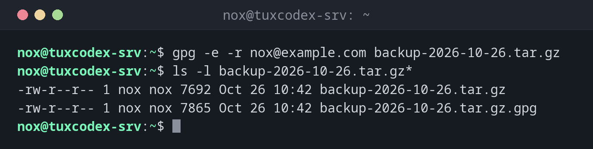

# gpg

> GnuPG verschlüsselt und signiert Dateien und Nachrichten mit Schlüsselpaaren und prüft Signaturen, etwa von Downloads und Paketen.



## Syntax

```bash
gpg [OPTIONEN] BEFEHL [DATEI]
```

## Optionen

| Option | Beschreibung |
|--------|--------------|
| `--quick-generate-key "NAME <MAIL>"` | Ein neues Schlüsselpaar erstellen |
| `-e -r EMPFÄNGER DATEI` | Für einen Empfänger verschlüsseln (mit seinem öffentlichen Schlüssel) |
| `-d DATEI` | Entschlüsseln; `-o DATEI` schreibt das Ergebnis in eine Datei |
| `-c DATEI` | Nur mit einem Passwort verschlüsseln, ohne Schlüssel |
| `--clearsign DATEI`, `--detach-sign DATEI` | Eine Datei signieren, lesbar oder als eigene `.sig` |
| `--verify DATEI` | Eine Signatur prüfen |
| `--list-keys`, `--list-secret-keys` | Die Schlüssel im Schlüsselbund zeigen |
| `--export -a NAME`, `--import DATEI` | Einen öffentlichen Schlüssel exportieren oder importieren |
| `--fingerprint NAME` | Den Fingerabdruck zeigen, um einen Schlüssel über einen zweiten Weg zu vergleichen |

## Beispiele

**Ein Backup für dich selbst verschlüsseln:**

```bash
gpg -e -r nox@example.com backup-2026-10-26.tar.gz
ls -l backup-2026-10-26.tar.gz*
```

```text
-rw-r--r-- 1 nox nox 7692 Oct 26 10:42 backup-2026-10-26.tar.gz
-rw-r--r-- 1 nox nox 7865 Oct 26 10:42 backup-2026-10-26.tar.gz.gpg
```

**Ein Schlüsselpaar erstellen:**

```bash
gpg --quick-generate-key "Nox <nox@example.com>" ed25519 sign,cert 2y
gpg --quick-add-key 4C96F1E5945D053F80BE1E5A0F1C19588BB972E3 cv25519 encr 2y
gpg --list-keys
```

```text
gpg: revocation certificate stored as '/home/nox/.gnupg/openpgp-revocs.d/4C96F1E5945D053F80BE1E5A0F1C19588BB972E3.rev'
/home/nox/.gnupg/pubring.kbx
----------------------------
pub   ed25519 2026-10-26 [SC] [expires: 2028-10-25]
      4C96F1E5945D053F80BE1E5A0F1C19588BB972E3
uid           [ultimate] Nox <nox@example.com>
sub   cv25519 2026-10-26 [E] [expires: 2028-10-25]
```

`[SC]` ist der Hauptschlüssel zum Signieren und Beglaubigen, `[E]` der Unterschlüssel zum Verschlüsseln. gpg fragt nach einer Passphrase für den Schlüssel.

**Entschlüsseln:**

```bash
gpg -d -o restored.tar.gz backup-2026-10-26.tar.gz.gpg
```

```text
gpg: encrypted with cv25519 key, ID 55665602289A0C80, created 2026-10-26
      "Nox <nox@example.com>"
```

**Eine Signatur prüfen:**

```bash
gpg --verify release-notes.txt.asc
```

```text
gpg: Signature made Mon Oct 26 10:42:17 2026 CET
gpg:                using EDDSA key 4C96F1E5945D053F80BE1E5A0F1C19588BB972E3
gpg: Good signature from "Nox <nox@example.com>" [ultimate]
```

**Nur mit einem Passwort verschlüsseln:**

```bash
gpg -c -o db-dump.sql.gpg db-dump.sql
```

```text
Enter passphrase: ********
Repeat passphrase: ********
```

## Wann brauche ich das?

- Um Backups zu verschlüsseln, bevor sie auf einen anderen Server oder in die Cloud gehen
- Um Downloads zu prüfen, etwa ein ISO-Image mit seiner `.asc`-Signatur
- Um Dateien zu signieren, damit andere sicher sein können, dass sie von dir stammen

!!! tip "Backups nur mit dem öffentlichen Schlüssel"
    Ein Backup-Server braucht zum Verschlüsseln nur deinen öffentlichen Schlüssel. Der
    private bleibt woanders, sodass ein kompromittierter Backup-Server die Backups nicht
    lesen kann.

!!! danger "Privaten Schlüssel und Widerrufszertifikat sichern"
    Ohne den privaten Schlüssel sind verschlüsselte Backups verloren. Exportiere ihn mit
    `gpg --export-secret-keys -a` an einen sicheren Ort und bewahre auch das
    Widerrufszertifikat aus `~/.gnupg/openpgp-revocs.d/` auf.

## Verwandte Befehle

[age](age.md) · [ssh-keygen](../12-ssh/ssh-keygen.md) · [tar](../14-archives/tar.md) · [sha256sum](../14-archives/sha256sum.md)
