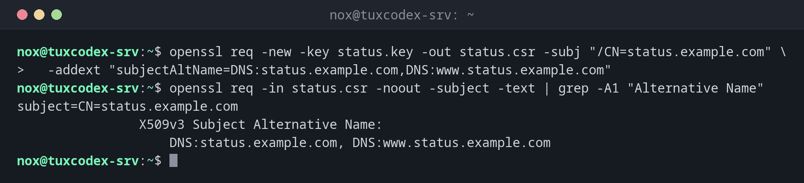

# openssl req

> Creates certificate signing requests (CSR) for a CA, or self-signed certificates for internal use.



## Syntax

```bash
openssl req -new -key KEY -out CSR [OPTIONS]
openssl req -x509 -newkey ALG -keyout KEY -out CERT [OPTIONS]
```

## Options

| Option | Description |
|--------|-------------|
| `-new -key FILE` | Create a CSR for an existing key |
| `-x509` | Create a self-signed certificate instead of a CSR |
| `-newkey ec -pkeyopt ec_paramgen_curve:P-256` | Create a new key at the same time |
| `-nodes` | Don't protect the new key with a password (needed for services) |
| `-subj "/CN=NAME"` | Subject without questions |
| `-addext "subjectAltName=DNS:..."` | Host names; clients only check the SAN, not the CN |
| `-days N` | Validity of a self-signed certificate |
| `-in CSR -noout -text` | Show a CSR |

## Examples

**A CSR for an existing key:**

```bash
openssl req -new -key status.key -out status.csr -subj "/CN=status.example.com" \
  -addext "subjectAltName=DNS:status.example.com,DNS:www.status.example.com"
openssl req -in status.csr -noout -subject -text | grep -A1 "Alternative Name"
```

```text
subject=CN=status.example.com
                X509v3 Subject Alternative Name:
                    DNS:status.example.com, DNS:www.status.example.com
```

**A self-signed certificate for an internal service:**

```bash
openssl req -x509 -newkey ec -pkeyopt ec_paramgen_curve:P-256 -nodes \
  -keyout monitor.key -out monitor.crt -days 365 \
  -subj "/CN=monitor.internal.example.com" \
  -addext "subjectAltName=DNS:monitor.internal.example.com"
openssl x509 -in monitor.crt -noout -subject -issuer -dates
```

```text
-----
subject=CN=monitor.internal.example.com
issuer=CN=monitor.internal.example.com
notBefore=Oct 26 09:42:17 2026 GMT
notAfter=Oct 26 09:42:17 2027 GMT
```

Subject and issuer are the same: that's what makes a certificate self-signed.

**The content of a CSR:**

```bash
openssl req -in status.csr -noout -text | head -8
```

```text
Certificate Request:
    Data:
        Version: 1 (0x0)
        Subject: CN=status.example.com
        Subject Public Key Info:
            Public Key Algorithm: id-ecPublicKey
                Public-Key: (256 bit)
                pub:
```

## When do I need it?

- To request a certificate from a commercial CA or an internal company CA
- For internal services that only your own machines use, with a self-signed certificate
- To check what a CSR contains before sending it

!!! tip "Always set subjectAltName"
    Browsers and current tools ignore the CN and only check `subjectAltName`. A certificate
    without it is rejected, even if the CN is correct.

!!! warning "Self-signed means: nobody trusts it"
    Clients reject a self-signed certificate until it, or your own CA, is installed as
    trusted, see the [basics](basics.md). For anything public, use Let's Encrypt.

## Related commands

[openssl genpkey](openssl-genpkey.md) · [openssl x509](openssl-x509.md) · [certbot](certbot.md)
