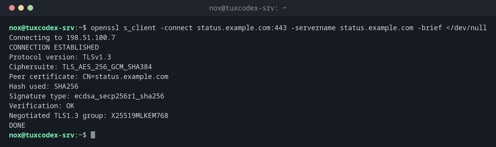

# openssl s_client

> Verbindet sich wie ein Client mit einem TLS-Server und zeigt Zertifikatskette, Protokoll und Verschlüsselung, die er bekommt.



## Syntax

```bash
openssl s_client -connect HOST:PORT [-servername NAME] [OPTIONEN]
```

## Optionen

| Option | Beschreibung |
|--------|--------------|
| `-connect HOST:PORT` | Server und Port, etwa `status.example.com:443` |
| `-servername NAME` | Name für SNI; nötig, wenn sich mehrere Seiten eine IP-Adresse teilen |
| `-brief` | Kurze Zusammenfassung: Protokoll, Verschlüsselung, Zertifikat, Prüfung |
| `-showcerts` | Alle Zertifikate der Kette ausgeben, nicht nur das erste |
| `-tls1_2`, `-tls1_3` | Nur diese Protokollversion erlauben |
| `-starttls smtp` | Erst eine unverschlüsselte Verbindung umstellen, auch `imap`, `ftp`, `postgres` |
| `</dev/null` | Die Verbindung direkt nach dem Handshake beenden |

## Beispiele

**Eine kurze Zusammenfassung der Verbindung:**

```bash
openssl s_client -connect status.example.com:443 -servername status.example.com -brief </dev/null
```

```text
Connecting to 198.51.100.7
CONNECTION ESTABLISHED
Protocol version: TLSv1.3
Ciphersuite: TLS_AES_256_GCM_SHA384
Peer certificate: CN=status.example.com
Hash used: SHA256
Signature type: ecdsa_secp256r1_sha256
Verification: OK
Negotiated TLS1.3 group: X25519MLKEM768
DONE
```

**Die Zertifikatskette, die der Server schickt:**

```bash
openssl s_client -connect status.example.com:443 -servername status.example.com </dev/null 2>/dev/null | head -11
```

```text
CONNECTED(00000003)
---
Certificate chain
 0 s:CN=status.example.com
   i:C=US, O=Let's Encrypt, CN=R13
   a:PKEY: EC, (prime256v1); sigalg: sha256WithRSAEncryption
   v:NotBefore: Oct  1 08:15:12 2026 GMT; NotAfter: Dec 30 08:15:11 2026 GMT
 1 s:C=US, O=Let's Encrypt, CN=R13
   i:C=US, O=Internet Security Research Group, CN=ISRG Root X1
   a:PKEY: RSA, 2048 (bit); sigalg: sha256WithRSAEncryption
   v:NotBefore: Mar 13 00:00:00 2024 GMT; NotAfter: Mar 12 23:59:59 2027 GMT
```

`s:` ist der Inhaber, `i:` der Aussteller. Zertifikat 0 stammt von R13, und R13 wird als Zertifikat 1 mitgeschickt: Die Kette ist vollständig.

**Nur die Daten des ausgelieferten Zertifikats:**

```bash
echo | openssl s_client -connect status.example.com:443 -servername status.example.com 2>/dev/null \
  | openssl x509 -noout -dates -subject -issuer
```

```text
notBefore=Oct  1 08:15:12 2026 GMT
notAfter=Dec 30 08:15:11 2026 GMT
subject=CN=status.example.com
issuer=C=US, O=Let's Encrypt, CN=R13
```

**Ein altes Protokoll wird abgelehnt:**

```bash
openssl s_client -connect status.example.com:443 -servername status.example.com -tls1_1 </dev/null
```

```text
Connecting to 198.51.100.7
80C7D1F3A57F0000:error:0A0000BF:SSL routines:tls_setup_handshake:no protocols available:../ssl/statem/statem_lib.c:155:
CONNECTED(00000003)
---
no peer certificate available
```

Hier verweigert schon der Client: OpenSSL 3 bietet TLS 1.1 standardmäßig nicht mehr an. Was der Server akzeptiert, prüfst du mit [`testssl.sh`](testssl.md).

## Wann brauche ich das?

- Um zu prüfen, welches Zertifikat ein Server wirklich ausliefert und ob die Kette vollständig ist
- Um herauszufinden, warum ein Client `unable to verify` meldet, während der Browser funktioniert
- Um TLS bei Mailservern und Datenbanken mit `-starttls` zu testen

!!! tip "Immer -servername angeben"
    Ohne `-servername` liefert ein Server mit mehreren Seiten womöglich sein
    Standardzertifikat, und du prüfst das falsche.

!!! warning "Verify return code"
    `Verify return code: 0 (ok)` heißt, die Kette ließ sich mit den CAs dieses Rechners
    prüfen. Jeder andere Code, etwa `21 (unable to verify the first certificate)`, bedeutet
    meist, dass auf dem Server das Zwischenzertifikat fehlt.

## Verwandte Befehle

[openssl x509](openssl-x509.md) · [testssl.sh](testssl.md) · [curl](../11-network/curl.md) · [nmap](../23-security-scanning/nmap.md)
