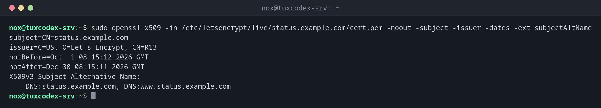

# openssl x509

> Shows and converts certificates: name, issuer, validity, alternative names and fingerprints.



## Syntax

```bash
openssl x509 -in FILE [-noout] [OPTIONS]
```

## Options

| Option | Description |
|--------|-------------|
| `-in FILE` | Certificate file; without it, it reads from standard input |
| `-noout` | Don't print the certificate itself, only the requested fields |
| `-text` | Everything in readable form |
| `-subject`, `-issuer`, `-dates` | Owner, issuer, validity |
| `-ext subjectAltName` | The host names the certificate is valid for |
| `-checkend SECONDS` | Exit code 1 if the certificate expires within this time |
| `-fingerprint -sha256` | Fingerprint, for comparing certificates |
| `-inform der -outform pem` | Convert between DER and PEM |

## Examples

**Names, issuer and validity:**

```bash
sudo openssl x509 -in /etc/letsencrypt/live/status.example.com/cert.pem -noout -subject -issuer -dates -ext subjectAltName
```

```text
subject=CN=status.example.com
issuer=C=US, O=Let's Encrypt, CN=R13
notBefore=Oct  1 08:15:12 2026 GMT
notAfter=Dec 30 08:15:11 2026 GMT
X509v3 Subject Alternative Name:
    DNS:status.example.com, DNS:www.status.example.com
```

**Check whether it expires within 30 days:**

```bash
sudo openssl x509 -in /etc/letsencrypt/live/status.example.com/cert.pem -noout -checkend $((30*86400))
echo "exit code: $?"
```

```text
Certificate will not expire
exit code: 0
```

**The complete certificate:**

```bash
sudo openssl x509 -in /etc/letsencrypt/live/status.example.com/cert.pem -noout -text | head -24
```

```text
Certificate:
    Data:
        Version: 3 (0x2)
        Serial Number:
            48:cc:34:4e:3c:b0:32:bd:78:74:83:4e:00:cf:32:55:7b:57:13:5a
        Signature Algorithm: sha256WithRSAEncryption
        Issuer: C=US, O=Let's Encrypt, CN=R13
        Validity
            Not Before: Oct  1 08:15:12 2026 GMT
            Not After : Dec 30 08:15:11 2026 GMT
        Subject: CN=status.example.com
        Subject Public Key Info:
            Public Key Algorithm: id-ecPublicKey
                Public-Key: (256 bit)
                pub:
                    04:39:a4:20:28:25:5c:6c:58:aa:a3:cb:b8:8b:88:
                    4d:58:fc:15:a3:25:f4:5f:1d:e9:f5:7e:d9:90:d0:
                    59:8a:76:ed:2c:dd:fa:d4:32:17:06:5e:ee:ce:c1:
                    4a:35:16:7e:a3:1b:e0:4e:42:5b:25:5e:53:0e:15:
                    a7:19:b2:65:b2
                ASN1 OID: prime256v1
                NIST CURVE: P-256
        X509v3 extensions:
            X509v3 Basic Constraints: critical
```

**Check that key and certificate belong together:**

```bash
sudo openssl x509 -noout -pubkey -in /etc/letsencrypt/live/status.example.com/cert.pem | openssl sha256
sudo openssl pkey -pubout -in /etc/letsencrypt/live/status.example.com/privkey.pem | openssl sha256
```

```text
SHA2-256(stdin)= 19817f946442cef5830e80b2b8b250e672a0281c4c6e250e5820c0c688720120
SHA2-256(stdin)= 19817f946442cef5830e80b2b8b250e672a0281c4c6e250e5820c0c688720120
```

**The fingerprint:**

```bash
sudo openssl x509 -in /etc/letsencrypt/live/status.example.com/cert.pem -noout -fingerprint -sha256
```

```text
sha256 Fingerprint=9C:3F:E1:76:FB:BE:BD:4C:C9:A7:28:22:9B:16:40:6A:B1:BB:3D:50:0F:1E:DD:6C:BA:E6:C0:15:17:7D:1C:05
```

## When do I need it?

- To check which names and which validity a certificate file has
- In monitoring scripts, to warn before a certificate expires
- To check whether a certificate and a private key belong together

!!! tip "Does the key fit the certificate?"
    Compare the public keys: `openssl x509 -noout -pubkey -in cert.pem | openssl sha256` and
    `openssl pkey -pubout -in privkey.pem | openssl sha256` must print the same value. If
    not, nginx refuses to start with `key values mismatch`.

## Related commands

[openssl s_client](openssl-s_client.md) · [openssl req](openssl-req.md) · [certbot](certbot.md) · [sha256sum](../14-archives/sha256sum.md)
