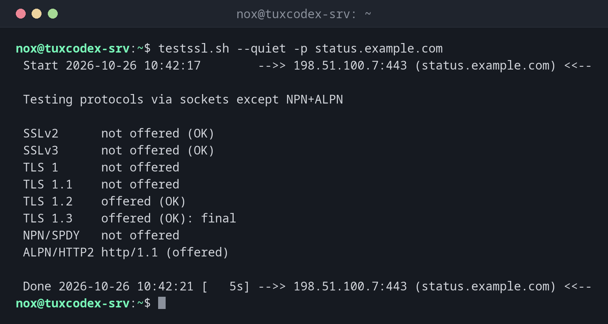

# testssl.sh

> Checks the TLS configuration of a server in depth: protocols, ciphers, certificate, headers and known weaknesses, with a grade.



## Syntax

```bash
testssl.sh [OPTIONS] HOST[:PORT]
```

## Options

| Option | Description |
|--------|-------------|
| (none) | All tests, takes about a minute |
| `-p` | Only the protocols |
| `-S` | Only the server defaults and the certificate |
| `-h` | Only the HTTP security headers |
| `-U` | Only the known vulnerabilities (Heartbleed, ROBOT, ...) |
| `--quiet` | Without the banner |
| `--severity HIGH` | Only report findings of this severity or higher |
| `--jsonfile FILE`, `--htmlfile FILE` | Save the results |
| `--starttls smtp` | Mail servers and other STARTTLS services |

## Examples

**Check the protocols:**

```bash
testssl.sh --quiet -p status.example.com
```

```text
 Start 2026-10-26 10:42:17        -->> 198.51.100.7:443 (status.example.com) <<--

 Testing protocols via sockets except NPN+ALPN

 SSLv2      not offered (OK)
 SSLv3      not offered (OK)
 TLS 1      not offered
 TLS 1.1    not offered
 TLS 1.2    offered (OK)
 TLS 1.3    offered (OK): final
 NPN/SPDY   not offered
 ALPN/HTTP2 http/1.1 (offered)

 Done 2026-10-26 10:42:21 [   5s] -->> 198.51.100.7:443 (status.example.com) <<--
```

**Certificate and server defaults:**

```bash
testssl.sh --quiet -S status.example.com | sed -n '/Signature Algorithm/,/Intermediate cert/p'
```

```text
 Signature Algorithm          SHA256 with RSA
 Server key size              EC 256 bits (curve P-256)
 Server key usage             Digital Signature
 Server extended key usage    TLS Web Server Authentication, TLS Web Client Authentication
 Serial                       48CC344E3CB032BD7874834E00CF32557B57135A (OK: length 20)
 Fingerprints                 SHA1 F23ED1761E4DEB37AF9C03DF6E78F0A046456FDB
                              SHA256 9C3FE176FBBEBD4CC9A728229B16406AB1BB3D500F1EDD6CBAE6C015177D1C05
 Common Name (CN)             status.example.com
 subjectAltName (SAN)         status.example.com www.status.example.com
 Trust (hostname)             Ok via SAN and CN (same w/o SNI)
 Chain of trust               Ok
 EV cert (experimental)       no
 Certificate Validity (UTC)   64 >= 30 days (2026-10-01 08:15 --> 2026-12-30 08:15)
 Certificate Revocation List  http://r13.c.lencr.org/112.crl
 OCSP URI                     --
 OCSP stapling                not offered
 Certificates provided        2
 Issuer                       R13 (Let's Encrypt from US)
 Intermediate cert validity   #1: ok > 40 days (2027-03-12 23:59). R13 <-- ISRG Root X1
```

**The grade at the end of a full run:**

```bash
testssl.sh --quiet status.example.com | grep -A8 'Rating (experimental)'
```

```text
 Rating (experimental)

 Rating specs (not complete)  SSL Labs's 'SSL Server Rating Guide' (version 2009r from 2025-05-16)
 Specification documentation  https://github.com/ssllabs/research/wiki/SSL-Server-Rating-Guide
 Protocol Support (weighted)  100 (30)
 Key Exchange     (weighted)  100 (30)
 Cipher Strength  (weighted)  90 (36)
 Final Score                  96
 Overall Grade                A+
```

A+ needs, among other things, HSTS (`Strict-Transport-Security`) of at least six months.

## When do I need it?

- After setting up HTTPS on a server, as a final check
- After changing protocols or ciphers in nginx or Apache
- Regularly, because new weaknesses become known

!!! tip "Like SSL Labs, but local"
    testssl.sh rates much like the SSL Labs website, but also works for internal servers,
    mail servers and other ports, and the results stay with you.

!!! warning "Only your own servers"
    testssl.sh opens hundreds of connections. As with any scan, only test servers you
    manage, see the chapter [Security scanning](../23-security-scanning/basics.md).

## Distribution differences

| | Debian | Ubuntu | RHEL | Arch |
|---|--------|--------|------|------|
| Install | `sudo apt install testssl.sh` | `sudo apt install testssl.sh` | from GitHub (`testssl/testssl.sh`) | `sudo pacman -S testssl.sh` |

## Related commands

[openssl s_client](openssl-s_client.md) · [certbot](certbot.md) · [nmap](../23-security-scanning/nmap.md)
