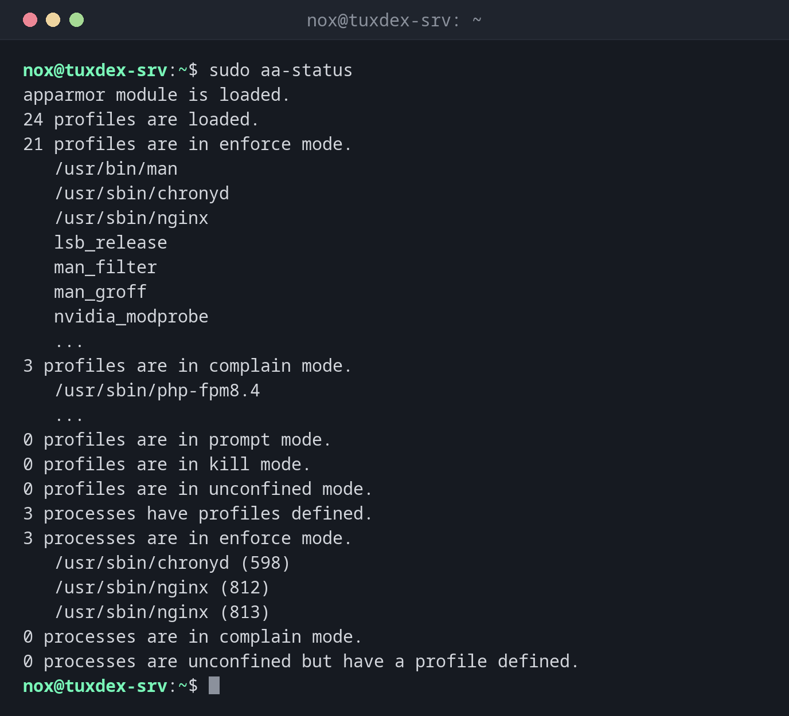

# aa-status

> On Debian and Ubuntu: shows whether AppArmor is active, which profiles are loaded and which processes they protect.



## Syntax

```bash
aa-status [--enabled | --json]
```

## Options

| Option | Description |
|--------|-------------|
| (none) | Full overview: profiles and processes per mode |
| `--enabled` | Only an exit code: 0 if AppArmor is active |
| `--json`, `--pretty-json` | Machine-readable output |
| `--complaining`, `--enforced` | Only the number of profiles in this mode |

Profiles are in `/etc/apparmor.d/`. Denials appear in the kernel log as `apparmor="DENIED"`.

## Examples

**The overview:**

```bash
sudo aa-status
```

```text
apparmor module is loaded.
24 profiles are loaded.
21 profiles are in enforce mode.
   /usr/bin/man
   /usr/sbin/chronyd
   /usr/sbin/nginx
   lsb_release
   man_filter
   man_groff
   nvidia_modprobe
   ...
3 profiles are in complain mode.
   /usr/sbin/php-fpm8.4
   ...
0 profiles are in prompt mode.
0 profiles are in kill mode.
0 profiles are in unconfined mode.
3 processes have profiles defined.
3 processes are in enforce mode.
   /usr/sbin/chronyd (598)
   /usr/sbin/nginx (812)
   /usr/sbin/nginx (813)
0 processes are in complain mode.
0 processes are unconfined but have a profile defined.
```

Shortened. nginx runs in enforce mode, so its profile is applied; php-fpm only logs.

**Show what AppArmor blocked:**

```bash
sudo journalctl -k | grep 'apparmor="DENIED"' | tail -1
```

```text
Oct 26 10:42:17 tuxdex-srv kernel: audit: type=1400 audit(1793094137.412:88): apparmor="DENIED" operation="open" class="file" profile="/usr/sbin/nginx" name="/srv/status/index.html" pid=1384 comm="nginx" requested_mask="r" denied_mask="r" fsuid=33 ouid=0
```

The nginx profile doesn't allow `/srv/status/`. Add the path to the profile, see [`aa-complain`](aa-complain.md).

**As a check in a script:**

```bash
sudo aa-status --enabled && echo "AppArmor is active"
```

```text
AppArmor is active
```

## When do I need it?

- As the first check when a service on Debian or Ubuntu gets "Permission denied"
- To see which services are protected by a profile at all
- After changing a profile, to confirm it's loaded in the right mode

!!! tip "Find denials"
    `sudo journalctl -k | grep apparmor=\"DENIED\"` shows what AppArmor blocked, with the
    profile, the operation and the path.

## Distribution differences

| | Debian | Ubuntu | RHEL | Arch |
|---|--------|--------|------|------|
| AppArmor | active | active | not available (SELinux instead) | possible, kernel parameter `lsm=` needed |
| Package | `sudo apt install apparmor-utils` | `apparmor-utils`, preinstalled | not available | `sudo pacman -S apparmor` |

## Related commands

[aa-complain](aa-complain.md) · [getenforce](getenforce.md) · [journalctl](../09-systemd/journalctl.md)
