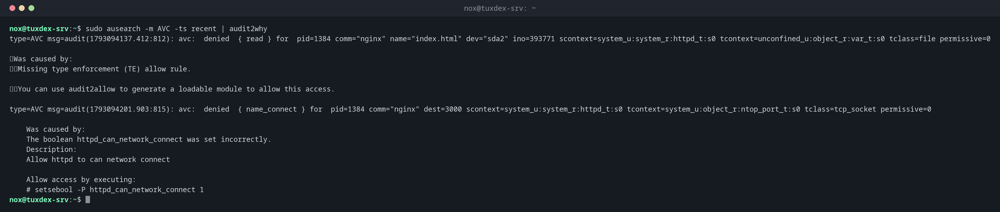

# audit2allow

> Unter RHEL, Rocky und Alma: macht aus SELinux-Ablehnungen im Audit-Log Erklärungen und bei Bedarf ein eigenes Richtlinienmodul.



## Syntax

```bash
audit2allow [-a | -i DATEI] [-w] [-M MODUL]
audit2why [-a | -i DATEI]
```

## Optionen

| Option | Beschreibung |
|--------|--------------|
| `-a` | Alle Ablehnungen aus dem Audit-Log lesen |
| `-i DATEI` | Ablehnungen aus einer Datei oder der Standardeingabe lesen |
| `-w` | Erklären, warum der Zugriff abgelehnt wurde (wie `audit2why`) |
| `-M NAME` | Aus den Ablehnungen ein ladbares Modul `NAME.pp` erzeugen |
| `-R` | Wo möglich Schnittstellen der Richtlinie nutzen (lesbarere Regeln) |

Meist zusammen mit [`ausearch`](../15-logs/ausearch.md): `sudo ausearch -m AVC -ts recent | audit2allow -w`.

## Beispiele

**Herausfinden, warum der Zugriff abgelehnt wurde:**

```bash
sudo ausearch -m AVC -ts recent | audit2why
```

```text
type=AVC msg=audit(1793094137.412:812): avc:  denied  { read } for  pid=1384 comm="nginx" name="index.html" dev="sda2" ino=393771 scontext=system_u:system_r:httpd_t:s0 tcontext=unconfined_u:object_r:var_t:s0 tclass=file permissive=0

	Was caused by:
		Missing type enforcement (TE) allow rule.

		You can use audit2allow to generate a loadable module to allow this access.

type=AVC msg=audit(1793094201.903:815): avc:  denied  { name_connect } for  pid=1384 comm="nginx" dest=3000 scontext=system_u:system_r:httpd_t:s0 tcontext=system_u:object_r:ntop_port_t:s0 tclass=tcp_socket permissive=0

    Was caused by:
    The boolean httpd_can_network_connect was set incorrectly.
    Description:
    Allow httpd to can network connect

    Allow access by executing:
    # setsebool -P httpd_can_network_connect 1
```

Zwei Ablehnungen, zwei verschiedene Lösungen: Die Datei `index.html` hat das Label `var_t` (Lösung mit [`semanage`](semanage.md) und [`restorecon`](restorecon.md)), die Verbindung zu Port 3000 braucht ein Boolean (Lösung mit [`setsebool`](setsebool.md)).

**Welche Regeln nötig wären:**

```bash
sudo ausearch -m AVC -ts recent | audit2allow
```

```text
#============= httpd_t ==============

#!!!! This avc can be allowed using the boolean 'httpd_can_network_connect'
allow httpd_t ntop_port_t:tcp_socket name_connect;
allow httpd_t var_t:file read;
```

**Ein Modul erstellen, als letztes Mittel:**

```bash
sudo ausearch -m AVC -c myapp -ts today | audit2allow -M myapp
cat myapp.te
sudo semodule -i myapp.pp
```

```text
******************** IMPORTANT ***********************
To make this policy package active, execute:

semodule -i myapp.pp


module myapp 1.0;

require {
    type myapp_t;
    type var_log_t;
    class file { append open };
}

#============= myapp_t ==============
allow myapp_t var_log_t:file { append open };
```

## Wann brauche ich das?

- Um eine Ablehnung zu verstehen: falsches Label, fehlendes Boolean oder wirklich fehlende Regel?
- Für eigene Anwendungen, die Zugriffe brauchen, die die Richtlinie nicht vorsieht
- Um im Permissive-Modus alle Ablehnungen einer neuen Anwendung zu sammeln und in einem Modul zu erlauben

!!! tip "Zuerst audit2why"
    Sehr oft ist die Antwort ein Boolean oder ein Label, kein neues Modul. `audit2why` sagt
    das direkt, wie im Beispiel unten.

!!! danger "Nicht blind erlauben"
    `audit2allow -M` erlaubt alles, was abgelehnt wurde, auch das, was ein Angreifer
    versucht hat. Lies die `.te`-Datei, bevor du das Modul lädst, und bevorzuge Labels und
    Booleans.

## Unterschiede zwischen Distributionen

| | Debian | Ubuntu | RHEL | Arch |
|---|--------|--------|------|------|
| SELinux | nicht aktiv (stattdessen AppArmor) | nicht aktiv (stattdessen AppArmor) | aktiv, `enforcing` | nicht aktiv |
| Paket | `policycoreutils-python-utils` (nur wenn SELinux eingerichtet ist) | `policycoreutils-python-utils` (nur wenn SELinux eingerichtet ist) | `sudo dnf install policycoreutils-python-utils` | nicht in den offiziellen Repositorys |

## Verwandte Befehle

[semanage](semanage.md) · [setsebool](setsebool.md) · [restorecon](restorecon.md) · [ausearch](../15-logs/ausearch.md)
