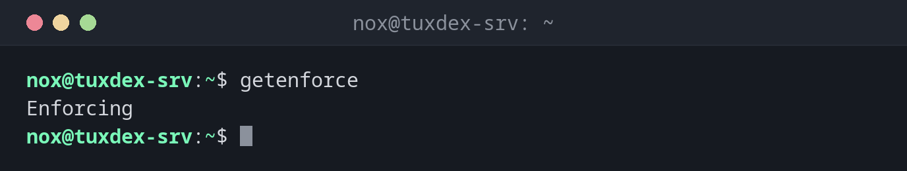

# getenforce

> On RHEL, Rocky and Alma: shows whether SELinux is enforcing, permissive or disabled.



## Syntax

```bash
getenforce
```

## Options

| Option | Description |
|--------|-------------|
| (none) | Print the current mode: `Enforcing`, `Permissive` or `Disabled` |

| Mode | Meaning |
|------|---------|
| `Enforcing` | Rules are applied: forbidden access is blocked and logged |
| `Permissive` | Rules are only checked: forbidden access is logged but allowed |
| `Disabled` | SELinux is switched off completely |

## Examples

**Check the mode:**

```bash
getenforce
```

```text
Enforcing
```

**After a temporary switch to permissive:**

```bash
sudo setenforce 0
getenforce
```

```text
Permissive
```

**As a check in a script:**

```bash
[ "$(getenforce)" = "Enforcing" ] || echo "WARNING: SELinux is not enforcing on $(hostname)"
```

```text
WARNING: SELinux is not enforcing on tuxdex-srv
```

## When do I need it?

- As the first check when a service gets "Permission denied" on RHEL
- In scripts and monitoring, to make sure SELinux wasn't switched off
- After a reboot, to confirm the mode from `/etc/selinux/config`

!!! tip "Details with sestatus"
    `getenforce` only shows the mode. [`sestatus`](sestatus.md) also shows the policy and the
    mode that applies after the next reboot.

## Distribution differences

| | Debian | Ubuntu | RHEL | Arch |
|---|--------|--------|------|------|
| SELinux | not active (AppArmor instead) | not active (AppArmor instead) | active, `enforcing` | not active |
| Package | `selinux-utils` (only if SELinux is set up) | `selinux-utils` (only if SELinux is set up) | `libselinux-utils`, preinstalled | not in the official repositories |

## Related commands

[setenforce](setenforce.md) · [sestatus](sestatus.md) · [aa-status](aa-status.md)
