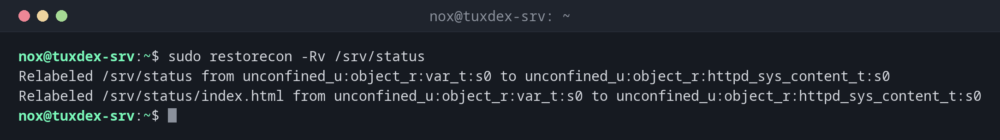

# restorecon

> Unter RHEL, Rocky und Alma: setzt die SELinux-Labels von Dateien auf das zurück, was die Regeln vorsehen.



## Syntax

```bash
restorecon [-R] [-v] [-n] PFAD...
```

## Optionen

| Option | Beschreibung |
|--------|--------------|
| `-R` | Rekursiv, mit allen Dateien darunter |
| `-v` | Jedes geänderte Label zeigen |
| `-n` | Nur zeigen, was sich ändern würde |
| `-F` | Auch Benutzer- und Rollenteil des Labels zurücksetzen |

`ls -Z` zeigt das Label einer Datei, `matchpathcon PFAD` das Label, das sie haben sollte.

## Beispiele

**Die Labels auf ein Verzeichnis anwenden:**

```bash
sudo restorecon -Rv /srv/status
```

```text
Relabeled /srv/status from unconfined_u:object_r:var_t:s0 to unconfined_u:object_r:httpd_sys_content_t:s0
Relabeled /srv/status/index.html from unconfined_u:object_r:var_t:s0 to unconfined_u:object_r:httpd_sys_content_t:s0
```

**Falsches Label nach mv:**

```bash
mv ~/index.html /var/www/html/
ls -Z /var/www/html/index.html
matchpathcon /var/www/html/index.html
```

```text
unconfined_u:object_r:user_home_t:s0 /var/www/html/index.html
/var/www/html/index.html  system_u:object_r:httpd_sys_content_t:s0
```

Die Datei hat noch das Label des Home-Verzeichnisses (`user_home_t`), nginx darf sie nicht lesen. `sudo restorecon -v /var/www/html/index.html` behebt das.

**Nur zeigen, was sich ändern würde:**

```bash
sudo restorecon -Rnv /var/www
```

```text
Would relabel /var/www/html/index.html from unconfined_u:object_r:user_home_t:s0 to unconfined_u:object_r:httpd_sys_content_t:s0
```

## Wann brauche ich das?

- Nach `semanage fcontext`, um neue Regeln auf vorhandene Dateien anzuwenden
- Nach dem Verschieben mit `mv`: Die Dateien behalten ihr altes Label aus dem Quellverzeichnis
- Wenn ein Dienst nach dem Zurückspielen eines Backups seine Dateien plötzlich nicht mehr lesen kann

!!! tip "cp statt mv"
    `cp` legt Dateien mit dem Label des Zielverzeichnisses an, `mv` behält das alte Label.
    Deshalb funktionieren Dateien, die aus dem Home-Verzeichnis nach `/var/www` verschoben
    wurden, oft nicht. `restorecon` repariert das.

!!! warning "Das ganze System neu labeln"
    War SELinux abgeschaltet, labeln `touch /.autorelabel` und ein Neustart das ganze
    Dateisystem neu. Auf großen Platten dauert das lange; plane ein Wartungsfenster ein.

## Unterschiede zwischen Distributionen

| | Debian | Ubuntu | RHEL | Arch |
|---|--------|--------|------|------|
| SELinux | nicht aktiv (stattdessen AppArmor) | nicht aktiv (stattdessen AppArmor) | aktiv, `enforcing` | nicht aktiv |
| Paket | `selinux-utils` (nur wenn SELinux eingerichtet ist) | `selinux-utils` (nur wenn SELinux eingerichtet ist) | `libselinux-utils`, vorinstalliert | nicht in den offiziellen Repositorys |

## Verwandte Befehle

[semanage](semanage.md) · [audit2allow](audit2allow.md) · [ls](../02-navigation/ls.md) · [mv](../03-files/mv.md)
