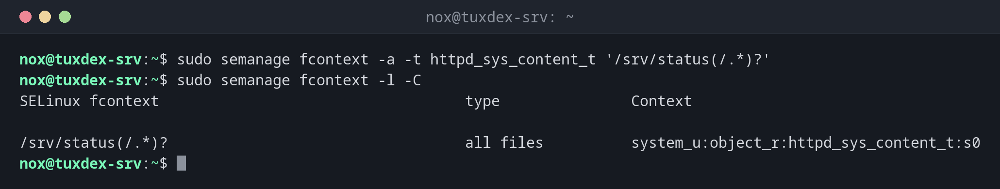

# semanage

> On RHEL, Rocky and Alma: changes the SELinux configuration permanently: file labels, allowed ports, booleans and permissive domains.



## Syntax

```bash
semanage fcontext | port | boolean | permissive  -l | -a | -d | -m [OPTIONS]
```

## Options

| Option | Description |
|--------|-------------|
| `fcontext -a -t TYPE 'PATH(/.*)?'` | Rule for which label files below a path get |
| `fcontext -l [-C]` | List the rules; `-C` only your own |
| `port -a -t TYPE -p tcp PORT` | Allow a service type to use another port |
| `port -l` | List which ports belong to which type |
| `boolean -l` | Booleans with state and description |
| `permissive -a DOMAIN` | Put a single domain into permissive mode |
| `-d` | Delete an own rule again |

`semanage fcontext` only changes the rules. The files get their new label when you run [`restorecon`](restorecon.md).

## Examples

**Let nginx serve a new directory:**

```bash
sudo semanage fcontext -a -t httpd_sys_content_t '/srv/status(/.*)?'
sudo semanage fcontext -l -C
```

```text
SELinux fcontext                                   type               Context

/srv/status(/.*)?                                  all files          system_u:object_r:httpd_sys_content_t:s0
```

Then apply the rule to the existing files with `sudo restorecon -Rv /srv/status`.

**Show the ports the web server may use:**

```bash
sudo semanage port -l | grep -E '^http_port_t'
```

```text
http_port_t                    tcp      80, 81, 443, 488, 8008, 8009, 8443, 9000
http_port_t                    udp      80, 443
```

**Allow an additional port:**

```bash
sudo semanage port -a -t http_port_t -p tcp 8090
sudo semanage port -l -C
```

```text
SELinux Port Type              Proto    Port Number

http_port_t                    tcp      8090
```

**The port already belongs to another type:**

```bash
sudo semanage port -a -t http_port_t -p tcp 8081
```

```text
Port tcp/8081 already defined, modifying instead
```

Port 8081 is defined as `transproxy_port_t`; semanage reassigns it instead of adding it.

## When do I need it?

- When a service serves files from an unusual directory, such as `/srv/status`
- When a service should listen on a port that isn't its default
- To see which own SELinux changes were made on a server (`-l -C`)

!!! tip "Look at the existing rules first"
    `semanage fcontext -l | grep /var/www` shows how the default directories are labeled.
    Copy the type from there for your own directory.

!!! warning "chcon doesn't last"
    `chcon -t httpd_sys_content_t FILE` changes a label directly, but the next relabel or
    `restorecon` resets it. For lasting changes, always use `semanage fcontext`.

## Distribution differences

| | Debian | Ubuntu | RHEL | Arch |
|---|--------|--------|------|------|
| SELinux | not active (AppArmor instead) | not active (AppArmor instead) | active, `enforcing` | not active |
| Package | `policycoreutils-python-utils` (only if SELinux is set up) | `policycoreutils-python-utils` (only if SELinux is set up) | `sudo dnf install policycoreutils-python-utils` | not in the official repositories |

## Related commands

[restorecon](restorecon.md) · [setsebool](setsebool.md) · [audit2allow](audit2allow.md) · [ls](../02-navigation/ls.md)
