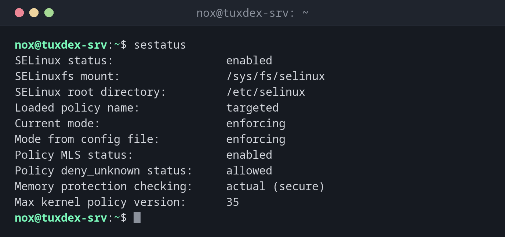

# sestatus

> On RHEL, Rocky and Alma: shows the complete SELinux status: mode, policy, configured mode and booleans.



## Syntax

```bash
sestatus [-v] [-b]
```

## Options

| Option | Description |
|--------|-------------|
| (none) | Status, mode, policy and the mode from the configuration file |
| `-b` | Also list all booleans with their state |
| `-v` | Also show the contexts of important files and processes |

## Examples

**The full status:**

```bash
sestatus
```

```text
SELinux status:                 enabled
SELinuxfs mount:                /sys/fs/selinux
SELinux root directory:         /etc/selinux
Loaded policy name:             targeted
Current mode:                   enforcing
Mode from config file:          enforcing
Policy MLS status:              enabled
Policy deny_unknown status:     allowed
Memory protection checking:     actual (secure)
Max kernel policy version:      35
```

**Someone switched to permissive:**

```bash
sestatus | grep -i mode
```

```text
Current mode:                   permissive
Mode from config file:          enforcing
```

**The booleans for the web server:**

```bash
sestatus -b | grep -E 'httpd_can_network_connect |httpd_enable_homedirs'
```

```text
httpd_can_network_connect                  off
httpd_enable_homedirs                      off
```

## When do I need it?

- To see at a glance whether the current mode and the configured mode match
- To check which policy is loaded (usually `targeted`)
- When documenting the state of a server

!!! warning "Current mode and config file differ"
    `Current mode: permissive` and `Mode from config file: enforcing` means someone ran
    `setenforce 0`. After the next reboot, SELinux will block again, so fix the cause
    before that.

## Distribution differences

| | Debian | Ubuntu | RHEL | Arch |
|---|--------|--------|------|------|
| SELinux | not active (AppArmor instead) | not active (AppArmor instead) | active, `enforcing` | not active |
| Package | `selinux-utils` (only if SELinux is set up) | `selinux-utils` (only if SELinux is set up) | `libselinux-utils`, preinstalled | not in the official repositories |

## Related commands

[getenforce](getenforce.md) · [setenforce](setenforce.md) · [setsebool](setsebool.md)
