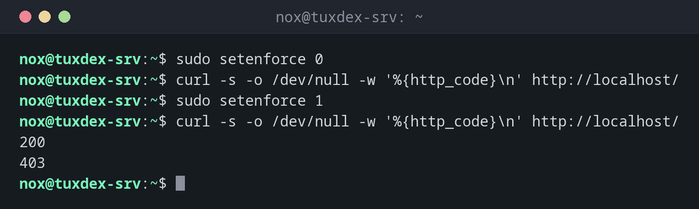

# setenforce

> Unter RHEL, Rocky und Alma: schaltet SELinux bis zum nächsten Neustart zwischen enforcing und permissive um.



## Syntax

```bash
setenforce 1 | 0 | Enforcing | Permissive
```

## Optionen

| Option | Beschreibung |
|--------|--------------|
| `1`, `Enforcing` | Regeln anwenden |
| `0`, `Permissive` | Nur protokollieren, nicht blockieren |

Den dauerhaften Modus legst du in `/etc/selinux/config` mit `SELINUX=enforcing` oder `SELINUX=permissive` fest. Ganz abschalten kann `setenforce` SELinux nicht.

## Beispiele

**Testen, ob SELinux die Ursache ist:**

```bash
sudo setenforce 0
curl -s -o /dev/null -w '%{http_code}\n' http://localhost/
sudo setenforce 1
curl -s -o /dev/null -w '%{http_code}\n' http://localhost/
```

```text
200
403
```

Im Permissive-Modus klappt die Seite, mit enforcing nicht: SELinux blockiert nginx. Die Lösung steht bei [`restorecon`](restorecon.md) oder [`semanage`](semanage.md).

**Die dauerhafte Einstellung:**

```bash
grep ^SELINUX= /etc/selinux/config
```

```text
SELINUX=enforcing
```

**Nur den Webserver in den Permissive-Modus:**

```bash
sudo semanage permissive -a httpd_t
sudo semanage permissive -l
```

```text
Customized Permissive Types

httpd_t
```

## Wann brauche ich das?

- Als schneller Test: Ist SELinux der Grund für einen Fehler?
- Um im Permissive-Modus alle Ablehnungen einer neuen Anwendung zu sammeln und dann eine Richtlinie dafür zu schreiben
- Um direkt nach dem Test wieder auf enforcing zu schalten

!!! tip "Permissive nur für eine Domäne"
    `sudo semanage permissive -a httpd_t` setzt nur die Domäne des Webservers auf
    permissive, alles andere bleibt geschützt. `semanage permissive -d httpd_t` nimmt es
    zurück.

!!! warning "Wieder einschalten"
    Der Permissive-Modus schützt nichts. Nutze ihn Minuten, nicht Tage, und prüf mit
    [`getenforce`](getenforce.md), dass wieder `Enforcing` gilt.

## Unterschiede zwischen Distributionen

| | Debian | Ubuntu | RHEL | Arch |
|---|--------|--------|------|------|
| SELinux | nicht aktiv (stattdessen AppArmor) | nicht aktiv (stattdessen AppArmor) | aktiv, `enforcing` | nicht aktiv |
| Paket | `selinux-utils` (nur wenn SELinux eingerichtet ist) | `selinux-utils` (nur wenn SELinux eingerichtet ist) | `libselinux-utils`, vorinstalliert | nicht in den offiziellen Repositorys |

## Verwandte Befehle

[getenforce](getenforce.md) · [sestatus](sestatus.md) · [semanage](semanage.md) · [aa-complain](aa-complain.md)
