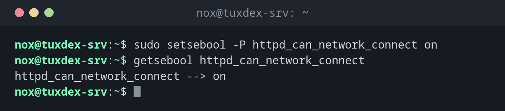

# setsebool

> On RHEL, Rocky and Alma: switches SELinux booleans, ready-made exceptions for common needs.



## Syntax

```bash
setsebool [-P] BOOLEAN on|off
getsebool -a | BOOLEAN
```

## Options

| Option | Description |
|--------|-------------|
| `-P` | Permanent, also after a reboot (without it, only until the next reboot) |
| `on`, `off` | Switch on or off (also `1`, `0`) |
| `getsebool -a` | List all booleans with their state |
| `getsebool BOOLEAN` | State of a single boolean |

Common booleans for servers:

| Boolean | Allows |
|---------|--------|
| `httpd_can_network_connect` | Web server connects to other servers, for example as a reverse proxy |
| `httpd_can_network_connect_db` | Web server connects to a database on the network |
| `httpd_can_sendmail` | Web applications send mail |
| `httpd_enable_homedirs` | Web server serves `~/public_html` |
| `samba_enable_home_dirs` | Samba shares home directories |

## Examples

**Allow nginx to work as a reverse proxy:**

```bash
sudo setsebool -P httpd_can_network_connect on
getsebool httpd_can_network_connect
```

```text
httpd_can_network_connect --> on
```

**All booleans for the web server that are on:**

```bash
getsebool -a | grep '^httpd' | grep 'on$'
```

```text
httpd_builtin_scripting --> on
httpd_can_network_connect --> on
httpd_enable_cgi --> on
httpd_graceful_shutdown --> on
```

**Booleans with description and default:**

```bash
sudo semanage boolean -l | grep -E '^httpd_can_network_connect |^httpd_enable_homedirs'
```

```text
httpd_can_network_connect      (on   ,  off)  Allow httpd to can network connect
httpd_enable_homedirs          (off  ,  off)  Allow httpd to enable homedirs
```

The first value is the current state, the second the default of the policy.

## When do I need it?

- When nginx as a reverse proxy gets `502 Bad Gateway` and the log shows `Permission denied` on connect
- When a web application can't reach the database or send mail
- Whenever `audit2why` names a boolean as the solution

!!! tip "Find the right boolean"
    `semanage boolean -l | grep httpd` lists all booleans for web servers with a
    description. `audit2why` often names the exact one.

!!! warning "Without -P it's gone after a reboot"
    `setsebool` without `-P` only changes the running state. The service works, and after
    the next reboot it fails again.

## Distribution differences

| | Debian | Ubuntu | RHEL | Arch |
|---|--------|--------|------|------|
| SELinux | not active (AppArmor instead) | not active (AppArmor instead) | active, `enforcing` | not active |
| Package | `selinux-utils` (only if SELinux is set up) | `selinux-utils` (only if SELinux is set up) | `libselinux-utils`, preinstalled | not in the official repositories |

## Related commands

[semanage](semanage.md) · [audit2allow](audit2allow.md) · [sestatus](sestatus.md)
