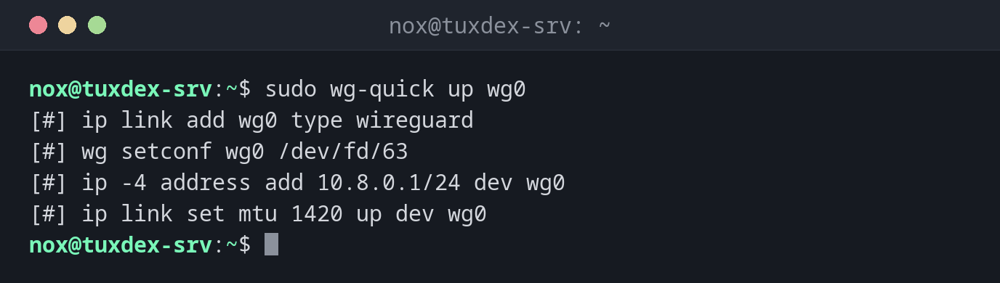

# wg-quick

> Brings a WireGuard tunnel up or down from a configuration file, including addresses, routes and DNS.



## Syntax

```bash
wg-quick up | down | save | strip INTERFACE
```

## Options

| Option | Description |
|--------|-------------|
| `up wg0` | Read `/etc/wireguard/wg0.conf`, create the interface, set addresses and routes |
| `down wg0` | Remove the interface and its routes again |
| `save wg0` | Write the running state (for example peers added with `wg set`) into the file |
| `strip wg0` | Print only the part of the file that `wg` itself understands |
| `systemctl enable --now wg-quick@wg0` | Start the tunnel now and at every boot |

Besides the `wg` settings, the `[Interface]` section understands `Address`, `DNS`, `MTU`, `PostUp` and `PostDown`, for example for NAT rules.

## Examples

**Bring the tunnel up:**

```bash
sudo wg-quick up wg0
```

```text
[#] ip link add wg0 type wireguard
[#] wg setconf wg0 /dev/fd/63
[#] ip -4 address add 10.8.0.1/24 dev wg0
[#] ip link set mtu 1420 up dev wg0
```

`wg-quick` shows every command it runs. The configuration is in the [basics](basics.md).

**Start at every boot:**

```bash
sudo systemctl enable --now wg-quick@wg0
ip -br address show wg0
```

```text
Created symlink '/etc/systemd/system/multi-user.target.wants/wg-quick@wg0.service' → '/usr/lib/systemd/system/wg-quick@.service'.
wg0              UNKNOWN        10.8.0.1/24
```

**Test the tunnel from the laptop:**

```bash
ping -c 3 10.8.0.1
```

```text
PING 10.8.0.1 (10.8.0.1) 56(84) bytes of data.
64 bytes from 10.8.0.1: icmp_seq=1 ttl=64 time=18.4 ms
64 bytes from 10.8.0.1: icmp_seq=2 ttl=64 time=18.1 ms
64 bytes from 10.8.0.1: icmp_seq=3 ttl=64 time=18.3 ms

--- 10.8.0.1 ping statistics ---
3 packets transmitted, 3 received, 0% packet loss, time 2003ms
rtt min/avg/max/mdev = 18.112/18.267/18.402/0.119 ms
```

**Save peers added at runtime:**

```bash
sudo wg-quick save wg0
sudo grep -c '^\[Peer\]' /etc/wireguard/wg0.conf
```

```text
2
```

**Bring the tunnel down:**

```bash
sudo wg-quick down wg0
```

```text
[#] ip link delete dev wg0
```

## When do I need it?

- To start a tunnel by hand for a test
- To start the VPN automatically at boot with systemd
- To save peers that were added on the running system

!!! tip "Restart after config changes"
    After editing `wg0.conf`, `sudo systemctl restart wg-quick@wg0` applies it. To change
    peers without interrupting connections, use
    `sudo wg syncconf wg0 <(wg-quick strip wg0)`.

!!! warning "DNS = needs resolvconf"
    A `DNS =` line in the client configuration needs `resolvconf` or `systemd-resolved`.
    Without it, `wg-quick up` fails with `resolvconf: command not found`.

## Distribution differences

| | Debian | Ubuntu | RHEL | Arch |
|---|--------|--------|------|------|
| Install | `sudo apt install wireguard-tools` | `sudo apt install wireguard-tools` | `sudo dnf install wireguard-tools` | `sudo pacman -S wireguard-tools` |

## Related commands

[wg](wg.md) · [systemctl](../09-systemd/systemctl.md) · [ip](../11-network/ip.md) · [resolvectl](../11-network/resolvectl.md)
