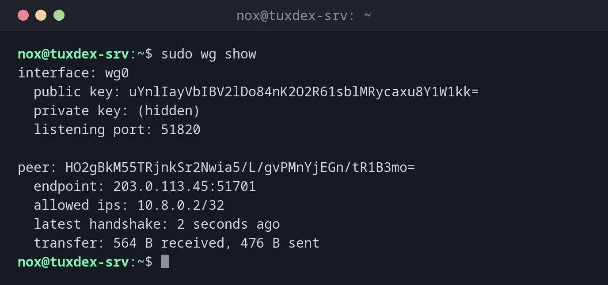

# wg

> Creates WireGuard keys, shows the state of the tunnels and changes peers while they run.



## Syntax

```bash
wg genkey | pubkey | genpsk
wg show [INTERFACE] [FIELD]
wg set INTERFACE peer KEY [OPTIONS]
```

## Options

| Option | Description |
|--------|-------------|
| `genkey` | Print a new private key |
| `pubkey` | Read a private key from the input and print its public key |
| `genpsk` | Create an additional pre-shared key for a peer |
| `show`, (none) | State of all interfaces: peers, endpoints, handshakes, traffic |
| `show wg0 latest-handshakes` | Single fields for scripts; also `transfer`, `endpoints`, `allowed-ips` |
| `set wg0 peer KEY allowed-ips IP` | Add or change a peer while the tunnel runs |
| `set wg0 peer KEY remove` | Remove a peer |
| `showconf wg0` | The running configuration in file format |

`wg show` needs root, because it can also read the private key.

## Examples

**The state of the tunnel:**

```bash
sudo wg show
```

```text
interface: wg0
  public key: uYnlIayVbIBV2lDo84nK2O2R61sblMRycaxu8Y1W1kk=
  private key: (hidden)
  listening port: 51820

peer: HO2gBkM55TRjnkSr2Nwia5/L/gvPMnYjEGn/tR1B3mo=
  endpoint: 203.0.113.45:51701
  allowed ips: 10.8.0.2/32
  latest handshake: 2 seconds ago
  transfer: 564 B received, 476 B sent
```

`endpoint` is the public address the laptop currently connects from; it changes when the laptop changes networks, and WireGuard follows it automatically.

**Create a key pair:**

```bash
cd /etc/wireguard
umask 077
wg genkey | tee server.key | wg pubkey > server.pub
cat server.pub
```

```text
uYnlIayVbIBV2lDo84nK2O2R61sblMRycaxu8Y1W1kk=
```

`umask 077` makes sure that `server.key` is only readable by root. Only the public key from `server.pub` is passed on.

**The client side:**

```bash
sudo wg
```

```text
interface: wg0
  public key: HO2gBkM55TRjnkSr2Nwia5/L/gvPMnYjEGn/tR1B3mo=
  private key: (hidden)
  listening port: 51701

peer: uYnlIayVbIBV2lDo84nK2O2R61sblMRycaxu8Y1W1kk=
  endpoint: 198.51.100.7:51820
  allowed ips: 10.8.0.0/24
  latest handshake: 2 seconds ago
  transfer: 476 B received, 564 B sent
  persistent keepalive: every 25 seconds
```

**Add a new client while the tunnel runs:**

```bash
sudo wg set wg0 peer BkDTavLKk/pQ56N0h4A2mTMxhNgXm03Daqqp6jjg4QQ= allowed-ips 10.8.0.3/32
sudo wg show wg0 allowed-ips
```

```text
HO2gBkM55TRjnkSr2Nwia5/L/gvPMnYjEGn/tR1B3mo=  10.8.0.2/32
BkDTavLKk/pQ56N0h4A2mTMxhNgXm03Daqqp6jjg4QQ=  10.8.0.3/32
```

**The last handshake per peer, for monitoring:**

```bash
sudo wg show wg0 latest-handshakes
```

```text
HO2gBkM55TRjnkSr2Nwia5/L/gvPMnYjEGn/tR1B3mo=  1793106175
BkDTavLKk/pQ56N0h4A2mTMxhNgXm03Daqqp6jjg4QQ=  0
```

The value is a Unix timestamp; `0` means the peer has never connected.

## When do I need it?

- To create the key pair for a new server or client
- To check whether a peer is connected: a recent `latest handshake` means yes
- To add a new client without restarting the tunnel

!!! tip "Handshake older than 2 minutes?"
    WireGuard renews the handshake every 2 minutes while traffic flows. If `latest
    handshake` is much older or missing, check the endpoint, the UDP port in the firewall and
    the public keys on both sides.

!!! warning "wg set isn't saved"
    Changes with `wg set` are lost when the interface is restarted. Add the peer to
    `/etc/wireguard/wg0.conf` too, or save the running state with
    `wg-quick save wg0`.

## Distribution differences

| | Debian | Ubuntu | RHEL | Arch |
|---|--------|--------|------|------|
| Install | `sudo apt install wireguard-tools` | `sudo apt install wireguard-tools` | `sudo dnf install wireguard-tools` | `sudo pacman -S wireguard-tools` |

## Related commands

[wg-quick](wg-quick.md) · [ip](../11-network/ip.md) · [ufw](../11-network/ufw.md) · [ping](../11-network/ping.md)
