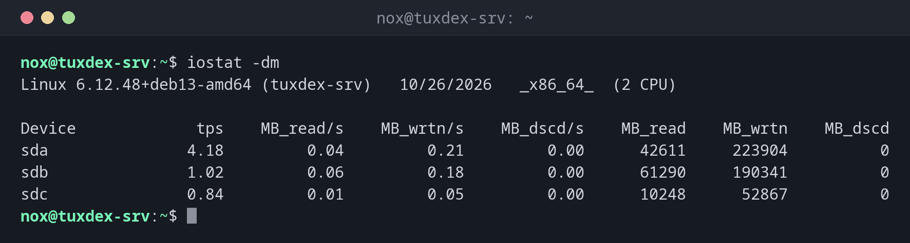

# iostat

> Shows how busy the disks are: reads and writes per second, throughput, waiting times and utilization.



## Syntax

```bash
iostat [OPTIONS] [DEVICE...] [INTERVAL [COUNT]]
```

## Options

| Option | Description |
|--------|-------------|
| `-x` | Extended statistics with waiting times and utilization |
| `-z` | Hide devices without activity |
| `-m`, `-h` | Values in MB, or human-readable |
| `-d` | Only disks, without the CPU summary |
| `-p sda` | Also show the partitions of a disk |
| `-y` | Skip the first report (averages since boot) |

The most important columns with `-x`:

| Column | Meaning |
|--------|---------|
| `r/s`, `w/s` | Read and write operations per second |
| `rkB/s`, `wkB/s` | Throughput |
| `r_await`, `w_await` | Average waiting time per operation in milliseconds |
| `aqu-sz` | Average length of the queue |
| `%util` | Share of the time the device was busy |

## Examples

**Throughput in MB since the boot:**

```bash
iostat -dm
```

```text
Linux 6.12.48+deb13-amd64 (tuxdex-srv)   10/26/2026   _x86_64_  (2 CPU)

Device             tps    MB_read/s    MB_wrtn/s    MB_dscd/s    MB_read    MB_wrtn    MB_dscd
sda               4.18         0.04         0.21         0.00      42611     223904          0
sdb               1.02         0.06         0.18         0.00      61290     190341          0
sdc               0.84         0.01         0.05         0.00      10248      52867          0
```

**Find the busy disk:**

```bash
iostat -dxzy 2 1
```

```text
Linux 6.12.48+deb13-amd64 (tuxdex-srv)   10/26/2026   _x86_64_  (2 CPU)

Device            r/s     rkB/s   rrqm/s  %rrqm r_await rareq-sz     w/s     wkB/s   wrqm/s  %wrqm w_await wareq-sz     d/s     dkB/s   drqm/s  %drqm d_await dareq-sz     f/s f_await  aqu-sz  %util
sda              2.50     40.00     0.00   0.00    0.80    16.00   18.00    196.00     6.50  26.53    1.42    10.89    0.00      0.00     0.00   0.00    0.00     0.00    1.00    0.50    0.03   2.60
sdb            412.00  52736.00     0.00   0.00   11.84   128.00  188.50  24128.00     0.00   0.00   38.10   128.00    0.00      0.00     0.00   0.00    0.00     0.00    0.00    0.00   12.06  99.80
```

`sdb` (the backup disk under `/mnt/backup`) is busy all the time with long waiting times, `sda` with the system is idle. Here a backup job is running.

**CPU summary with I/O wait:**

```bash
iostat -c 2 2 | tail -3
```

```text
avg-cpu:  %user   %nice %system %iowait  %steal   %idle
           5.82    0.00    8.94   47.61    0.00   37.63
```

## When do I need it?

- When `vmstat` shows a high `wa` and you need to know which disk is busy
- To check whether a disk or a storage is simply too slow (`await`)
- During backups or database maintenance, to see the load on the disks

!!! tip "%util on SSDs"
    SSDs and NVMe disks handle many requests in parallel. `%util` near 100 doesn't mean they
    are at their limit; look at `r_await` and `w_await` instead.

## Distribution differences

| | Debian | Ubuntu | RHEL | Arch |
|---|--------|--------|------|------|
| Install | `sudo apt install sysstat` | `sudo apt install sysstat` | `sudo dnf install sysstat` | `sudo pacman -S sysstat` |

## Related commands

[vmstat](vmstat.md) · [iotop](iotop.md) · [sar](sar.md) · [smartctl](../13-disks-storage/smartctl.md)
