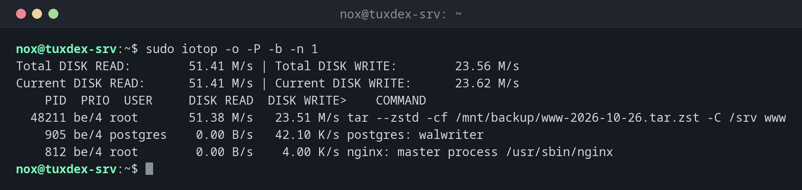

# iotop

> Shows live which processes are reading and writing on the disks, like top but for disk I/O.



## Syntax

```bash
iotop [-o] [-a] [-b] [-n COUNT] [-d SECONDS]
```

## Options

| Option | Description |
|--------|-------------|
| `-o`, `--only` | Only processes that are reading or writing right now |
| `-a`, `--accumulated` | Add up the I/O since the start instead of showing rates |
| `-P`, `--processes` | Processes instead of single threads |
| `-b`, `--batch` | Plain text output, for logs and scripts |
| `-n COUNT`, `-d SECONDS` | Number of updates, interval |

Inside `iotop`: ++o++ toggles "only active", ++a++ accumulated values, ++left++ and ++right++ change the sort column, ++q++ quits.

## Examples

**Only processes that cause I/O right now:**

```bash
sudo iotop -o -P -b -n 1
```

```text
Total DISK READ:        51.41 M/s | Total DISK WRITE:        23.56 M/s
Current DISK READ:      51.41 M/s | Current DISK WRITE:      23.62 M/s
    PID  PRIO  USER     DISK READ  DISK WRITE>    COMMAND
  48211 be/4 root       51.38 M/s   23.51 M/s tar --zstd -cf /mnt/backup/www-2026-10-26.tar.zst -C /srv www
    905 be/4 postgres    0.00 B/s   42.10 K/s postgres: walwriter
    812 be/4 root        0.00 B/s    4.00 K/s nginx: master process /usr/sbin/nginx
```

The backup with `tar` causes almost all of the I/O. Running it with `nice` and `ionice -c3` lets other processes go first.

**Who has written the most since the start:**

```bash
sudo iotop -a -o -P -b -n 3 -d 5 | tail -4
```

```text
    PID  PRIO  USER     DISK READ  DISK WRITE>    COMMAND
    905 be/4 postgres    0.00 B     18.42 M postgres: checkpointer
   1310 be/4 www-data    0.00 B      6.13 M php-fpm: pool www
    640 be/4 root        0.00 B     32.00 K sshd: nox [priv]
```

## When do I need it?

- When `iostat` shows a busy disk and you need to know which process causes it
- To find a runaway log file or a backup that slows everything down
- To check how much a database or a container writes over time (`-a`)

!!! tip "iotop-c instead of the old iotop"
    The original `iotop` is a Python program and no longer maintained. `iotop-c` is a
    compatible reimplementation in C and is installed as `iotop` on many distributions.

!!! warning "Needs root"
    iotop needs root rights (or the capability `CAP_NET_ADMIN`) to read the I/O statistics of
    other processes.

## Distribution differences

| | Debian | Ubuntu | RHEL | Arch |
|---|--------|--------|------|------|
| Install | `sudo apt install iotop-c` | `sudo apt install iotop-c` | `sudo dnf install iotop` | `sudo pacman -S iotop-c` |

## Related commands

[iostat](iostat.md) · [vmstat](vmstat.md) · [nice](../08-processes/nice.md) · [top](../08-processes/top.md)
