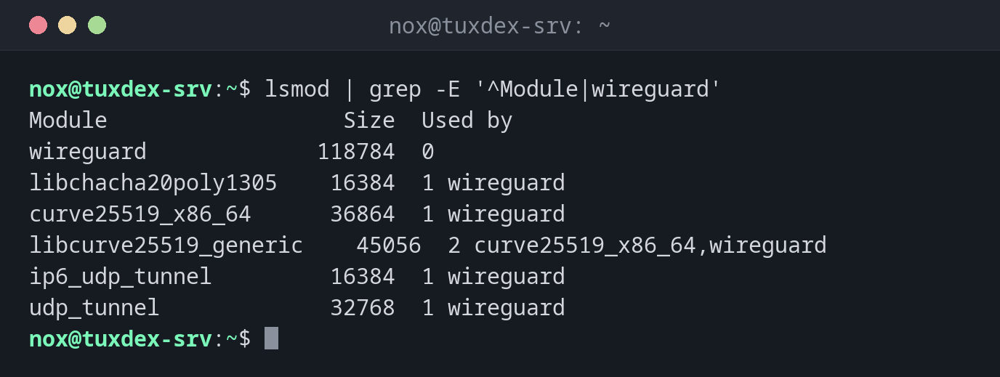

# lsmod

> Lists the kernel modules that are currently loaded, with their size and which other modules use them.



## Syntax

```bash
lsmod
```

## Options

| Option | Description |
|--------|-------------|
| (none) | All loaded modules: name, size, number of users and the modules that use them |

`modinfo NAME` shows details about a module: description, file, parameters and version.

## Examples

**Check whether the WireGuard module is loaded:**

```bash
lsmod | grep -E '^Module|wireguard'
```

```text
Module                  Size  Used by
wireguard             118784  0
libchacha20poly1305    16384  1 wireguard
curve25519_x86_64      36864  1 wireguard
libcurve25519_generic    45056  2 curve25519_x86_64,wireguard
ip6_udp_tunnel         16384  1 wireguard
udp_tunnel             32768  1 wireguard
```

**Details about a module:**

```bash
modinfo wireguard | head -6
```

```text
filename:       /lib/modules/6.12.48+deb13-amd64/kernel/drivers/net/wireguard/wireguard.ko.xz
intree:         Y
alias:          net-pf-16-proto-16-family-wireguard
alias:          rtnl-link-wireguard
version:        1.0.0
author:         Jason A. Donenfeld <Jason@zx2c4.com>
```

**The driver of the network card:**

```bash
lspci -k | grep -A2 Ethernet
```

```text
00:12.0 Ethernet controller: Red Hat, Inc. Virtio 1.0 network device (rev 01)
        Subsystem: Red Hat, Inc. Device 1100
        Kernel driver in use: virtio_net
```

## When do I need it?

- To check whether a driver is loaded, for example for a network card or WireGuard
- To find out which module belongs to a piece of hardware (together with `lspci -k`)
- Before unloading a module, to see what still uses it

!!! tip "Which driver does a device use?"
    `lspci -k` shows for every PCI device the line `Kernel driver in use`, so you know which
    module to look for in `lsmod`.

## Related commands

[modprobe](modprobe.md) · [dmesg](../15-logs/dmesg.md) · [wg](../26-wireguard/wg.md)
