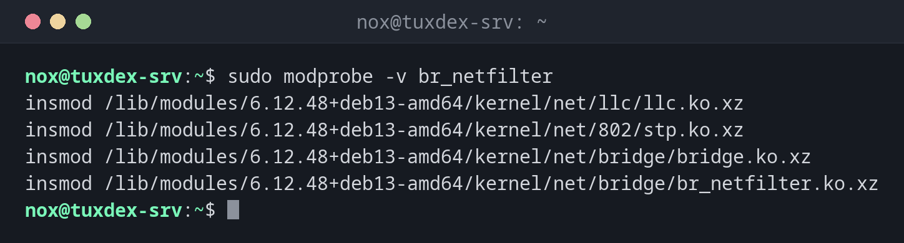

# modprobe

> Lädt und entlädt Kernelmodule, samt der Module, von denen sie abhängen.



## Syntax

```bash
modprobe [-r] [-v] MODUL [PARAMETER=WERT...]
```

## Optionen

| Option | Beschreibung |
|--------|--------------|
| `MODUL` | Das Modul und seine Abhängigkeiten laden |
| `-r` | Das Modul entladen (und ungenutzte Abhängigkeiten) |
| `-v` | Zeigen, was geladen wird |
| `-n` | Nur zeigen, was passieren würde (Probelauf) |
| `PARAMETER=WERT` | Dem Modul einen Parameter übergeben |
| `-c` | Die wirksame Konfiguration zeigen |

Dauerhafte Einstellungen:

| Datei | Wirkung |
|-------|---------|
| `/etc/modules-load.d/NAME.conf` | Diese Module bei jedem Start laden (ein Name pro Zeile) |
| `/etc/modprobe.d/NAME.conf` | Optionen (`options MODUL PARAM=WERT`) und Sperren (`blacklist MODUL`) |

## Beispiele

**Ein Modul laden und sehen, was passiert:**

```bash
sudo modprobe -v br_netfilter
```

```text
insmod /lib/modules/6.12.48+deb13-amd64/kernel/net/llc/llc.ko.xz
insmod /lib/modules/6.12.48+deb13-amd64/kernel/net/802/stp.ko.xz
insmod /lib/modules/6.12.48+deb13-amd64/kernel/net/bridge/bridge.ko.xz
insmod /lib/modules/6.12.48+deb13-amd64/kernel/net/bridge/br_netfilter.ko.xz
```

modprobe lädt zuerst die Abhängigkeiten `llc`, `stp` und `bridge`.

**Module bei jedem Start laden:**

```bash
printf 'overlay\nbr_netfilter\n' | sudo tee /etc/modules-load.d/k8s.conf
```

```text
overlay
br_netfilter
```

**USB-Speicher auf einem Server sperren:**

```bash
printf 'blacklist usb-storage\ninstall usb-storage /bin/false\n' | sudo tee /etc/modprobe.d/no-usb-storage.conf
sudo modprobe usb-storage; echo "exit code: $?"
```

```text
blacklist usb-storage
install usb-storage /bin/false
exit code: 1
```

**Ein Modul entladen:**

```bash
sudo modprobe -r -v br_netfilter
```

```text
rmmod br_netfilter
rmmod bridge
rmmod stp
rmmod llc
```

## Wann brauche ich das?

- Um ein Modul zu laden, das nicht automatisch geladen wird, etwa `br_netfilter` für Kubernetes
- Um ein Modul zu sperren, das Probleme macht oder nicht erwünscht ist, etwa `usb-storage` auf Servern
- Um einen Treiber mit anderen Parametern neu zu laden

!!! tip "Beim Start laden für Kubernetes und Container"
    k3s und andere Kubernetes-Setups brauchen `overlay` und `br_netfilter`. Trag beide Namen
    in `/etc/modules-load.d/k8s.conf` ein, dann sind sie nach jedem Neustart da.

!!! warning "blacklist stoppt keine Abhängigkeiten"
    `blacklist MODUL` verhindert nur das automatische Laden über einen Alias. Um ein Modul
    zuverlässig zu sperren, ergänze `install MODUL /bin/false`.

## Verwandte Befehle

[lsmod](lsmod.md) · [sysctl](sysctl.md) · [k3s](../20-kubernetes/k3s.md)
