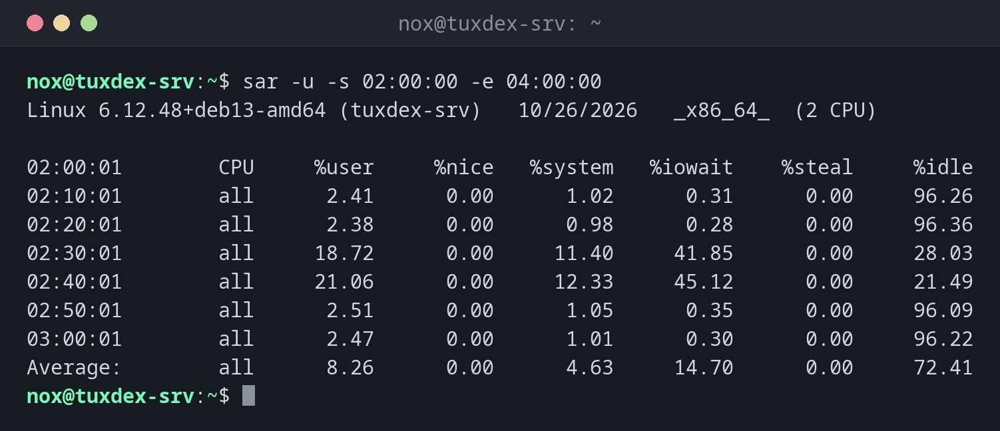

# sar

> Liest die Systemstatistik, die sysstat im Hintergrund sammelt, und zeigt CPU, Speicher, Platten und Netzwerk für jede Uhrzeit des Tages.



## Syntax

```bash
sar [-u | -r | -q | -d | -n DEV] [-f DATEI] [-s START] [-e ENDE] [INTERVALL [ANZAHL]]
```

## Optionen

| Option | Beschreibung |
|--------|--------------|
| `-u` | CPU-Auslastung (Standard) |
| `-r` | Speicherauslastung |
| `-S`, `-W` | Swap-Belegung, Auslagerungsaktivität |
| `-q` | Last und Warteschlange |
| `-d -p` | Plattenaktivität mit Gerätenamen |
| `-n DEV`, `-n TCP,ETCP` | Netzwerkverkehr pro Interface, TCP-Fehler |
| `-f /var/log/sysstat/saTT` | Einen älteren Tag lesen (`/var/log/sa/saTT` unter RHEL) |
| `-s HH:MM:SS -e HH:MM:SS` | Nur diesen Zeitraum |
| `INTERVALL ANZAHL` | Live messen, statt den Verlauf zu lesen |

## Beispiele

**CPU-Auslastung in der Nacht:**

```bash
sar -u -s 02:00:00 -e 04:00:00
```

```text
Linux 6.12.48+deb13-amd64 (tuxdex-srv)   10/26/2026   _x86_64_  (2 CPU)

02:00:01        CPU     %user     %nice   %system   %iowait    %steal     %idle
02:10:01        all      2.41      0.00      1.02      0.31      0.00     96.26
02:20:01        all      2.38      0.00      0.98      0.28      0.00     96.36
02:30:01        all     18.72      0.00     11.40     41.85      0.00     28.03
02:40:01        all     21.06      0.00     12.33     45.12      0.00     21.49
02:50:01        all      2.51      0.00      1.05      0.35      0.00     96.09
03:00:01        all      2.47      0.00      1.01      0.30      0.00     96.22
Average:        all      8.26      0.00      4.63     14.70      0.00     72.41
```

Zwischen 02:30 und 02:50 springt `%iowait` auf über 40 %. Das ist genau die Zeit des nächtlichen Backups im Cronjob.

**Speicherverbrauch von gestern:**

```bash
sar -r -f /var/log/sysstat/sa25 | tail -4
```

```text
21:50:01    kbmemfree   kbavail kbmemused  %memused kbbuffers  kbcached  kbcommit   %commit  kbactive   kbinact   kbdirty
22:00:01       841204   2691532   1103884     27.53    100412   1662308   2412908     47.83   1520764    887212       512
22:10:01       838576   2690112   1106292     27.59    100412   1663464   2412908     47.83   1521980    887640       388
Average:       852901   2702354   1094012     27.28    100368   1655782   2398110     47.54   1512240    884017       437
```

**Last und Warteschlange live:**

```bash
sar -q 1 3
```

```text
Linux 6.12.48+deb13-amd64 (tuxdex-srv)   10/26/2026   _x86_64_  (2 CPU)

10:42:17      runq-sz  plist-sz   ldavg-1   ldavg-5  ldavg-15   blocked
10:42:18            1       214      0.18      0.12      0.09         0
10:42:19            0       214      0.18      0.12      0.09         0
10:42:20            1       214      0.16      0.12      0.09         0
Average:            1       214      0.17      0.12      0.09         0
```

## Wann brauche ich das?

- Wenn der Server nachts langsam war und du wissen willst, warum
- Um Trends zu sehen, etwa ob der Speicherverbrauch jeden Tag wächst
- Um einen anstrengenden Tag mit einem normalen zu vergleichen

!!! tip "Das Sammeln einschalten"
    Ohne Sammeln im Hintergrund misst `sar` nur live. Unter Debian und Ubuntu setzt du
    `ENABLED="true"` in `/etc/default/sysstat`, unter RHEL und Arch
    `systemctl enable --now sysstat`. Die Daten werden standardmäßig 28 Tage aufbewahrt.

## Unterschiede zwischen Distributionen

| | Debian | Ubuntu | RHEL | Arch |
|---|--------|--------|------|------|
| Installation | `sudo apt install sysstat` | `sudo apt install sysstat` | `sudo dnf install sysstat` | `sudo pacman -S sysstat` |
| Datenverzeichnis | `/var/log/sysstat/` | `/var/log/sysstat/` | `/var/log/sa/` | `/var/log/sa/` |

## Verwandte Befehle

[vmstat](vmstat.md) · [iostat](iostat.md) · [crontab](../16-scheduling/crontab.md) · [uptime](../01-orientation/uptime.md)
