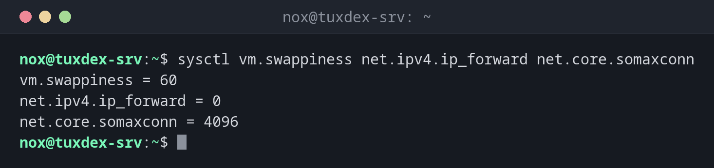

# sysctl

> Liest und ändert Kernel-Parameter im laufenden Betrieb, etwa IP-Forwarding, Swappiness oder Netzwerkpuffer.



## Syntax

```bash
sysctl [-a] [NAME...]
sysctl -w NAME=WERT
sysctl --system
```

## Optionen

| Option | Beschreibung |
|--------|--------------|
| `NAME` | Einen Parameter zeigen, etwa `vm.swappiness` |
| `-a` | Alle Parameter zeigen |
| `-w NAME=WERT` | Einen Parameter bis zum nächsten Neustart ändern |
| `--system` | Alle Dateien aus `/etc/sysctl.d/` und den anderen Konfigurationsverzeichnissen laden |
| `-p DATEI` | Eine einzelne Datei laden |

Parameter, die Admins oft anfassen:

| Parameter | Standard | Zweck |
|-----------|----------|-------|
| `net.ipv4.ip_forward` | `0` | `1` lässt den Server Pakete weiterleiten, für ein VPN-Gateway oder einen Router |
| `vm.swappiness` | `60` | Niedrigere Werte halten mehr im RAM, bevor ausgelagert wird |
| `fs.file-max` | sehr hoch | Maximal offene Dateien im ganzen System |
| `net.core.somaxconn` | `4096` | Maximale Warteschlange wartender Verbindungen pro Socket |
| `kernel.panic` | `0` | Sekunden bis zum automatischen Neustart nach einer Kernel-Panic |

## Beispiele

**Einige Parameter lesen:**

```bash
sysctl vm.swappiness net.ipv4.ip_forward net.core.somaxconn
```

```text
vm.swappiness = 60
net.ipv4.ip_forward = 0
net.core.somaxconn = 4096
```

**IP-Forwarding für ein VPN-Gateway dauerhaft einschalten:**

```bash
echo 'net.ipv4.ip_forward = 1' | sudo tee /etc/sysctl.d/90-tuxdex.conf
sudo sysctl --system | tail -3
```

```text
net.ipv4.ip_forward = 1
* Applying /etc/sysctl.d/90-tuxdex.conf ...
net.ipv4.ip_forward = 1
* Applying /etc/sysctl.conf ...
```

**Einen Wert nur für einen Test ändern:**

```bash
sudo sysctl -w vm.swappiness=10
```

```text
vm.swappiness = 10
```

**Alle Parameter durchsuchen:**

```bash
sudo sysctl -a 2>/dev/null | grep -E '^net.ipv4.tcp_(keepalive_time|fin_timeout|syncookies)'
```

```text
net.ipv4.tcp_fin_timeout = 60
net.ipv4.tcp_keepalive_time = 7200
net.ipv4.tcp_syncookies = 1
```

## Wann brauche ich das?

- Um einen Server zum VPN-Gateway oder Router zu machen (`ip_forward`)
- Um den Kernel an eine Last anzupassen, etwa eine Datenbank oder viele Verbindungen
- Um zu prüfen, was eine Härtungsanleitung oder ein Werkzeug geändert hat

!!! tip "Dauerhaft in /etc/sysctl.d/"
    Schreib eigene Einstellungen in eine Datei wie `/etc/sysctl.d/90-tuxdex.conf` und lade
    sie mit `sudo sysctl --system`. So ist klar, welche Werte du geändert hast, und sie
    überstehen den Neustart.

!!! warning "Immer nur eine Änderung"
    Kopierte Tuning-Blöcke mit Dutzenden Werten machen unmöglich zu erkennen, welcher
    geholfen oder geschadet hat. Ändere einen Parameter, miss, dann entscheide.

## Verwandte Befehle

[ulimit](ulimit.md) · [modprobe](modprobe.md) · [wg-quick](../26-wireguard/wg-quick.md)
