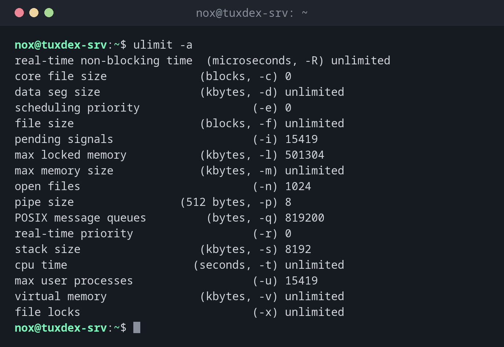

# ulimit

> Shows and sets the resource limits of the shell and the processes started from it, most importantly the number of open files.



## Syntax

```bash
ulimit [-a] [-H | -S] [-n | -u | -c | -v] [VALUE]
```

## Options

| Option | Description |
|--------|-------------|
| `-a` | Show all limits |
| `-n` | Maximum open files (file descriptors) |
| `-u` | Maximum processes of the user |
| `-c` | Maximum size of core dumps |
| `-S`, `-H` | Soft limit (current) or hard limit (upper bound for the soft limit) |
| `VALUE` | New value, such as `65535` or `unlimited` |

`ulimit` is a shell builtin and only applies to the current shell. Permanent limits for logins are in `/etc/security/limits.conf`, for services in the systemd unit (`LimitNOFILE=`).

## Examples

**All limits of the shell:**

```bash
ulimit -a
```

```text
real-time non-blocking time  (microseconds, -R) unlimited
core file size              (blocks, -c) 0
data seg size               (kbytes, -d) unlimited
scheduling priority                 (-e) 0
file size                   (blocks, -f) unlimited
pending signals                     (-i) 15419
max locked memory           (kbytes, -l) 501304
max memory size             (kbytes, -m) unlimited
open files                          (-n) 1024
pipe size                (512 bytes, -p) 8
POSIX message queues         (bytes, -q) 819200
real-time priority                  (-r) 0
stack size                  (kbytes, -s) 8192
cpu time                   (seconds, -t) unlimited
max user processes                  (-u) 15419
virtual memory              (kbytes, -v) unlimited
file locks                          (-x) unlimited
```

**The limit of a running service:**

```bash
grep 'open files' /proc/$(pidof -s nginx)/limits
```

```text
Max open files            1024                 524288               files
```

**Raise the limit for a service permanently:**

```bash
sudo mkdir -p /etc/systemd/system/nginx.service.d
printf '[Service]\nLimitNOFILE=65535\n' | sudo tee /etc/systemd/system/nginx.service.d/limits.conf
sudo systemctl daemon-reload && sudo systemctl restart nginx
grep 'open files' /proc/$(pidof -s nginx)/limits
```

```text
[Service]
LimitNOFILE=65535
Max open files            65535                65535                files
```

**Raise the soft limit in the current shell:**

```bash
ulimit -n 4096
ulimit -Sn; ulimit -Hn
```

```text
4096
524288
```

## When do I need it?

- When a service logs `Too many open files`
- To check the limits of a running process: `cat /proc/PID/limits`
- To allow core dumps for debugging a crashing program

!!! tip "Services: use systemd"
    Limits from `limits.conf` don't apply to systemd services. Set them in the unit, for
    example with `sudo systemctl edit nginx` and `[Service]` `LimitNOFILE=65535`, then
    restart the service.

## Related commands

[sysctl](sysctl.md) · [systemctl](../09-systemd/systemctl.md) · [lsof](../08-processes/lsof.md)
