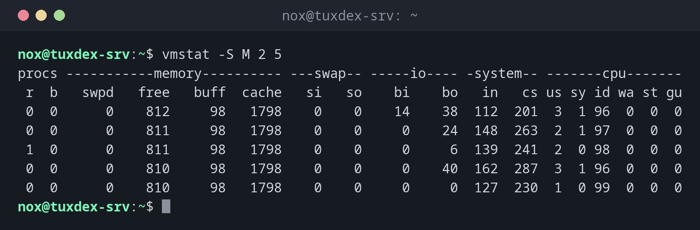

# vmstat

> Shows in one line per interval how busy CPU, memory, swap and disks are; the quickest overview when a server is slow.



## Syntax

```bash
vmstat [OPTIONS] [INTERVAL [COUNT]]
```

## Options

| Option | Description |
|--------|-------------|
| `INTERVAL` | Print a new line every N seconds |
| `COUNT` | Stop after N lines |
| `-w` | Wide output, columns don't run into each other |
| `-S M` | Show memory in MB instead of KB |
| `-s` | Memory and event counters as a list |
| `-d` | Statistics per disk |
| `-t` | Add a timestamp to every line |

The most important columns:

| Column | Meaning | Watch out when |
|--------|---------|----------------|
| `r` | Processes waiting for a CPU | permanently higher than the number of cores |
| `b` | Processes blocked, usually waiting for disk I/O | not 0 for a longer time |
| `si`, `so` | Swapped in and out per second | not 0: memory is short |
| `us`, `sy` | CPU time for programs and kernel | together near 100 |
| `wa` | CPU waits for I/O | above about 10: disk is the bottleneck |
| `st` | Time stolen by the hypervisor | not 0 on a VM: the host is overloaded |

## Examples

**Five measurements, every two seconds:**

```bash
vmstat -S M 2 5
```

```text
procs -----------memory---------- ---swap-- -----io---- -system-- -------cpu-------
 r  b   swpd   free   buff  cache   si   so    bi    bo   in   cs us sy id wa st gu
 0  0      0    812     98   1798    0    0    14    38  112  201  3  1 96  0  0  0
 0  0      0    811     98   1798    0    0     0    24  148  263  2  1 97  0  0  0
 1  0      0    811     98   1798    0    0     0     6  139  241  2  0 98  0  0  0
 0  0      0    810     98   1798    0    0     0    40  162  287  3  1 96  0  0  0
 0  0      0    810     98   1798    0    0     0     0  127  230  1  0 99  0  0  0
```

An idle server: `id` (idle) near 100, no swap activity, no waiting processes.

**A server that waits for the disk:**

```bash
vmstat -S M 2 3
```

```text
procs -----------memory---------- ---swap-- -----io---- -system-- -------cpu-------
 r  b   swpd   free   buff  cache   si   so    bi    bo   in   cs us sy id wa st gu
 1  3      0    205     98   2310    0    0  8420 21650 1890 2410  6  9 37 48  0  0
 0  4      0    198     98   2321    0    0  9104 23102 1977 2533  5 10 36 49  0  0
 1  3      0    201     98   2319    0    0  8833 22410 1920 2487  6  9 35 50  0  0
```

`b` is 3 to 4 and `wa` around 50 %: processes wait for the disk while the CPU has time. Next step: [`iostat -x`](iostat.md) and [`iotop`](iotop.md).

**Memory is short and the server swaps:**

```bash
vmstat -S M 2 3
```

```text
procs -----------memory---------- ---swap-- -----io---- -system-- -------cpu-------
 r  b   swpd   free   buff  cache   si   so    bi    bo   in   cs us sy id wa st gu
 3  1    612     54      4    121  310  498  1310  1902 1488 1720 41 12 22 25  0  0
 2  2    640     49      4    118  352  514  1402  2011 1530 1798 39 14 21 26  0  0
 4  1    671     51      3    115  288  476  1250  1876 1501 1755 43 12 20 25  0  0
```

`si` and `so` are permanently above zero: the server constantly moves memory to disk and back. Find the process that needs so much memory, see [`top`](../08-processes/top.md).

## When do I need it?

- As the first command when a server is slow: CPU, memory or disk?
- To watch a load test or a backup run live
- To find out whether a VM suffers from an overloaded host (`st`)

!!! tip "Ignore the first line"
    The first line shows averages since the boot, not the current state. Look at the
    following lines, such as with `vmstat 2 5`.

## Related commands

[iostat](iostat.md) · [sar](sar.md) · [top](../08-processes/top.md) · [free](../08-processes/free.md)
