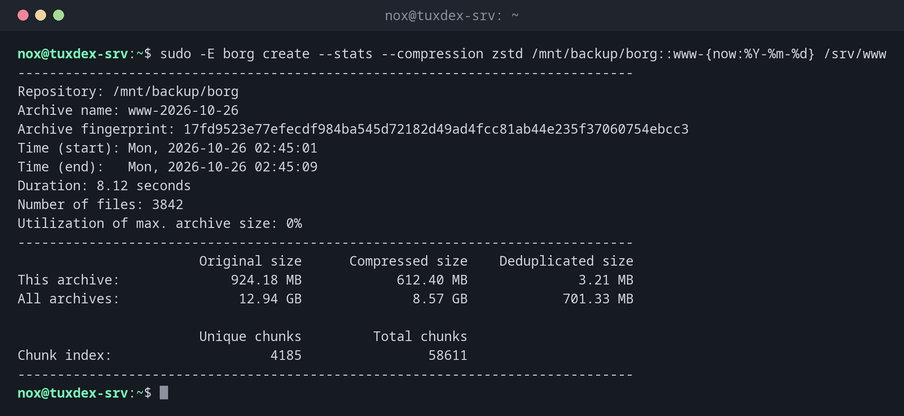

# borg

> BorgBackup: deduplicated, compressed and encrypted backups into archives, locally or on another server via SSH.



## Syntax

```bash
borg COMMAND [OPTIONS] REPOSITORY[::ARCHIVE] [PATH...]
```

## Options

| Option | Description |
|--------|-------------|
| `init --encryption=repokey REPO` | Create a repository; the key is stored in it, protected by the passphrase |
| `create REPO::NAME PATH...` | Create an archive, such as `::www-{now:%Y-%m-%d}` |
| `--stats`, `--compression zstd` | With `create`: show statistics, compress with zstd |
| `list REPO[::ARCHIVE]` | List the archives, or the files in an archive |
| `extract REPO::ARCHIVE [PATH]` | Restore into the current directory |
| `prune --keep-daily 7 ...` | Delete old archives by a retention policy; `compact` frees the space |
| `check REPO` | Verify the repository |
| `key export REPO FILE` | Export the key, for safekeeping outside the server |
| `mount REPO DIR` | Mount archives as a file system |

Remote repositories look like `ssh://backup@backup.example.com/./borg`; the target needs `borg` too. The passphrase comes from `BORG_PASSPHRASE` or `BORG_PASSCOMMAND`.

## Examples

**Create an archive with statistics:**

```bash
sudo -E borg create --stats --compression zstd /mnt/backup/borg::www-{now:%Y-%m-%d} /srv/www
```

```text
------------------------------------------------------------------------------
Repository: /mnt/backup/borg
Archive name: www-2026-10-26
Archive fingerprint: 17fd9523e77efecdf984ba545d72182d49ad4fcc81ab44e235f37060754ebcc3
Time (start): Mon, 2026-10-26 02:45:01
Time (end):   Mon, 2026-10-26 02:45:09
Duration: 8.12 seconds
Number of files: 3842
Utilization of max. archive size: 0%
------------------------------------------------------------------------------
                       Original size      Compressed size    Deduplicated size
This archive:              924.18 MB            612.40 MB              3.21 MB
All archives:               12.94 GB              8.57 GB            701.33 MB

                       Unique chunks         Total chunks
Chunk index:                    4185                58611
------------------------------------------------------------------------------
```

`Deduplicated size` is what this archive really adds: 3.21 MB of 924 MB. All 14 archives together only take 701 MB.

**Create a repository:**

```bash
export BORG_PASSCOMMAND='cat /root/.borg-pass'
sudo -E borg init --encryption=repokey /mnt/backup/borg
```

```text
IMPORTANT: you will need both KEY AND PASSPHRASE to access this repo!

Key storage location depends on the mode:
- repokey modes: key is stored in the repository directory.
- keyfile modes: key is stored in the home directory of this user.

For any mode, you should:
1. Export the borg key and store the result at a safe place:
   borg key export           REPOSITORY encrypted-key-backup
   borg key export --paper   REPOSITORY encrypted-key-backup.txt
   borg key export --qr-html REPOSITORY encrypted-key-backup.html
2. Write down the borg key passphrase and store it at safe place.
```

**List the archives and restore a file:**

```bash
sudo -E borg list /mnt/backup/borg | tail -2
cd /tmp && sudo -E borg extract /mnt/backup/borg::www-2026-10-26 srv/www/index.html
cat /tmp/srv/www/index.html
```

```text
www-2026-10-25                       Sun, 2026-10-25 02:45:02 [b4e1c09d7a35f2e8c6d0a9b1f3e5c7a2d4b6e8f0a1c3e5d7b9f1a3c5e7d9b1f3]
www-2026-10-26                       Mon, 2026-10-26 02:45:01 [17fd9523e77efecdf984ba545d72182d49ad4fcc81ab44e235f37060754ebcc3]
<h1>tuxdex-srv: all systems operational</h1>
```

**Delete old archives:**

```bash
sudo -E borg prune --list --keep-daily 7 --keep-weekly 4 /mnt/backup/borg | tail -3
sudo -E borg compact /mnt/backup/borg
```

```text
Keeping archive (rule: daily #1):            www-2026-10-26                       Mon, 2026-10-26 02:45:01 [17fd9523e77efecdf984ba545d72182d49ad4fcc81ab44e235f37060754ebcc3]
Keeping archive (rule: daily #2):            www-2026-10-25                       Sun, 2026-10-25 02:45:02 [b4e1c09d7a35f2e8c6d0a9b1f3e5c7a2d4b6e8f0a1c3e5d7b9f1a3c5e7d9b1f3]
Pruning archive (1/1):                       www-2026-10-12                       Mon, 2026-10-12 02:45:01 [6a2c8e0f4b1d3e5a7c9e1f3a5b7d9e1c3a5f7b9d1e3c5a7f9b1d3e5c7a9b1d3e]
```

## When do I need it?

- For backups to an own backup server or a storage box over SSH
- When compression matters, for example for many text files and logs
- To mount an old archive and browse it like a directory

!!! tip "Restrict the SSH key"
    On the backup server, `command="borg serve --restrict-to-path /srv/borg --append-only"`
    in front of the key in `authorized_keys` allows only borg and only adding data. A hacked
    server then can't delete its backups.

!!! danger "Export the key"
    With `repokey`, the key is inside the repository. If the repository is damaged or you
    lose the passphrase, everything is lost. Run `borg key export` and keep the file and the
    passphrase in a safe place.

## Distribution differences

| | Debian | Ubuntu | RHEL | Arch |
|---|--------|--------|------|------|
| Install | `sudo apt install borgbackup` | `sudo apt install borgbackup` | `sudo dnf install borgbackup` (EPEL) | `sudo pacman -S borg` |

## Related commands

[restic](restic.md) · [mysqldump](mysqldump.md) · [ssh-keygen](../12-ssh/ssh-keygen.md) · [tar](../14-archives/tar.md)
