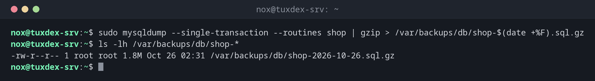

# mysqldump

> Writes a backup of MySQL and MariaDB databases as SQL; on MariaDB the same tool is also called mariadb-dump.



## Syntax

```bash
mysqldump [OPTIONS] DATABASE [TABLE...]
mysqldump [OPTIONS] --all-databases
```

## Options

| Option | Description |
|--------|-------------|
| `--single-transaction` | Consistent dump of InnoDB tables without locking them |
| `--all-databases` | All databases, including the user tables in `mysql` |
| `--routines`, `--events`, `--triggers` | Also stored procedures, scheduled events and triggers |
| `--no-data` | Only the table structure |
| `-u USER`, `-p`, `-h HOST` | Connection; better put credentials in `~/.my.cnf` |
| `--result-file=FILE` | Write to a file |

Restore with `mysql DATABASE < dump.sql` (on MariaDB also `mariadb`).

## Examples

**Dump one database, compressed:**

```bash
sudo mysqldump --single-transaction --routines shop | gzip > /var/backups/db/shop-$(date +%F).sql.gz
ls -lh /var/backups/db/shop-*
```

```text
-rw-r--r-- 1 root root 1.8M Oct 26 02:31 /var/backups/db/shop-2026-10-26.sql.gz
```

**The beginning of a dump:**

```bash
zcat /var/backups/db/shop-2026-10-26.sql.gz | head -6
```

```text
/*M!999999\- enable the sandbox mode */
-- MariaDB dump 10.19-11.8.3-MariaDB, for debian-linux-gnu (x86_64)
--
-- Host: localhost    Database: shop
-- ------------------------------------------------------
-- Server version  11.8.3-MariaDB-0+deb13u1 from Debian
```

**All databases with users and routines:**

```bash
sudo mysqldump --all-databases --single-transaction --routines --events | gzip > /var/backups/db/all-$(date +%F).sql.gz
ls -lh /var/backups/db/all-*
```

```text
-rw-r--r-- 1 root root 2.4M Oct 26 02:32 /var/backups/db/all-2026-10-26.sql.gz
```

**Restore into a test database:**

```bash
sudo mysql -e 'CREATE DATABASE shop_test'
zcat /var/backups/db/shop-2026-10-26.sql.gz | sudo mysql shop_test
sudo mysql -e 'SELECT count(*) FROM shop_test.orders'
```

```text
count(*)
2
```

## When do I need it?

- Every night before the file backup, so the dump is part of it
- Before updates of the database server or a web application such as WordPress or Nextcloud
- To move a database to another server

!!! tip "No password on the command line"
    With `-pSECRET`, the password shows up in `ps` and the shell history. Put it into
    `/root/.my.cnf` with mode `600` (`[client]`, `user=`, `password=`), then `mysqldump` and
    `mysql` need no options.

!!! warning "Without --single-transaction"
    Without this option, a dump of a busy database can contain tables from different points
    in time, or lock them for the duration of the dump. For InnoDB, always use
    `--single-transaction`.

## Distribution differences

| | Debian | Ubuntu | RHEL | Arch |
|---|--------|--------|------|------|
| Database server | MariaDB | MySQL or MariaDB | MySQL or MariaDB | MariaDB |
| Package with the tool | `mariadb-client` | `mysql-client` or `mariadb-client` | `mysql` or `mariadb` | `mariadb-clients` |

## Related commands

[pg_dump](pg_dump.md) · [borg](borg.md) · [gzip](../14-archives/gzip.md) · [crontab](../16-scheduling/crontab.md)
