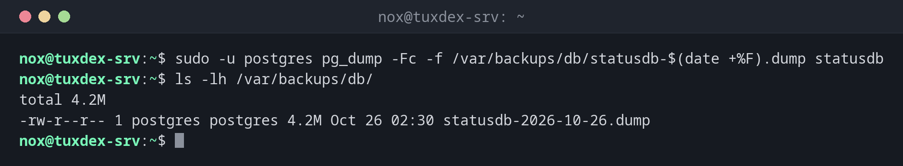

# pg_dump

> Schreibt ein konsistentes Backup einer PostgreSQL-Datenbank, während sie weiterläuft, als SQL oder in einem komprimierten Archivformat.



## Syntax

```bash
pg_dump [OPTIONEN] DATENBANK
pg_restore [OPTIONEN] -d DATENBANK DATEI
```

## Optionen

| Option | Beschreibung |
|--------|--------------|
| `-Fc` | Custom-Format: komprimiert, mit `pg_restore` gezielt zurückspielbar |
| `-f DATEI` | In eine Datei statt auf die Standardausgabe schreiben |
| `-t TABELLE` | Nur diese Tabelle |
| `--schema-only`, `--data-only` | Nur die Struktur oder nur die Daten |
| `-U BENUTZER`, `-h HOST` | Als anderer Benutzer, mit einem anderen Server verbinden |
| `pg_dumpall --globals-only` | Rollen und Tablespaces, die `pg_dump` nicht enthält |
| `pg_restore -d DB DATEI` | Einen Dump im Custom-Format zurückspielen; `-l` listet den Inhalt |

## Beispiele

**Eine Datenbank im Custom-Format sichern:**

```bash
sudo -u postgres pg_dump -Fc -f /var/backups/db/statusdb-$(date +%F).dump statusdb
ls -lh /var/backups/db/
```

```text
total 4.2M
-rw-r--r-- 1 postgres postgres 4.2M Oct 26 02:30 statusdb-2026-10-26.dump
```

**Was im Dump steckt:**

```bash
pg_restore -l /var/backups/db/statusdb-2026-10-26.dump | head -12
```

```text
;
; Archive created at 2026-10-26 02:30:01 CET
;     dbname: statusdb
;     TOC Entries: 11
;     Compression: gzip
;     Dump Version: 1.16-0
;     Format: CUSTOM
;     Integer: 4 bytes
;     Offset: 8 bytes
;     Dumped from database version: 17.6 (Debian 17.6-0+deb13u1)
;     Dumped by pg_dump version: 17.6 (Debian 17.6-0+deb13u1)
;
```

**In eine Testdatenbank zurückspielen:**

```bash
sudo -u postgres createdb statusdb_test
sudo -u postgres pg_restore -d statusdb_test /var/backups/db/statusdb-2026-10-26.dump
sudo -u postgres psql -tA statusdb_test -c 'SELECT count(*) FROM checks'
```

```text
5000
```

Der Wiederherstellungstest: Die Zahl der Zeilen stimmt mit der Produktionsdatenbank überein.

**Auch die Rollen sichern:**

```bash
sudo -u postgres pg_dumpall --globals-only > /var/backups/db/globals.sql
grep -c 'CREATE ROLE' /var/backups/db/globals.sql
```

```text
3
```

## Wann brauche ich das?

- Jede Nacht vor dem Datei-Backup, damit der Dump darin enthalten ist
- Vor einem Upgrade von PostgreSQL oder der Anwendung
- Um eine Datenbank auf ein Test- oder Staging-System zu kopieren

!!! tip "Custom-Format für Backups"
    `-Fc` ist komprimiert, und `pg_restore` kann daraus einzelne Tabellen oder nur das Schema
    zurückspielen. Ein reiner SQL-Dump (`.sql`) ist lesbarer, lässt sich aber nur vollständig
    zurückspielen.

!!! warning "Rollen sind nicht im Dump"
    `pg_dump` enthält eine Datenbank, nicht die Benutzer und ihre Passwörter. Sichere sie
    zusätzlich mit `pg_dumpall --globals-only`, sonst scheitert die Wiederherstellung an
    fehlenden Rollen.

## Unterschiede zwischen Distributionen

| | Debian | Ubuntu | RHEL | Arch |
|---|--------|--------|------|------|
| Paket | `postgresql-client` | `postgresql-client` | `postgresql` | `postgresql` |

## Verwandte Befehle

[mysqldump](mysqldump.md) · [restic](restic.md) · [docker exec](../19-docker/docker-exec.md) · [crontab](../16-scheduling/crontab.md)
