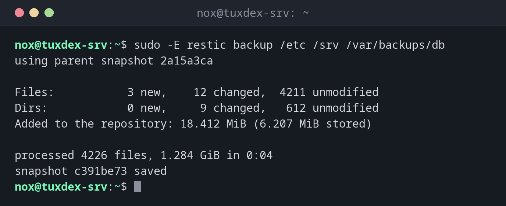

# restic

> Fast, encrypted and deduplicated backups to a local disk, another server or cloud storage.



## Syntax

```bash
restic -r REPOSITORY COMMAND [OPTIONS]
```

## Options

| Option | Description |
|--------|-------------|
| `init` | Create a new repository |
| `backup PATH...` | Back up; only changed data is stored again |
| `--exclude PATTERN`, `--exclude-file FILE` | With `backup`: leave out files |
| `snapshots` | List the backups |
| `restore ID --target DIR` | Restore a snapshot; `latest` for the newest, `--include` for single files |
| `ls`, `diff`, `find` | Look into snapshots, compare them, search files |
| `forget --keep-daily 7 ... --prune` | Delete old snapshots by a retention policy and free the space |
| `check` | Verify the repository; `--read-data-subset 10%` also reads data |
| `mount DIR` | Mount all snapshots as a file system for browsing |

Repository and password usually come from environment variables: `RESTIC_REPOSITORY` and `RESTIC_PASSWORD_FILE`. Repository addresses look like `/mnt/backup/restic`, `sftp:backup@backup.example.com:/srv/restic` or `s3:https://s3.example.com/bucket`.

## Examples

**Back up for the second time, only changes are stored:**

```bash
sudo -E restic backup /etc /srv /var/backups/db
```

```text
using parent snapshot 2a15a3ca

Files:           3 new,    12 changed,  4211 unmodified
Dirs:            0 new,     9 changed,   612 unmodified
Added to the repository: 18.412 MiB (6.207 MiB stored)

processed 4226 files, 1.284 GiB in 0:04
snapshot c391be73 saved
```

Of 1.28 GiB, only 6 MiB had to be stored: the rest was already in the repository.

**Create a repository:**

```bash
export RESTIC_REPOSITORY=/mnt/backup/restic RESTIC_PASSWORD_FILE=/root/.restic-pass
sudo -E restic init
```

```text
created restic repository d97428fbea at /mnt/backup/restic

Please note that knowledge of your password is required to access
the repository. Losing your password means that your data is
irrecoverably lost.
```

**List the snapshots:**

```bash
sudo -E restic snapshots
```

```text
ID        Time                 Host        Tags        Paths               Size
------------------------------------------------------------------------------------
2a15a3ca  2026-10-25 02:40:01  tuxdex-srv              /etc                1.281 GiB
                                                       /srv
                                                       /var/backups/db

c391be73  2026-10-26 02:40:02  tuxdex-srv              /etc                1.284 GiB
                                                       /srv
                                                       /var/backups/db
------------------------------------------------------------------------------------
2 snapshots
```

**What changed between two snapshots:**

```bash
sudo -E restic diff 2a15a3ca c391be73 | head -6
```

```text
comparing snapshot 2a15a3ca to c391be73:

M    /etc/nginx/conf.d/status.conf
M    /srv/www/index.html
+    /srv/www/img/new.jpg
+    /var/backups/db/statusdb-2026-10-26.dump
```

**Restore a single file:**

```bash
sudo -E restic restore latest --target /tmp/restore --include /etc/nginx/conf.d/status.conf
```

```text
restoring snapshot c391be73 of [/etc /srv /var/backups/db] at 2026-10-26 02:40:02.001926226 +0100 CET by root@tuxdex-srv to /tmp/restore
Summary: Restored 5 / 1 files/dirs (412 B / 412 B) in 0:00
```

The file ends up under `/tmp/restore/etc/nginx/conf.d/status.conf`, the original stays untouched. Compare first, then copy it back.

**Delete old snapshots and check the repository:**

```bash
sudo -E restic forget --keep-daily 7 --keep-weekly 4 --keep-monthly 6 --prune | tail -3
sudo -E restic check | tail -2
```

```text
this removes 3 snapshots and 0 B of data
[0:00] 100.00%  3 / 3 files deleted
done
[0:00] 100.00%  9 / 9 snapshots
no errors were found
```

## When do I need it?

- For the daily backup of `/etc`, `/srv` and the database dumps
- To keep a copy offsite, for example in S3-compatible storage
- To restore a single file from last Tuesday in seconds

!!! tip "Password from a file"
    Put the password in `/root/.restic-pass` with mode `600` and set
    `RESTIC_PASSWORD_FILE=/root/.restic-pass`. Then cron jobs and timers don't need the
    password on the command line.

!!! warning "forget without --prune frees nothing"
    `restic forget` only removes the snapshot entries. The data is only deleted with
    `--prune` or a later `restic prune`.

## Distribution differences

| | Debian | Ubuntu | RHEL | Arch |
|---|--------|--------|------|------|
| Install | `sudo apt install restic` | `sudo apt install restic` | `sudo dnf install restic` (EPEL) | `sudo pacman -S restic` |

## Related commands

[borg](borg.md) · [pg_dump](pg_dump.md) · [rsync](../12-ssh/rsync.md) · [crontab](../16-scheduling/crontab.md)
