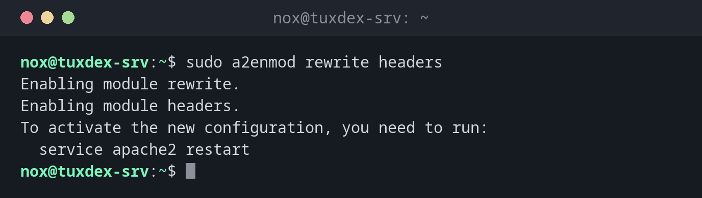

# a2enmod

> Unter Debian und Ubuntu: aktiviert und deaktiviert Apache-Module, samt der Module, von denen sie abhängen.



## Syntax

```bash
a2enmod MODUL...
a2dismod MODUL...
a2query -m [MODUL]
```

## Optionen

| Option | Beschreibung |
|--------|--------------|
| `a2enmod MODUL` | Ein Modul aktivieren, etwa `rewrite`, `headers` oder `ssl` |
| `a2dismod MODUL` | Ein Modul deaktivieren |
| `a2query -m` | Die aktiven Module auflisten oder eines prüfen |
| `-q`, `--quiet` | Keine Hinweise |

Module brauchen einen Neustart, nicht nur ein Neuladen: `sudo systemctl restart apache2`.

## Beispiele

**Zwei Module aktivieren:**

```bash
sudo a2enmod rewrite headers
```

```text
Enabling module rewrite.
Enabling module headers.
To activate the new configuration, you need to run:
  service apache2 restart
```

**Ein Modul mit Abhängigkeiten:**

```bash
sudo a2enmod ssl
```

```text
Considering dependency mime for ssl:
Module mime already enabled
Considering dependency socache_shmcb for ssl:
Enabling module socache_shmcb.
Enabling module ssl.
See /usr/share/doc/apache2/README.Debian.gz on how to configure SSL and create self-signed certificates.
To activate the new configuration, you need to run:
  service apache2 restart
```

**Ein Modul abschalten:**

```bash
sudo a2dismod status
sudo systemctl restart apache2
```

```text
Module status disabled.
To activate the new configuration, you need to run:
  service apache2 restart
```

**Prüfen, ob ein Modul aktiv ist:**

```bash
a2query -m rewrite
```

```text
rewrite (enabled by site administrator)
```

## Wann brauche ich das?

- Für `.htaccess`-Regeln mit `RewriteRule` (`rewrite`)
- Für HTTPS (`ssl`) oder Sicherheits-Header (`headers`)
- Um nicht benötigte Module abzuschalten, das verkleinert die Angriffsfläche

!!! tip "Module unter RHEL"
    Unter RHEL laden Dateien in `/etc/httpd/conf.modules.d/` die Module. `ssl` kommt mit dem
    Paket `mod_ssl`: `sudo dnf install mod_ssl`.

!!! warning "mod_status zeigt Interna"
    `/server-status` verrät laufende Anfragen samt Client-Adressen und URLs. Wenn du es
    brauchst, erlaube es nur von localhost oder deinem Admin-Netz.

## Unterschiede zwischen Distributionen

| | Debian | Ubuntu | RHEL | Arch |
|---|--------|--------|------|------|
| Vorhanden | ja (`apache2`) | ja (`apache2`) | nein: Dateien nach `/etc/httpd/conf.d/` legen | nein: `Include`-Zeilen in `httpd.conf` |

## Verwandte Befehle

[a2ensite](a2ensite.md) · [apachectl](apachectl.md) · [certbot](../24-certificates/certbot.md)
