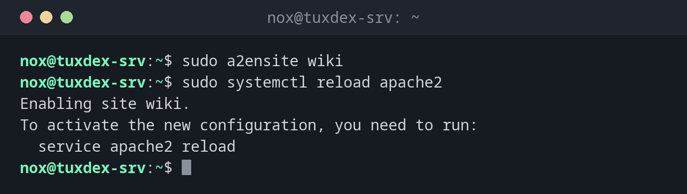

# a2ensite

> On Debian and Ubuntu: enables and disables Apache sites by linking them from sites-available to sites-enabled.



## Syntax

```bash
a2ensite SITE...
a2dissite SITE...
a2query -s
```

## Options

| Option | Description |
|--------|-------------|
| `a2ensite SITE` | Enable a site (file `sites-available/SITE.conf`) |
| `a2dissite SITE` | Disable a site |
| `a2query -s` | List the enabled sites |
| `-q`, `--quiet` | No hints |
| `a2enconf`, `a2disconf` | The same for snippets in `conf-available/` |

After enabling or disabling, reload Apache: `sudo systemctl reload apache2`.

## Examples

**Enable a site and reload:**

```bash
sudo a2ensite wiki
sudo systemctl reload apache2
```

```text
Enabling site wiki.
To activate the new configuration, you need to run:
  service apache2 reload
```

**Disable the default page:**

```bash
sudo a2dissite 000-default
```

```text
Site 000-default disabled.
To activate the new configuration, you need to run:
  service apache2 reload
```

**List the enabled sites:**

```bash
a2query -s
```

```text
wiki (enabled by site administrator)
```

**Enabling twice does no harm:**

```bash
sudo a2ensite wiki
```

```text
Site wiki already enabled
```

## When do I need it?

- To put a new website online
- To take a site offline without deleting its configuration
- To disable the default page `000-default` on a production server

!!! tip "nginx has no a2ensite"
    With nginx on Debian, a symbolic link does the same job:
    `sudo ln -s /etc/nginx/sites-available/status /etc/nginx/sites-enabled/`, and `rm` of
    the link disables the site.

## Distribution differences

| | Debian | Ubuntu | RHEL | Arch |
|---|--------|--------|------|------|
| Available | yes (`apache2`) | yes (`apache2`) | no: put files into `/etc/httpd/conf.d/` | no: `Include` lines in `httpd.conf` |

## Related commands

[a2enmod](a2enmod.md) · [apachectl](apachectl.md) · [ln](../03-files/ln.md)
