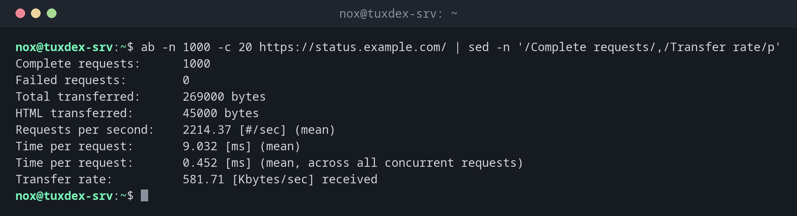

# ab

> ApacheBench: schickt viele HTTP-Anfragen an eine URL und misst, wie viele der Server pro Sekunde beantwortet und wie schnell.



## Syntax

```bash
ab -n ANFRAGEN -c GLEICHZEITIG [OPTIONEN] URL
```

## Optionen

| Option | Beschreibung |
|--------|--------------|
| `-n N` | Gesamtzahl der Anfragen |
| `-c N` | Gleichzeitige Anfragen |
| `-k` | Verbindungen offen halten (Keep-Alive) |
| `-H 'Header: Wert'` | Zusätzlicher Header, etwa `Host:` oder ein Cookie |
| `-A benutzer:passwort` | Basic-Authentifizierung |
| `-t SEKUNDEN` | Nach dieser Zeit aufhören |

Die URL braucht einen Pfad, mindestens `/`: `http://status.example.com/`.

## Beispiele

**1000 Anfragen, 20 gleichzeitig:**

```bash
ab -n 1000 -c 20 https://status.example.com/ | sed -n '/Complete requests/,/Transfer rate/p'
```

```text
Complete requests:      1000
Failed requests:        0
Total transferred:      269000 bytes
HTML transferred:       45000 bytes
Requests per second:    2214.37 [#/sec] (mean)
Time per request:       9.032 [ms] (mean)
Time per request:       0.452 [ms] (mean, across all concurrent requests)
Transfer rate:          581.71 [Kbytes/sec] received
```

`Requests per second` ist der Durchsatz, `Time per request` die Zeit, die ein einzelner Client im Schnitt wartet.

**Die Verteilung der Antwortzeiten:**

```bash
ab -n 1000 -c 20 https://status.example.com/ | sed -n '/Percentage/,$p'
```

```text
Percentage of the requests served within a certain time (ms)
  50%      8
  66%      9
  75%     10
  80%     10
  90%     12
  95%     14
  98%     17
  99%     21
 100%     38 (longest request)
```

Die Hälfte der Anfragen brauchte bis zu 8 ms, 99 % bis zu 21 ms. Ein großer Abstand zwischen 99 % und 100 % deutet auf gelegentliche Hänger hin.

**Eine geschützte Seite mit Keep-Alive testen:**

```bash
ab -k -n 500 -c 10 -A nox:S3cret https://status.example.com/admin/ | grep -E 'Failed|Non-2xx|per second'
```

```text
Failed requests:        0
Requests per second:    3891.06 [#/sec] (mean)
```

## Wann brauche ich das?

- Um die Geschwindigkeit vor und nach einer Konfigurationsänderung zu vergleichen, etwa beim Caching
- Um herauszufinden, wie viele Anfragen der Server schafft, bevor er langsam wird
- Um Last zu erzeugen, während du `vmstat`, `top` oder die Logs beobachtest

!!! tip "Von einem anderen Rechner testen"
    Starte `ab` von einem zweiten Server. Auf dem Server selbst konkurriert `ab` mit dem
    Webserver um die CPU, und das Ergebnis sieht schlechter aus, als es ist.

!!! danger "Nur gegen eigene Server"
    Ein Lasttest gegen fremde Server ist ein Denial-of-Service-Angriff. Auch auf dem eigenen
    Produktionsserver: Teste außerhalb der Stoßzeiten, die Besucher merken es.

## Unterschiede zwischen Distributionen

| | Debian | Ubuntu | RHEL | Arch |
|---|--------|--------|------|------|
| Paket | `apache2-utils` | `apache2-utils` | `httpd-tools` | `apache` |

## Verwandte Befehle

[htpasswd](htpasswd.md) · [vmstat](../27-performance/vmstat.md) · [curl](../11-network/curl.md)
