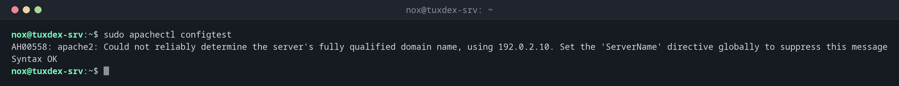

# apachectl

> Steuert den Webserver Apache: die Konfiguration testen, schonend neu laden und Virtual Hosts und Module anzeigen.



## Syntax

```bash
apachectl configtest | graceful | restart | -S | -M | -v
```

## Optionen

| Option | Beschreibung |
|--------|--------------|
| `configtest`, `-t` | Die Konfiguration testen |
| `graceful` | Neu laden: Laufende Anfragen werden erst zu Ende bearbeitet |
| `restart` | Sofort neu starten |
| `-S` | Alle Virtual Hosts mit Datei und Zeile zeigen |
| `-M` | Die geladenen Module auflisten |
| `-v`, `-V` | Version oder Version mit Build-Einstellungen |

Unter Debian und Ubuntu heißt das Programm `apache2` bzw. `apache2ctl`; `apachectl` gibt es dort ebenfalls. Unter RHEL und Arch heißt es `httpd`.

## Beispiele

**Die Konfiguration testen:**

```bash
sudo apachectl configtest
```

```text
AH00558: apache2: Could not reliably determine the server's fully qualified domain name, using 192.0.2.10. Set the 'ServerName' directive globally to suppress this message
Syntax OK
```

**Alle Virtual Hosts auf einen Blick:**

```bash
sudo apachectl -S 2>/dev/null | head -5
```

```text
VirtualHost configuration:
*:80                   is a NameVirtualHost
         default server 192.0.2.10 (/etc/apache2/sites-enabled/000-default.conf:1)
         port 80 namevhost 192.0.2.10 (/etc/apache2/sites-enabled/000-default.conf:1)
         port 80 namevhost wiki.example.com (/etc/apache2/sites-enabled/wiki.conf:1)
```

**Ein Fehler in einem Virtual Host:**

```bash
sudo apachectl configtest
```

```text
AH00526: Syntax error on line 10 of /etc/apache2/sites-enabled/wiki.conf:
DocumentRoot takes one argument, Root directory of the document tree
```

**Nach einem Test schonend neu laden:**

```bash
sudo apachectl configtest 2>/dev/null && sudo apachectl graceful 2>/dev/null
systemctl is-active apache2
```

```text
Syntax OK
active
```

**Prüfen, ob Module geladen sind:**

```bash
sudo apachectl -M 2>/dev/null | grep -E 'rewrite|ssl'
```

```text
 rewrite_module (shared)
 ssl_module (shared)
```

## Wann brauche ich das?

- Nach jeder Änderung an einem Virtual Host, vor dem Neuladen
- Um herauszufinden, welcher Virtual Host für eine Domain antwortet (`-S`)
- Um zu prüfen, ob ein Modul wie `rewrite` oder `ssl` geladen ist (`-M`)

!!! tip "AH00558 abstellen"
    Die Warnung `Could not reliably determine the server's fully qualified domain name` ist
    harmlos. `ServerName tuxdex-srv.example.com` in
    `/etc/apache2/conf-available/servername.conf` plus `a2enconf servername` stellt sie ab.

!!! warning "Der erste Virtual Host ist der Standard"
    Anfragen für unbekannte Namen landen beim ersten Virtual Host eines Ports. `apachectl -S`
    zeigt ihn als `default server`. Sorg dafür, dass das eine harmlose Seite ist, keine
    Anwendung.

## Unterschiede zwischen Distributionen

| | Debian | Ubuntu | RHEL | Arch |
|---|--------|--------|------|------|
| Paket | `apache2` | `apache2` | `httpd` | `apache` |
| Dienst | `apache2` | `apache2` | `httpd` | `httpd` |
| Konfiguration | `/etc/apache2/` | `/etc/apache2/` | `/etc/httpd/` | `/etc/httpd/` |

## Verwandte Befehle

[a2ensite](a2ensite.md) · [a2enmod](a2enmod.md) · [nginx](nginx.md) · [systemctl](../09-systemd/systemctl.md)
