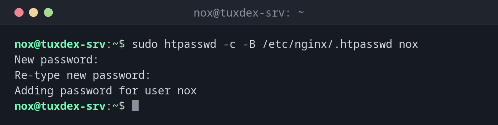

# htpasswd

> Legt Passwortdateien für HTTP-Basic-Authentifizierung an und verwaltet sie, nutzbar mit Apache und nginx.



## Syntax

```bash
htpasswd [-c] [-B] DATEI BENUTZER
htpasswd -b [-B] DATEI BENUTZER PASSWORT
htpasswd -D DATEI BENUTZER
```

## Optionen

| Option | Beschreibung |
|--------|--------------|
| `-c` | Eine neue Datei anlegen (überschreibt eine vorhandene) |
| `-B` | Mit bcrypt hashen, das empfohlene Verfahren |
| `-b` | Das Passwort von der Kommandozeile nehmen (landet in der History) |
| `-D` | Einen Benutzer löschen |
| `-v` | Das Passwort eines Benutzers prüfen |
| `-n` | Nur die Zeile ausgeben, keine Datei schreiben |

In nginx: `auth_basic "Admin";` und `auth_basic_user_file /etc/nginx/.htpasswd;`. In Apache: `AuthType Basic`, `AuthUserFile`, `Require valid-user`.

## Beispiele

**Eine Datei mit dem ersten Benutzer anlegen:**

```bash
sudo htpasswd -c -B /etc/nginx/.htpasswd nox
```

```text
New password:
Re-type new password:
Adding password for user nox
```

**Einen weiteren Benutzer hinzufügen:**

```bash
sudo htpasswd -B /etc/nginx/.htpasswd alice
sudo cat /etc/nginx/.htpasswd
```

```text
New password:
Re-type new password:
Adding password for user alice
nox:$2y$05$XUiYJ9pcm/KX9Q/mV5xd8.ef6LX8VwI39TOUHx50L5oSU59D7hAR2
alice:$2y$05$s8m.gZ5e39bisfQdxXMCk..ZZ2V5XMnulORhPTTog3rOF.hkpDXKO
```

**Den Schutz prüfen:**

```bash
curl -s -o /dev/null -w '%{http_code}\n' https://status.example.com/admin/
curl -s -o /dev/null -w '%{http_code}\n' -u nox https://status.example.com/admin/
```

```text
401
Enter host password for user 'nox':
200
```

**Einen Benutzer entfernen:**

```bash
sudo htpasswd -D /etc/nginx/.htpasswd alice
```

```text
Deleting password for user alice
```

## Wann brauche ich das?

- Um schnell einen Admin-Bereich, eine Staging-Seite oder eine Monitoring-Seite zu schützen
- Um wenigen Personen Zugang zu geben, ohne vollständige Benutzerverwaltung
- Um einen Reverse Proxy vor einem Werkzeug ohne eigene Anmeldung zu schützen

!!! tip "Nur über HTTPS"
    Basic-Authentifizierung schickt das Passwort mit jeder Anfrage mit, nur base64-kodiert.
    Nutze sie nur auf Seiten, die per HTTPS ausgeliefert werden.

!!! warning "-c überschreibt"
    `htpasswd -c` legt die Datei neu an, alle anderen Benutzer sind weg. Nimm `-c` nur für den
    ersten Benutzer.

## Unterschiede zwischen Distributionen

| | Debian | Ubuntu | RHEL | Arch |
|---|--------|--------|------|------|
| Paket | `apache2-utils` | `apache2-utils` | `httpd-tools` | `apache` |

## Verwandte Befehle

[nginx](nginx.md) · [apachectl](apachectl.md) · [curl](../11-network/curl.md)
