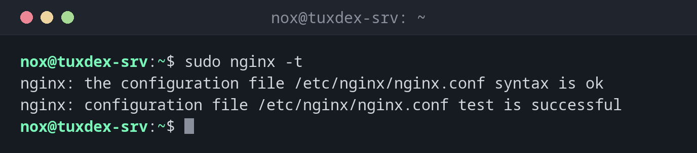

# nginx

> The nginx web server: test the configuration, reload it and show the complete configuration nginx actually uses.



## Syntax

```bash
nginx [-t | -T | -s SIGNAL | -v | -V]
```

## Options

| Option | Description |
|--------|-------------|
| `-t` | Test the configuration and exit |
| `-T` | Test and print the complete configuration, including all included files |
| `-s reload` | Reload the configuration without dropping connections (same as `systemctl reload nginx`) |
| `-s quit`, `-s stop` | Stop gracefully, or immediately |
| `-v`, `-V` | Version, or version with build options and modules |
| `-c FILE` | Use another main configuration file |

On servers, nginx runs as the systemd service `nginx`; use `systemctl reload nginx` and `systemctl status nginx` there.

## Examples

**Test the configuration:**

```bash
sudo nginx -t
```

```text
nginx: the configuration file /etc/nginx/nginx.conf syntax is ok
nginx: configuration file /etc/nginx/nginx.conf test is successful
```

**A typo is found before it takes the site down:**

```bash
sudo nginx -t
```

```text
2026/10/26 10:42:17 [emerg] 3431#3431: invalid number of arguments in "root" directive in /etc/nginx/sites-enabled/status:5
nginx: configuration file /etc/nginx/nginx.conf test failed
```

Line 5 lacks the `;` at the end. The running nginx keeps the old configuration.

**Test and reload in one step:**

```bash
sudo nginx -t && sudo systemctl reload nginx
systemctl is-active nginx
```

```text
nginx: the configuration file /etc/nginx/nginx.conf syntax is ok
nginx: configuration file /etc/nginx/nginx.conf test is successful
active
```

**Which server names are configured where:**

```bash
sudo nginx -T 2>/dev/null | grep -E '^# configuration file|server_name ' | grep -B1 server_name
```

```text
# configuration file /etc/nginx/sites-enabled/default:
    server_name _;
# configuration file /etc/nginx/sites-enabled/status:
    server_name status.example.com;
```

**The reverse proxy can't reach the application:**

```bash
sudo tail -1 /var/log/nginx/error.log
```

```text
2026/10/26 10:42:17 [error] 813#813: *42 connect() failed (111: Connection refused) while connecting to upstream, client: 198.51.100.23, server: status.example.com, request: "GET /api/health HTTP/1.1", upstream: "http://127.0.0.1:3000/health", host: "status.example.com"
```

## When do I need it?

- After every change of a server block, before reloading
- To find which file defines a `server_name` or a `location`
- When nginx doesn't start: the test names file and line of the error

!!! tip "Search the whole configuration"
    `sudo nginx -T | grep -n server_name` searches all included files at once. That's how
    you find a forgotten second server block for the same domain.

!!! warning "502 Bad Gateway"
    nginx itself works, but the application behind `proxy_pass` doesn't answer. The error log
    `/var/log/nginx/error.log` shows the target and the reason, such as `Connection refused`.

## Distribution differences

| | Debian | Ubuntu | RHEL | Arch |
|---|--------|--------|------|------|
| Install | `sudo apt install nginx` | `sudo apt install nginx` | `sudo dnf install nginx` | `sudo pacman -S nginx` |
| Sites | `sites-available/` + `sites-enabled/` | `sites-available/` + `sites-enabled/` | `conf.d/*.conf` | `nginx.conf` |
| Started after install | yes | yes | no: `systemctl enable --now nginx` | no: `systemctl enable --now nginx` |

## Related commands

[apachectl](apachectl.md) · [htpasswd](htpasswd.md) · [systemctl](../09-systemd/systemctl.md) · [certbot](../24-certificates/certbot.md)
