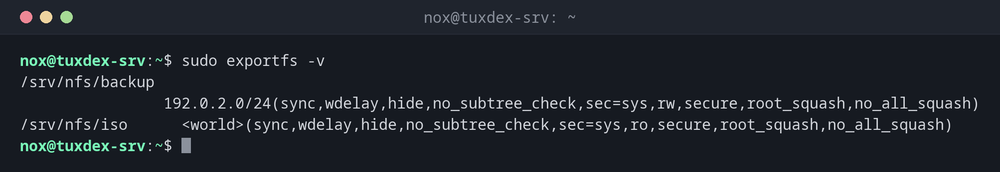

# exportfs

> Activates the NFS shares from `/etc/exports` and shows what the server currently exports.



## Syntax

```bash
exportfs [-r | -a | -u] [-v] [-o OPTIONS] [CLIENT:/PATH]
```

## Options

| Option | Description |
|--------|-------------|
| `-r` | Re-export: apply `/etc/exports`, also removes shares that were deleted there |
| `-a` | Export (or with `-u` unexport) all directories |
| `-v` | Show the exports with all options, including the defaults |
| `-s` | Show the exports in the format of `/etc/exports` |
| `-o OPTIONS` | Export a directory temporarily, without `/etc/exports` |
| `-u CLIENT:/PATH` | Stop exporting a directory |

`exportfs` is part of the NFS server package and changes the export table of the kernel. Shares added with `-o` disappear at the next `exportfs -ra` or reboot.

## Examples

**Show the current shares with all options:**

```bash
sudo exportfs -v
```

```text
/srv/nfs/backup
                192.0.2.0/24(sync,wdelay,hide,no_subtree_check,sec=sys,rw,secure,root_squash,no_all_squash)
/srv/nfs/iso      <world>(sync,wdelay,hide,no_subtree_check,sec=sys,ro,secure,root_squash,no_all_squash)
```

**Apply a changed `/etc/exports`:**

```bash
sudo exportfs -ra && sudo exportfs -s
```

```text
/srv/nfs/backup  192.0.2.0/24(sync,wdelay,hide,no_subtree_check,sec=sys,rw,secure,root_squash,no_all_squash)
/srv/nfs/iso  *(sync,wdelay,hide,no_subtree_check,sec=sys,ro,secure,root_squash,no_all_squash)
```

**A warning about a missing option:**

```bash
sudo exportfs -ra
```

```text
exportfs: /etc/exports [3]: Neither 'subtree_check' or 'no_subtree_check' specified for export "198.51.100.23:/srv/nfs/web".
  Assuming default behaviour ('no_subtree_check').
  NOTE: this default has changed since nfs-utils version 1.0.x
```

The share works anyway. Add `no_subtree_check` to line 3, then the warning is gone.

**Share a directory temporarily and stop it again:**

```bash
sudo exportfs -o ro,no_subtree_check 198.51.100.23:/srv/migration
sudo exportfs | grep migration
sudo exportfs -u 198.51.100.23:/srv/migration
```

```text
/srv/migration    198.51.100.23
```

## When do I need it?

- After every change of `/etc/exports`: `sudo exportfs -ra`
- To check which options a share really has, including defaults like `root_squash`
- To share a directory for a short time, for example for a migration

!!! tip "No restart needed"
    `sudo exportfs -ra` applies the changes while the NFS server keeps running. Clients that
    have the share mounted keep working.

!!! warning "No space before the parenthesis"
    `/srv/nfs/backup 192.0.2.0/24(rw)` shares read and write to the network.
    `/srv/nfs/backup 192.0.2.0/24 (rw)` shares read only to the network and read and write
    to **everyone**: the options then belong to the client `*`.

## Distribution differences

| | Debian | Ubuntu | RHEL | Arch |
|---|--------|--------|------|------|
| Package | `nfs-kernel-server` | `nfs-kernel-server` | `nfs-utils` | `nfs-utils` |
| Service started after install | yes | yes | no: `systemctl enable --now nfs-server` | no: `systemctl enable --now nfs-server` |
| Firewall | open the port in `ufw` if active | open the port in `ufw` if active | `firewall-cmd --add-service=nfs --permanent` | as configured |

## Related commands

[showmount](showmount.md) · [mount](../13-disks-storage/mount.md) · [systemctl](../09-systemd/systemctl.md) · [smbclient](smbclient.md)
