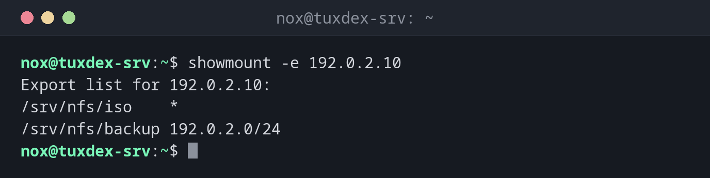

# showmount

> Asks an NFS server which directories it exports and, with limits, which clients have mounted them.



## Syntax

```bash
showmount [-e | -a | -d] [SERVER]
```

## Options

| Option | Description |
|--------|-------------|
| `-e` | List the exports of the server |
| `-a` | Show clients and the directories they mounted |
| `-d` | Show only the directories that clients mounted |
| `--no-headers` | Leave out the heading line |

Without a server, `showmount` asks the local machine. It talks to `mountd` of NFSv3: a server that only offers NFSv4 or blocks port 111 doesn't answer.

## Examples

**The exports of a server:**

```bash
showmount -e 192.0.2.10
```

```text
Export list for 192.0.2.10:
/srv/nfs/iso    *
/srv/nfs/backup 192.0.2.0/24
```

**Check the own exports on the server:**

```bash
showmount -e
```

```text
Export list for tuxdex-srv:
/srv/nfs/iso    *
/srv/nfs/backup 192.0.2.0/24
```

**Which clients have mounted something:**

```bash
showmount -a
```

```text
All mount points on tuxdex-srv:
192.0.2.21:/srv/nfs/backup
192.0.2.22:/srv/nfs/backup
```

**The firewall blocks the request:**

```bash
showmount -e 192.0.2.30
```

```text
clnt_create: RPC: Port mapper failure - Unable to receive: errno 113 (No route to host)
```

Port 111 is blocked. On RHEL open it with `sudo firewall-cmd --permanent --add-service={rpc-bind,mountd}` plus `--reload`, or mount over NFSv4 directly: it only needs port 2049.

## When do I need it?

- On a client, before mounting: what does the server offer?
- To check after `exportfs -ra` whether a share is visible from outside
- When a mount fails: is it the share, the network or the firewall?

!!! warning "`-a` is not reliable"
    The list of mounted clients is kept by `mountd` and isn't cleaned up when a client
    shuts down without unmounting. NFSv4 clients don't appear at all. For a current view,
    run `ss -tn sport = :2049` on the server.

## Distribution differences

| | Debian | Ubuntu | RHEL | Arch |
|---|--------|--------|------|------|
| Package | `nfs-common` | `nfs-common` | `nfs-utils` | `nfs-utils` |

## Related commands

[exportfs](exportfs.md) · [mount](../13-disks-storage/mount.md) · [ss](../11-network/ss.md) · [firewall-cmd](../11-network/firewall-cmd.md)
