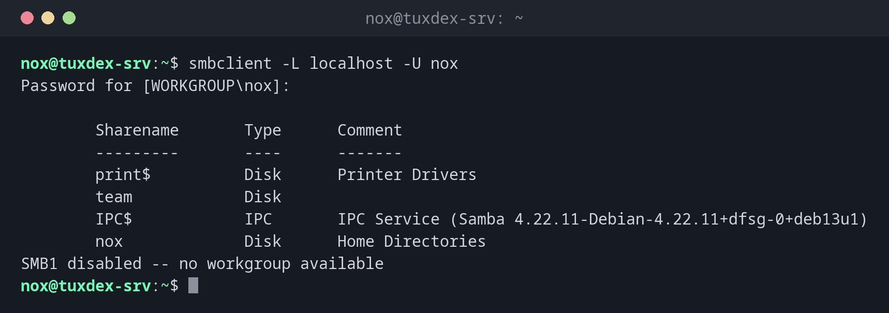

# smbclient

> Ein FTP-ähnlicher Client für SMB-Freigaben: Freigaben auflisten, durchsuchen und Dateien kopieren, ideal, um den Zugriff auf der Kommandozeile zu testen.



## Syntax

```bash
smbclient -L SERVER -U BENUTZER
smbclient //SERVER/FREIGABE -U BENUTZER [-c 'BEFEHLE']
```

## Optionen

| Option | Beschreibung |
|--------|--------------|
| `-L SERVER` | Die Freigaben eines Servers auflisten |
| `-U BENUTZER` | Als dieser Benutzer anmelden (`BENUTZER%PASSWORT` nur in Tests) |
| `-c 'BEF; BEF'` | Befehle ausführen und beenden, zum Beispiel `ls`, `get`, `put` |
| `-N` | Ohne Passwort, als Gast |
| `-m SMB3` | Höchste zu verwendende Protokollversion |
| `-W DOMÄNE` | Arbeitsgruppe oder Domäne |

In der interaktiven Shell (`smb: \>`) sind die wichtigsten Befehle `ls`, `cd`, `get`, `put`, `mget`, `mkdir` und `exit`.

## Beispiele

**Die Freigaben eines Servers auflisten:**

```bash
smbclient -L localhost -U nox
```

```text
Password for [WORKGROUP\nox]:

        Sharename       Type      Comment
        ---------       ----      -------
        print$          Disk      Printer Drivers
        team            Disk
        IPC$            IPC       IPC Service (Samba 4.22.11-Debian-4.22.11+dfsg-0+deb13u1)
        nox             Disk      Home Directories
SMB1 disabled -- no workgroup available
```

Die letzte Zeile ist nur ein Hinweis: Das Durchsuchen des Netzwerks braucht das alte SMB1. Die Freigaben selbst laufen über SMB3.

**Den Inhalt einer Freigabe zeigen:**

```bash
smbclient //192.0.2.10/team -U nox -c 'ls'
```

```text
Password for [WORKGROUP\nox]:
  .                                   D        0  Mon Oct 26 10:42:17 2026
  ..                                  D        0  Mon Oct 26 10:42:17 2026
  notes.txt                           N        6  Mon Oct 26 10:42:17 2026
  reports                             D        0  Mon Oct 26 10:42:17 2026

                30787492 blocks of size 1024. 22140316 blocks available
```

**Eine Datei in ein Unterverzeichnis hochladen:**

```bash
smbclient //192.0.2.10/team -U nox -c 'cd reports; put report.pdf'
```

```text
Password for [WORKGROUP\nox]:
putting file report.pdf as \reports\report.pdf (1843.2 kb/s) (average 1843.2 kb/s)
```

**Eine Datei herunterladen:**

```bash
smbclient //192.0.2.10/team -U nox -c 'get notes.txt'
```

```text
Password for [WORKGROUP\nox]:
getting file \notes.txt of size 6 as notes.txt (5.9 KiloBytes/sec) (average 5.9 KiloBytes/sec)
```

**Falsches Passwort:**

```bash
smbclient //192.0.2.10/team -U nox -c 'ls'
```

```text
Password for [WORKGROUP\nox]:
session setup failed: NT_STATUS_LOGON_FAILURE
```

**Den Freigabenamen gibt es nicht:**

```bash
smbclient //192.0.2.10/doku -U nox
```

```text
Password for [WORKGROUP\nox]:
tree connect failed: NT_STATUS_BAD_NETWORK_NAME
```

## Wann brauche ich das?

- Um eine neue Freigabe direkt auf dem Server zu testen, bevor jemand Windows benutzt
- Um herauszufinden, ob ein Problem am Passwort, am Freigabenamen oder an den Rechten liegt
- Um in einem Skript Dateien von einer Windows-Freigabe zu kopieren

!!! tip "Fehlercodes nennen die Ursache"
    `NT_STATUS_LOGON_FAILURE`: falscher Benutzer oder falsches Passwort.
    `NT_STATUS_BAD_NETWORK_NAME`: Die Freigabe gibt es nicht. `NT_STATUS_ACCESS_DENIED`:
    angemeldet, aber keine Rechte auf das Verzeichnis.

!!! warning "Keine Passwörter auf der Kommandozeile"
    `-U nox%geheim` landet in der Shell-History und in der Prozessliste. Nimm in Skripten
    eine Anmeldedatei mit `-A ~/.smbcredentials` (Rechte `600`).

## Unterschiede zwischen Distributionen

| | Debian | Ubuntu | RHEL | Arch |
|---|--------|--------|------|------|
| Paket | `smbclient` | `smbclient` | `samba-client` | `smbclient` |

## Verwandte Befehle

[testparm](testparm.md) · [smbpasswd](smbpasswd.md) · [mount](../13-disks-storage/mount.md) · [showmount](showmount.md)
