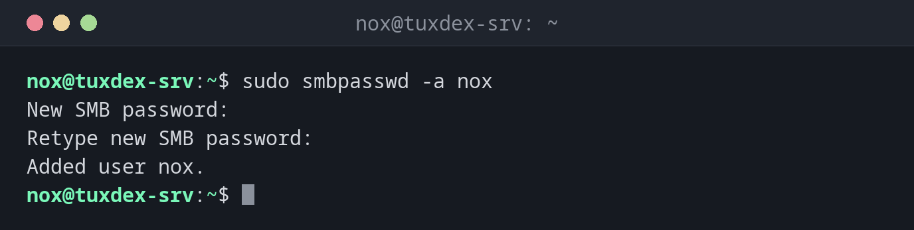

# smbpasswd

> Verwaltet Samba-Benutzer: einen Linux-Benutzer in Samba aufnehmen, das Passwort setzen, das Konto sperren oder löschen.



## Syntax

```bash
smbpasswd [-a | -x | -d | -e] [BENUTZER]
```

## Optionen

| Option | Beschreibung |
|--------|--------------|
| `-a BENUTZER` | Einen Benutzer in Samba aufnehmen und das Passwort setzen |
| `BENUTZER` | Als root: ein neues Passwort für den Benutzer setzen |
| `-d`, `-e` | Das Konto sperren oder entsperren |
| `-x BENUTZER` | Den Benutzer aus Samba löschen |
| `-s` | Das Passwort ohne Abfrage von stdin lesen (für Skripte) |

Ohne Argumente ändert ein Benutzer sein eigenes Samba-Passwort. Samba führt eigene Passwörter: Das Linux-Passwort aus `passwd` wird nicht genutzt.

## Beispiele

**Einen Benutzer in Samba aufnehmen:**

```bash
sudo smbpasswd -a nox
```

```text
New SMB password:
Retype new SMB password:
Added user nox.
```

**Den Benutzer gibt es im System nicht:**

```bash
sudo smbpasswd -a anna
```

```text
New SMB password:
Retype new SMB password:
Failed to add entry for user anna.
```

Erst `sudo useradd -M -s /usr/sbin/nologin anna`, dann noch einmal `smbpasswd -a`.

**Ein vergessenes Passwort neu setzen:**

```bash
sudo smbpasswd nox
```

```text
New SMB password:
Retype new SMB password:
```

**Ein Konto sperren und wieder entsperren:**

```bash
sudo smbpasswd -d nox
sudo smbpasswd -e nox
```

```text
Disabled user nox.
Enabled user nox.
```

**Alle Samba-Benutzer:**

```bash
sudo pdbedit -L
```

```text
nox:1000:
anna:1001:
```

**Einen Benutzer aus Samba löschen:**

```bash
sudo smbpasswd -x anna
```

```text
Deleted user anna.
```

## Wann brauche ich das?

- Wenn eine neue Kollegin oder ein neuer Kollege Zugriff auf eine Freigabe braucht
- Wenn jemand das Passwort für die Freigabe vergessen hat
- Wenn jemand das Team verlässt: das Konto sperren oder löschen

!!! tip "Alle Samba-Benutzer auflisten"
    `sudo pdbedit -L` listet alle Benutzer der Samba-Datenbank, `sudo pdbedit -L -v nox`
    zeigt Details wie die Kontoflags.

!!! warning "Der Linux-Benutzer muss existieren"
    `smbpasswd -a` funktioniert nur für Benutzer, die es im System gibt. Leg sie vorher mit
    [`useradd`](../07-users-groups/useradd.md) an, am besten mit `-s /usr/sbin/nologin`, wenn
    sie nur die Freigabe brauchen.

## Unterschiede zwischen Distributionen

| | Debian | Ubuntu | RHEL | Arch |
|---|--------|--------|------|------|
| Paket | `samba-common-bin` | `samba-common-bin` | `samba-common-tools` | `samba` |

## Verwandte Befehle

[testparm](testparm.md) · [smbclient](smbclient.md) · [useradd](../07-users-groups/useradd.md) · [passwd](../07-users-groups/passwd.md)
