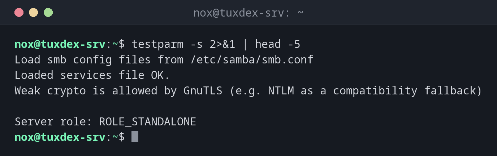

# testparm

> Prüft die Samba-Konfiguration `smb.conf` auf Fehler und zeigt die Einstellungen, die Samba tatsächlich nutzt.



## Syntax

```bash
testparm [-s] [-v] [--section-name=FREIGABE] [KONFIGDATEI]
```

## Optionen

| Option | Beschreibung |
|--------|--------------|
| `-s` | Die Konfiguration ausgeben, ohne auf Enter zu warten |
| `-v` | Auch alle Parameter mit ihren Standardwerten zeigen |
| `--section-name=FREIGABE` | Nur eine Freigabe zeigen |
| `--parameter-name=NAME` | Nur den Wert eines Parameters zeigen |
| `KONFIGDATEI` | Eine andere Datei statt `/etc/samba/smb.conf` prüfen |

Meldungen gehen auf stderr, die Konfiguration auf stdout. `testparm -s 2>/dev/null` gibt deshalb ein sauberes `smb.conf` ohne Kommentare aus.

## Beispiele

**Die Konfiguration prüfen:**

```bash
testparm -s 2>&1 | head -5
```

```text
Load smb config files from /etc/samba/smb.conf
Loaded services file OK.
Weak crypto is allowed by GnuTLS (e.g. NTLM as a compatibility fallback)

Server role: ROLE_STANDALONE
```

**Ein Tippfehler in einem Parameter:**

```bash
testparm -s 2>&1 | head -4
```

```text
Load smb config files from /etc/samba/smb.conf
Unknown parameter encountered: "wirte list"
Ignoring unknown parameter "wirte list"
Loaded services file OK.
```

`wirte list` sollte `write list` heißen. Samba würde trotzdem starten und die Zeile einfach ignorieren.

**Nur eine Freigabe zeigen:**

```bash
testparm -s --section-name=team 2>/dev/null
```

```text
[team]
    path = /srv/share/team
    read only = No
    valid users = nox
```

**Welche SMB-Versionen der Server erlaubt:**

```bash
testparm -sv 2>/dev/null | grep -E 'server (min|max) protocol'
```

```text
    server max protocol = SMB3
    server min protocol = SMB2_02
```

Das alte SMB1 ist standardmäßig aus. Lass es dabei.

## Wann brauche ich das?

- Nach jeder Änderung an `smb.conf`, vor `systemctl reload smbd`
- Um Tippfehler zu finden: Samba ignoriert unbekannte Parameter stillschweigend
- Um die wirksamen Einstellungen einer Freigabe zu sehen, ohne Kommentare und Standardwerte

!!! tip "Nach dem Test neu laden"
    `testparm -s >/dev/null && sudo systemctl reload smbd` lädt nur neu, wenn sich die Datei
    lesen lässt. Laufende Verbindungen bleiben bestehen.

!!! warning "„Loaded services file OK“ ist nicht alles"
    `testparm` prüft die Syntax, nicht die Rechte. Bekommt `nox` trotzdem `ACCESS_DENIED`,
    schau dir Besitzer und Rechte des Verzeichnisses mit [`namei -l`](../06-permissions/namei.md) an.

## Unterschiede zwischen Distributionen

| | Debian | Ubuntu | RHEL | Arch |
|---|--------|--------|------|------|
| Paket | `samba-common-bin` | `samba-common-bin` | `samba-common-tools` | `samba` |
| Samba-Dienst | `smbd` | `smbd` | `smb` | `smb` |
| `smb.conf` nach der Installation | ja | ja | ja | nein: `/etc/samba/smb.conf.default` kopieren |

## Verwandte Befehle

[smbpasswd](smbpasswd.md) · [smbclient](smbclient.md) · [systemctl](../09-systemd/systemctl.md) · [namei](../06-permissions/namei.md)
