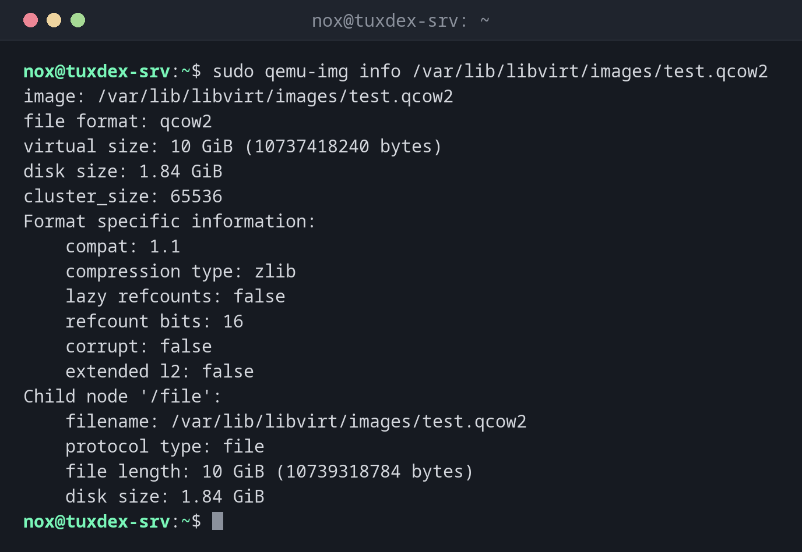

# qemu-img

> Creates, inspects, enlarges and converts disk images of virtual machines, for example `qcow2`, `raw` or `vmdk`.



## Syntax

```bash
qemu-img info | create | resize | convert | check | snapshot [OPTIONS] FILE
```

## Options

| Command | Description |
|---------|-------------|
| `info FILE` | Format, virtual size and real usage of an image |
| `info -U FILE` | Read an image that a running VM uses |
| `create -f qcow2 FILE SIZE` | Create a new, empty image |
| `create -b BASE -F qcow2` | Create an overlay that only stores changes to `BASE` |
| `resize FILE +10G` | Make an image larger (`--shrink` for smaller) |
| `convert -f IN -O OUT -p` | Convert between formats, with progress |
| `check FILE` | Check a `qcow2` image for errors |
| `snapshot -l`, `-c NAME` | List or create internal snapshots |

`qcow2` only takes up as much space as is actually written and supports snapshots. `raw` is a plain byte-for-byte copy of a disk.

## Examples

**Inspect the image of a VM that is switched off:**

```bash
sudo qemu-img info /var/lib/libvirt/images/test.qcow2
```

```text
image: /var/lib/libvirt/images/test.qcow2
file format: qcow2
virtual size: 10 GiB (10737418240 bytes)
disk size: 1.84 GiB
cluster_size: 65536
Format specific information:
    compat: 1.1
    compression type: zlib
    lazy refcounts: false
    refcount bits: 16
    corrupt: false
    extended l2: false
Child node '/file':
    filename: /var/lib/libvirt/images/test.qcow2
    protocol type: file
    file length: 10 GiB (10739318784 bytes)
    disk size: 1.84 GiB
```

**The VM is running:**

```bash
sudo qemu-img info /var/lib/libvirt/images/web01.qcow2
```

```text
qemu-img: Could not open '/var/lib/libvirt/images/web01.qcow2': Failed to get shared "write" lock
Is another process using the image [/var/lib/libvirt/images/web01.qcow2]?
```

For reading, `qemu-img info -U` is fine. For everything that writes, shut the VM down.

**Create a new image:**

```bash
sudo qemu-img create -f qcow2 /var/lib/libvirt/images/data01.qcow2 20G
```

```text
Formatting '/var/lib/libvirt/images/data01.qcow2', fmt=qcow2 cluster_size=65536 extended_l2=off compression_type=zlib size=21474836480 lazy_refcounts=off refcount_bits=16
```

**Give a VM 10 GB more:**

```bash
sudo virsh shutdown test
sudo qemu-img resize /var/lib/libvirt/images/test.qcow2 +10G
```

```text
Domain 'test' is being shutdown

Image resized.
```

**Shrinking is protected:**

```bash
sudo qemu-img resize /var/lib/libvirt/images/test.qcow2 5G
```

```text
qemu-img: Use the --shrink option to perform a shrink operation.
qemu-img: warning: Shrinking an image will delete all data beyond the shrunken image's end. Before performing such an operation, make sure there is no important data there.
```

**Convert a VMware disk:**

```bash
sudo qemu-img convert -p -f vmdk -O qcow2 legacy-app.vmdk /var/lib/libvirt/images/legacy-app.qcow2
```

```text
    (100.00/100%)
```

**Test VMs from a base image (overlay):**

```bash
cd /var/lib/libvirt/images
sudo qemu-img create -f qcow2 -b debian-13-base.qcow2 -F qcow2 test2.qcow2
```

```text
Formatting 'test2.qcow2', fmt=qcow2 cluster_size=65536 extended_l2=off compression_type=zlib size=21474836480 backing_file=debian-13-base.qcow2 backing_fmt=qcow2 lazy_refcounts=off refcount_bits=16
```

`test2.qcow2` starts tiny and only stores what the VM changes. The base image must not be changed any more.

**Check an image for errors:**

```bash
sudo qemu-img check /var/lib/libvirt/images/test.qcow2
```

```text
No errors were found on the image.
30148/327680 = 9.20% allocated, 2.31% fragmented, 0.00% compressed clusters
Image end offset: 1977745408
```

## When do I need it?

- To check how large an image really is and whether it has a backing file
- To give a VM more disk space
- To migrate VMs from VMware or Hyper-V (`vmdk`, `vhdx`) to KVM

!!! tip "After `resize` inside the VM"
    The image is bigger, the partition and file system aren't yet. In the VM run
    `sudo growpart /dev/vda 1` and [`resize2fs`](../13-disks-storage/resize2fs.md) or
    [`xfs_growfs`](../13-disks-storage/xfs_growfs.md).

!!! danger "Never change an image while the VM runs"
    `resize`, `convert` into the same file, `snapshot -c` or `check -r` on a running VM
    destroy the image. Shut the VM down first; `qemu-img` refuses with a lock error to
    protect you.

## Distribution differences

| | Debian | Ubuntu | RHEL | Arch |
|---|--------|--------|------|------|
| Package | `qemu-utils` | `qemu-utils` | `qemu-img` | `qemu-img` |

## Related commands

[virsh](virsh.md) · [virt-install](virt-install.md) · [resize2fs](../13-disks-storage/resize2fs.md) · [du](../13-disks-storage/du.md)
