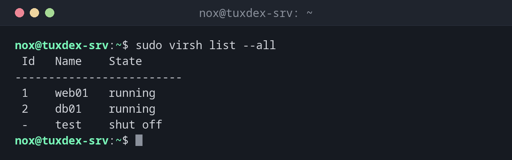

# virsh

> The command line for libvirt: list, start, stop and inspect virtual machines, open their console and take snapshots.



## Syntax

```bash
virsh COMMAND [VM] [OPTIONS]
```

## Options

| Command | Description |
|---------|-------------|
| `list --all` | All VMs, including those that are switched off |
| `start`, `shutdown`, `reboot` | Start a VM, shut it down cleanly, restart it |
| `destroy` | Switch a VM off hard, like pulling the plug |
| `autostart` | Start the VM with the host (`--disable` to undo) |
| `dominfo`, `domifaddr` | Details of a VM, or its IP addresses |
| `console` | Serial console of the VM, leave with `Ctrl` + `]` |
| `edit` | Edit the XML definition of a VM |
| `snapshot-create-as`, `snapshot-list`, `snapshot-revert` | Create, list and restore snapshots |
| `undefine` | Remove a VM from libvirt |

Run `virsh` as root (`sudo virsh`) or as a member of the group `libvirt` with `LIBVIRT_DEFAULT_URI=qemu:///system`; otherwise you only see your private VMs.

## Examples

**All VMs on the host:**

```bash
sudo virsh list --all
```

```text
 Id   Name    State
-------------------------
 1    web01   running
 2    db01    running
 -    test    shut off
```

**Start a VM and start it with the host from now on:**

```bash
sudo virsh start test
sudo virsh autostart test
```

```text
Domain 'test' started

Domain 'test' marked as autostarted
```

**Details of a VM:**

```bash
sudo virsh dominfo web01
```

```text
Id:             1
Name:           web01
UUID:           6c1f0e5a-3b2d-4f8e-9a71-2d5c8b4e7f10
OS Type:        hvm
State:          running
CPU(s):         1
CPU time:       842.3s
Max memory:     1048576 KiB
Used memory:    1048576 KiB
Persistent:     yes
Autostart:      enable
Managed save:   no
Security model: apparmor
Security DOI:   0
Security label: libvirt-6c1f0e5a-3b2d-4f8e-9a71-2d5c8b4e7f10 (enforcing)
```

**Which IP address a VM got:**

```bash
sudo virsh domifaddr web01
```

```text
 Name       MAC address          Protocol     Address
-------------------------------------------------------------------------------
 vnet0      52:54:00:3a:7c:21    ipv4         192.168.122.53/24
```

This works for VMs in the NAT network `default`. For VMs on a bridge add `--source agent`; that needs the `qemu-guest-agent` in the VM.

**Into the VM through the serial console:**

```bash
sudo virsh console web01
```

```text
Connected to domain 'web01'
Escape character is ^] (Ctrl + ])

web01 login:
```

**A snapshot before an upgrade:**

```bash
sudo virsh snapshot-create-as web01 before-upgrade
sudo virsh snapshot-list web01
```

```text
Domain snapshot before-upgrade created
 Name             Creation Time               State
---------------------------------------------------------
 before-upgrade   2026-10-26 10:42:17 +0100   running
```

If the upgrade goes wrong: `sudo virsh snapshot-revert web01 before-upgrade`. Delete the snapshot afterwards with `snapshot-delete`, so the image doesn't keep growing.

**Shut a VM down cleanly:**

```bash
sudo virsh shutdown test
```

```text
Domain 'test' is being shutdown
```

## When do I need it?

- To see which VMs run on a host and to start or stop them
- To make VMs start after a reboot of the host
- To take a snapshot before an upgrade inside the VM
- To get into a VM whose network doesn't work, through the console

!!! tip "Shut down VMs with the host"
    On Debian and Ubuntu the service `libvirt-guests` shuts down or suspends running VMs
    when the host reboots. Set `ON_SHUTDOWN=shutdown` in `/etc/default/libvirt-guests`.

!!! warning "`shutdown` needs the guest"
    `virsh shutdown` sends an ACPI signal. If the guest ignores it (no `acpid`, hung
    system), nothing happens. Only then use `virsh destroy`.

!!! danger "`undefine --remove-all-storage`"
    This removes the VM and deletes its disk images. There is no undo. Without the option
    the images stay in `/var/lib/libvirt/images/`.

## Distribution differences

| | Debian | Ubuntu | RHEL | Arch |
|---|--------|--------|------|------|
| Package | `libvirt-clients` | `libvirt-clients` | `libvirt-client` | `libvirt` |
| Daemon | `libvirtd` | `libvirtd` | `virtqemud` | `libvirtd` |
| Security label | AppArmor | AppArmor | SELinux | none |

## Related commands

[virt-install](virt-install.md) · [virt-clone](virt-clone.md) · [qemu-img](qemu-img.md) · [systemctl](../09-systemd/systemctl.md)
