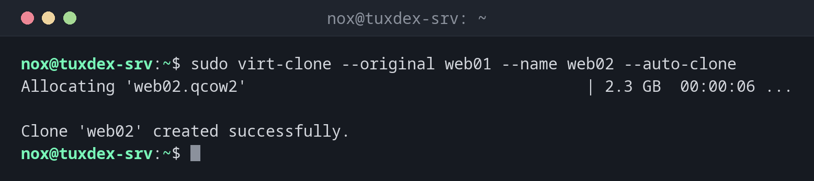

# virt-clone

> Copies an existing virtual machine: definition and disk images, with a new name, new MAC address and new UUID.



## Syntax

```bash
virt-clone --original VM --name NEW --auto-clone
```

## Options

| Option | Description |
|--------|-------------|
| `--original VM` | The VM to copy; it must be switched off |
| `--name NEW` | Name of the copy |
| `--auto-clone` | Choose file names for the new images automatically |
| `--file PATH` | Path for the new image, once per disk |
| `--mac MAC` | Set a fixed MAC address instead of a random one |
| `--preserve-data` | Only create the definition, don't copy the images |

`virt-clone` copies the hardware. Inside, the clone is identical: same hostname, same SSH host keys, same `/etc/machine-id`.

## Examples

**Clone a switched off VM:**

```bash
sudo virt-clone --original web01 --name web02 --auto-clone
```

```text
Allocating 'web02.qcow2'                                    | 2.3 GB  00:00:06 ...

Clone 'web02' created successfully.
```

**The original is still running:**

```bash
sudo virt-clone --original db01 --name db02 --auto-clone
```

```text
ERROR    Domain to clone must be shutoff.
```

Shut it down first with `sudo virsh shutdown db01`, clone, then start it again.

**Choose the path of the new image:**

```bash
sudo virt-clone --original web01 --name web03 --file /srv/vms/web03.qcow2
```

```text
Allocating 'web03.qcow2'                                    | 2.3 GB  00:00:07 ...

Clone 'web03' created successfully.
```

**Give the clone its own identity and start it:**

```bash
sudo virt-sysprep -d web02 --hostname web02 >/dev/null
sudo virsh start web02
```

```text
Domain 'web02' started
```

## When do I need it?

- To make a test copy of a server VM before trying something risky
- To create several identical VMs from one prepared template

!!! tip "Prepare the clone with `virt-sysprep`"
    `sudo virt-sysprep -d web02 --hostname web02` (package `guestfs-tools`) resets machine ID,
    SSH host keys, logs and the hostname in the switched off clone. Then the copy is a
    separate machine.

!!! warning "Two machines with the same identity"
    Without `virt-sysprep`, both VMs have the same `machine-id`. DHCP servers can give them
    the same address, and SSH clients see the same host key on two servers.

## Distribution differences

| | Debian | Ubuntu | RHEL | Arch |
|---|--------|--------|------|------|
| Package | `virtinst` | `virtinst` | `virt-install` | `virt-install` |

## Related commands

[virsh](virsh.md) · [virt-install](virt-install.md) · [qemu-img](qemu-img.md) · [hostnamectl](../01-orientation/hostnamectl.md)
