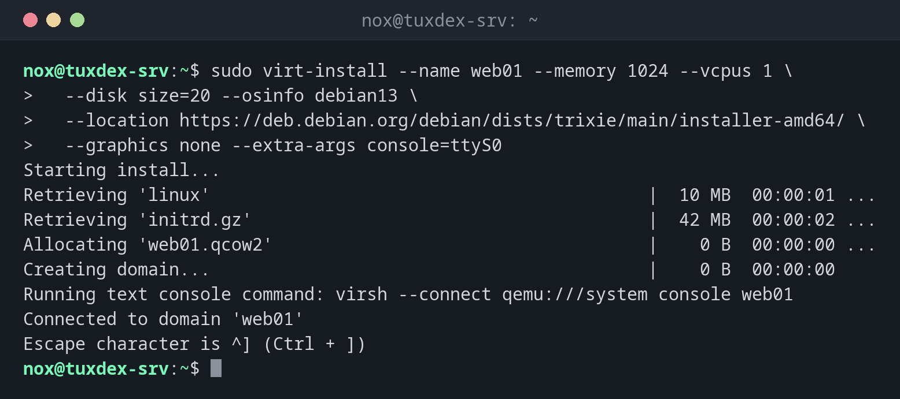

# virt-install

> Legt eine neue virtuelle Maschine in libvirt an und startet die Installation, aus einem Installer, einer ISO-Datei oder einem fertigen Abbild.



## Syntax

```bash
virt-install --name NAME --memory MiB --vcpus N --disk SPEZ --osinfo OS QUELLE [OPTIONEN]
```

## Optionen

| Option | Beschreibung |
|--------|--------------|
| `--name` | Name der VM |
| `--memory`, `--vcpus` | RAM in MiB und Anzahl der virtuellen CPUs |
| `--disk size=20` | Neues Plattenabbild mit 20 GB im Standard-Pool (oder `path=DATEI`) |
| `--osinfo debian13` | Betriebssystem, für passende Standardwerte (alter Name `--os-variant`) |
| `--location URL` | Netzwerk-Installer einer Distribution |
| `--cdrom DATEI.iso` | Von einer ISO-Datei installieren |
| `--import` | Keine Installation: Das vorhandene Abbild sofort booten |
| `--network bridge=br0` | An eine Bridge anschließen statt ans NAT-Netz `default` |
| `--graphics none` | Keine Grafik; mit `--extra-args console=ttyS0` läuft der Installer im Terminal |
| `--noautoconsole` | Nach dem Anlegen nicht die Konsole öffnen |

`virt-install --osinfo list` zeigt alle bekannten Namen von Betriebssystemen.

## Beispiele

**Debian 13 über das Netz installieren, im Terminal:**

```bash
sudo virt-install --name web01 --memory 1024 --vcpus 1 \
  --disk size=20 --osinfo debian13 \
  --location https://deb.debian.org/debian/dists/trixie/main/installer-amd64/ \
  --graphics none --extra-args console=ttyS0
```

```text
Starting install...
Retrieving 'linux'                                          |  10 MB  00:00:01 ...
Retrieving 'initrd.gz'                                      |  42 MB  00:00:02 ...
Allocating 'web01.qcow2'                                    |    0 B  00:00:00 ...
Creating domain...                                          |    0 B  00:00:00
Running text console command: virsh --connect qemu:///system console web01
Connected to domain 'web01'
Escape character is ^] (Ctrl + ])
```

Danach läuft der Debian-Installer im Terminal. Nach der Installation startet die VM neu und steht in `virsh list`.

**Eine VM aus einem Cloud-Abbild starten, ohne Installation:**

```bash
sudo virt-install --name db01 --memory 1024 --vcpus 1 \
  --disk /var/lib/libvirt/images/db01.qcow2 --import --osinfo debian13 \
  --cloud-init root-ssh-key=/home/nox/.ssh/id_ed25519.pub --noautoconsole
```

```text
Starting install...
Creating domain...                                          |    0 B  00:00:00
Domain creation completed.
```

**Von einer ISO-Datei ins Bridge-Netz installieren:**

```bash
sudo virt-install --name test --memory 1024 --vcpus 1 \
  --disk size=10 --osinfo ubuntu24.04 --network bridge=br0 \
  --cdrom /var/lib/libvirt/images/ubuntu-24.04-live-server-amd64.iso \
  --graphics vnc,listen=127.0.0.1 --noautoconsole
```

```text
Starting install...
Allocating 'test.qcow2'                                     |    0 B  00:00:00 ...
Creating domain...                                          |    0 B  00:00:00
Domain is still running. Installation may be in progress.
You can reconnect to the console to complete the installation process.
```

Der Installer hat hier eine grafische Oberfläche. Du erreichst sie über einen SSH-Tunnel: `ssh -L 5900:127.0.0.1:5900 nox@tuxdex-srv`, dann einen VNC-Viewer mit `localhost:5900` verbinden.

**Ohne Namen des Betriebssystems:**

```bash
sudo virt-install --name test2 --memory 1024 --disk size=10 --cdrom /var/lib/libvirt/images/rescue.iso 2>&1 | head -3
```

```text
ERROR
--os-variant/--osinfo OS name is required, but no value was
set or detected.
```

Ergänz `--osinfo` mit einem Namen aus `virt-install --osinfo list`. Für unbekannte Systeme gibt es allgemeine Namen wie `linux2024`.

## Wann brauche ich das?

- Um auf einem Server ohne grafische Oberfläche eine neue VM einzurichten
- Um VMs per Skript oder mit Ansible immer mit denselben Einstellungen anzulegen
- Um eine VM aus einem Cloud-Abbild in Sekunden zu starten, ganz ohne Installer

!!! tip "Cloud-Abbilder sparen die Installation"
    Distributionen bieten fertige `qcow2`-Abbilder an (etwa `debian-13-genericcloud-amd64.qcow2`).
    Kopier eins, vergrößere es mit [`qemu-img resize`](qemu-img.md) und starte es mit `--import`
    und `--cloud-init root-ssh-key=~/.ssh/id_ed25519.pub`.

!!! warning "Den Host nicht überbuchen"
    Der RAM aller laufenden VMs plus der Host selbst müssen in den physischen Speicher
    passen. Sonst lagert der Host aus, und jede VM wird langsam.

## Unterschiede zwischen Distributionen

| | Debian | Ubuntu | RHEL | Arch |
|---|--------|--------|------|------|
| Paket | `virtinst` | `virtinst` | `virt-install` | `virt-install` |

## Verwandte Befehle

[virsh](virsh.md) · [virt-clone](virt-clone.md) · [qemu-img](qemu-img.md) · [ssh](../12-ssh/ssh.md)
