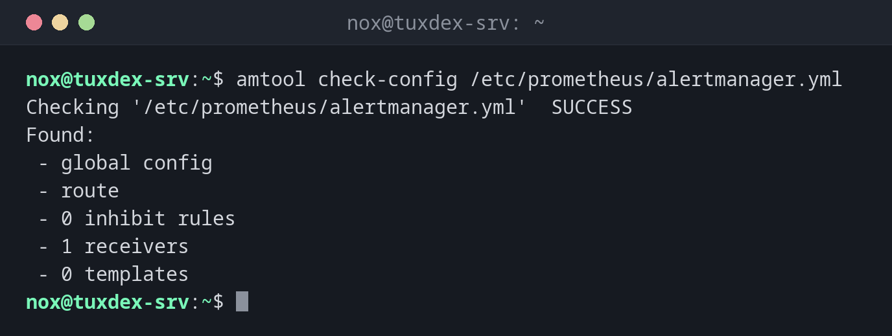

# amtool

> The command line for the Prometheus Alertmanager: check its configuration, show active alerts and silence them during maintenance.



## Syntax

```bash
amtool [--alertmanager.url=URL] check-config | alert query | silence add | silence query | silence expire
```

## Options

| Command | Description |
|---------|-------------|
| `check-config FILE` | Check `alertmanager.yml` |
| `alert query [MATCHER]` | Show active alerts, e.g. `alertname=InstanceDown` |
| `silence add MATCHER --duration=2h --comment=…` | Silence matching alerts for a while |
| `silence query` | List active silences (`-q`: IDs only) |
| `silence expire ID` | End a silence early |
| `config routes` | Show the routing tree: who gets which alert |
| `--alertmanager.url=` | Address of the Alertmanager, e.g. `http://localhost:9093` |

Put the address into `~/.config/amtool/config.yml` (`alertmanager.url: http://localhost:9093`), then you can leave out `--alertmanager.url`.

## Examples

**Check the configuration:**

```bash
amtool check-config /etc/prometheus/alertmanager.yml
```

```text
Checking '/etc/prometheus/alertmanager.yml'  SUCCESS
Found:
 - global config
 - route
 - 0 inhibit rules
 - 1 receivers
 - 0 templates

```

**Active alerts:**

```bash
amtool --alertmanager.url=http://localhost:9093 alert query
```

```text
Alertname     Starts At                Summary                  State
InstanceDown  2026-10-26 09:38:05 UTC  192.0.2.21:9100 is down  active
```

**Silence a server for two hours of maintenance:**

```bash
amtool --alertmanager.url=http://localhost:9093 silence add instance=192.0.2.21:9100 \
  --duration=2h --comment="Kernel update" --author=nox
```

```text
10e4013c-0d68-430c-b174-6ffc507daab7
```

The output is the ID of the silence. While it runs, alerts for `192.0.2.21:9100` show the state `suppressed` and send no mails.

**List the active silences:**

```bash
amtool --alertmanager.url=http://localhost:9093 silence query
```

```text
ID                                    Matchers                    Ends At                  Created By  Comment
10e4013c-0d68-430c-b174-6ffc507daab7  instance="192.0.2.21:9100"  2026-10-26 11:42:17 UTC  nox         Kernel update
```

**End all silences after the maintenance:**

```bash
amtool --alertmanager.url=http://localhost:9093 silence expire $(amtool --alertmanager.url=http://localhost:9093 silence query -q)
echo $?
```

```text
0
```

**Who gets the alerts:**

```bash
amtool --alertmanager.url=http://localhost:9093 config routes
```

```text
Routing tree:
.
└── default-route  receiver: admin
```

## When do I need it?

- Before planned maintenance, so a reboot doesn't wake anybody
- To check after a change of `alertmanager.yml` whether the file is valid
- To see which alerts are active, without the web interface

!!! tip "Silence before, not after"
    Set the silence before the maintenance starts: `amtool silence add instance=~"web01.*"
    --duration=1h --comment="Kernel update"`. Afterwards, `silence expire` ends it, so later
    problems are reported again.

!!! warning "Silences hide real problems"
    A silence with a wide matcher (`severity=critical`) or a long duration also swallows
    alerts that have nothing to do with the maintenance. Keep the matcher narrow and the
    duration short.

## Distribution differences

| | Debian | Ubuntu | RHEL | Arch |
|---|--------|--------|------|------|
| Package | `prometheus-alertmanager` | `prometheus-alertmanager` | not in the repositories: release archive or container `prom/alertmanager` | `alertmanager` |
| Alertmanager service | `prometheus-alertmanager` | `prometheus-alertmanager` | own systemd unit | `alertmanager` |
| Configuration | `/etc/prometheus/alertmanager.yml` | `/etc/prometheus/alertmanager.yml` | as configured | `/etc/alertmanager/alertmanager.yml` |

## Related commands

[promtool](promtool.md) · [prometheus](prometheus.md) · [node_exporter](node_exporter.md) · [curl](../11-network/curl.md)
